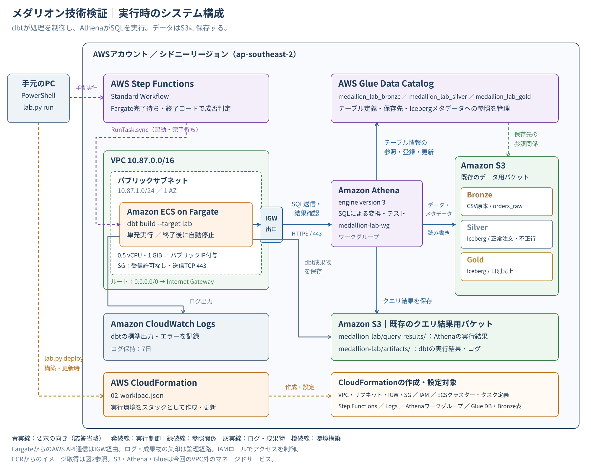
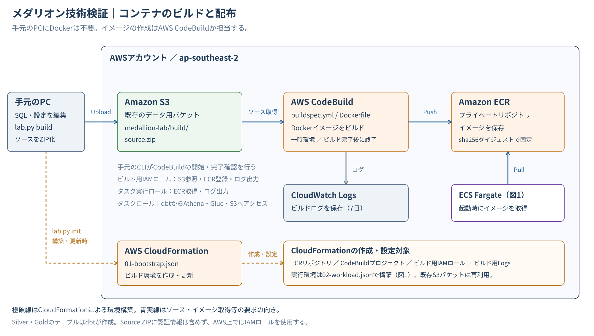
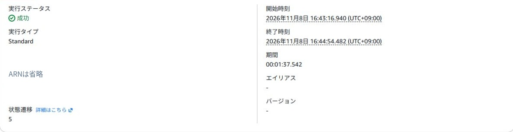
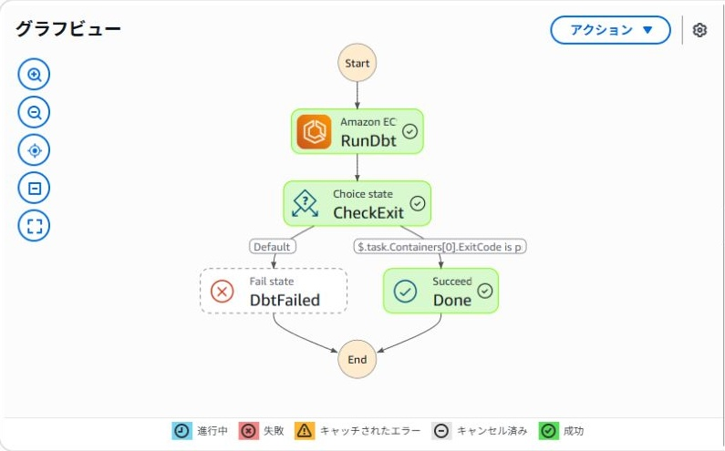
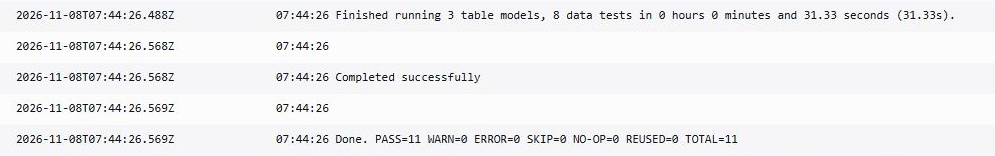
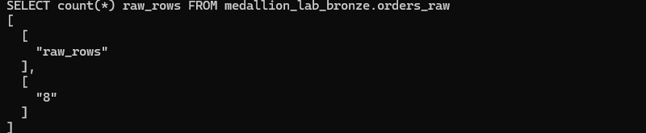
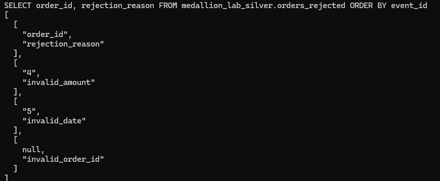
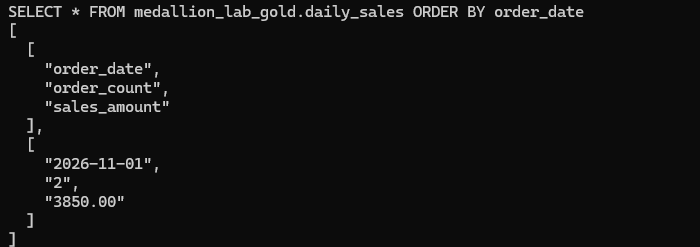
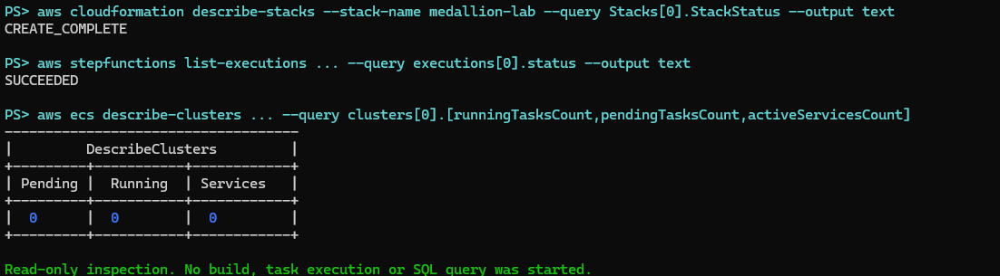

前回は、Amazon S3・Amazon Athena・AWS Glue Data Catalogを使い、Apache Icebergの更新・削除やタイムトラベルを検証しました。

https://zenn.dev/kkoch5t2/articles/aws-iceberg-lakehouse-lab

今回は、そのときに作成したS3バケットを再利用して、注文CSVをBronze・Silver・Goldに分けるデータ変換処理を作ってみます。

変換処理を定義するのは**dbt**、SQLを実行するのは**Athena**です。dbtは**ECS Fargateの単発タスク**として動かし、処理が終わると停止させます。コンテナのビルドにはAWS CodeBuildを使うため、手元のPCにDockerをインストールする必要はありません。

この記事では、構成・モデルの設計から、CloudFormationでの構築、初回実行で確認した結果までをまとめます。

:::message
実際の業務データを扱う本番環境ではなく、架空の注文データを使った技術検証です。確認済みの範囲は、初回CSVの取り込み、Silver・Goldの作成、データテスト、処理終了後のタスク停止までです。
:::

## 1. 今回の構成と各サービスの役割

### 実行時の構成


*橙色の破線はCloudFormationによる構築・更新時の操作。それ以外は、作成した環境でデータ変換を実行するときの関係を示しています。*

| サービス・ツール | 今回の役割 |
| --- | --- |
| S3 | 注文CSV、Icebergのデータ・メタデータファイル、クエリ結果、dbtの実行成果物を保存 |
| Glue Data Catalog | テーブル定義や、Icebergメタデータファイルへの参照を管理 |
| Athena | CSVの読み取り、データ変換、Icebergテーブルの作成、テスト用SQLの実行 |
| dbt | 変換SQL・モデル間の依存関係・データテストを管理 |
| ECS Fargate | dbtを実行するコンテナの起動先 |
| Step Functions | Fargateの起動、終了待ち、終了コードによる成否判定 |
| CloudWatch Logs | dbtの実行ログを保存 |
| CloudFormation | ネットワーク、IAM、実行基盤、Glue DBなどを作成・更新 |

ここで使うGlueは**Data Catalog**です。GlueのSpark ETLジョブは使用していません。

また、Fargate上で全データを読み込んで集計するわけではありません。dbtがAthenaへSQLを送り、完了を待って次のモデルやテストを実行します。データの計算処理はAthenaが担当します。

Step FunctionsとECSの連携には`ecs:runTask.sync`を使います。`.sync`は、タスクの起動要求だけで次へ進まず、処理完了を待つための連携方式です。

https://docs.aws.amazon.com/step-functions/latest/dg/connect-ecs.html


### ビルド時の構成



手元のPCではSQLや設定ファイルを編集し、必要なソースをZIPにしてS3へ送ります。CodeBuildがDockerイメージをビルドしてECRへ登録し、Fargateは起動時にそのイメージを取得します。

イメージはタグだけで指定せず、ビルド完了後に取得した`sha256`ダイジェストで固定しました。SQLを変更した場合は、**build → deploy → run**の順に実行して新しいイメージへ切り替えます。

### ネットワークと検証環境

| 項目 | 設定 |
| --- | --- |
| リージョン | シドニー：`ap-southeast-2` |
| VPC | `10.87.0.0/16` |
| サブネット | `10.87.1.0/24`、1 AZ |
| Fargate | Linux / X86_64、0.5 vCPU、1 GiB |
| 通信 | パブリックIPとInternet Gatewayを使ってAWS APIへ接続 |
| Security Group | インバウンド許可なし、アウトバウンドTCP 443 |
| Athena | エンジンバージョン3、専用ワークグループ |
| ログ保持 | 7日 |

今回は単一の検証環境です。ECSサービスや自動実行スケジュールは作成せず、手動で単発タスクを起動します。NAT GatewayやVPCエンドポイントも使用していません。社内向けの閉域ネットワークを再現した構成ではありません。

## 2. Bronze・Silver・Goldの設計

### 何を各層に置くか

| 層 | テーブル | 保存形式 | 内容 |
| --- | --- | --- | --- |
| Bronze | `medallion_lab_bronze.orders_raw` | CSVを参照する外部テーブル | 受け取った注文データの原本 |
| Silver | `medallion_lab_silver.orders_clean` | Iceberg / Parquet | 最新の注文を選び、型変換や表記統一を行った正常行 |
| Silver | `medallion_lab_silver.orders_rejected` | Iceberg / Parquet | 不正データと、その理由 |
| Gold | `medallion_lab_gold.daily_sales` | Iceberg / Parquet | 支払い済み注文の日別件数・金額 |

Bronzeは「必ずIcebergにする層」ではありません。今回はCSVを原本として保存し、Silver以降をIcebergにします。前回作成した`orders`テーブルを直接加工するのではなく、同じS3バケットの別プレフィックスで今回の検証を行います。

### 注文サンプル

初回CSVは、ヘッダーを除いて8行です。

```csv:samples/orders-001.csv
order_id,customer_name,amount,status,order_date,source_updated_at,event_id
1, Alice ,1200,NEW,2026-11-01,2026-11-01 10:00:00,e001
1, Alice ,1350,PAID,2026-11-01,2026-11-01 11:00:00,e002
2,Bob,2500,paid,2026-11-01,2026-11-01 12:00:00,e003
3,Carol,800,cancelled,2026-11-01,2026-11-01 12:00:00,e004
4,Dan,bad,paid,2026-11-02,2026-11-02 10:00:00,e005
5,Eve,900,paid,bad-date,2026-11-02 10:00:00,e006
6,Frank,600,new,2026-11-02,2026-11-02 10:00:00,e007
,Grace,300,paid,2026-11-02,2026-11-02 10:00:00,e008
```

Aliceは同じ注文IDで2行あり、金額とステータスが更新されています。ほかに、不正な金額、不正な日付、注文IDがない行を用意しました。


### Silverで行う処理

最初に`stg_orders`で、次の処理を行います。

- 注文ID・金額・日付・更新日時を`try_cast`で型変換する。
- 顧客名の前後の空白を取り除き、ステータスを小文字へ統一する。
- 注文IDごとに、元システムの更新日時が新しい行を選ぶ。
- 選んだ行の妥当性を判定し、不正理由を付ける。

`try_cast`は、変換できない値をNULLにするため、今回のように不正値を別テーブルへ分ける処理で使っています。

注文IDごとの最新行を選ぶ部分は、次のSQLです。

```sql
row_number() over (
  partition by coalesce(
    cast(order_id as varchar),
    concat('invalid:', event_id)
  )
  order by source_updated_at desc nulls last, event_id desc
) rn
```

この後、`rn = 1`だけを残します。取り込んだ順番ではなく、**元システムの更新日時**を基準にしている点がポイントです。同時刻の更新は、サンプルの`event_id`で順序を決めています。

最新行を選んでから妥当性を判定するため、最新行が不正だった場合に、古い正常行へ戻す処理にはしていません。正常行と不正行は、それぞれ次のモデルに分けます。

```sql:dbt/models/silver/orders_clean.sql
select order_id, customer_name, amount, status, order_date, source_updated_at
from {{ ref('stg_orders') }}
where rejection_reason is null
```

```sql:dbt/models/silver/orders_rejected.sql
select *
from {{ ref('stg_orders') }}
where rejection_reason is not null
```

`stg_orders`は`ephemeral`モデルなので、物理テーブルは作成しません。参照先のSQLへ展開されます。今回のdbtプロジェクトは4モデルですが、作成する物理テーブルはSilverの2個とGoldの1個です。

### Goldで行う処理

Goldは、正常行のうち`paid`の注文だけを注文日ごとに集計します。

```sql:dbt/models/gold/daily_sales.sql
select order_date, count(*) order_count, sum(amount) sales_amount
from {{ ref('orders_clean') }}
where status = 'paid'
group by order_date
```

この検証でいう「日別売上」は、**支払い済み注文を注文日で集計した金額**です。支払日や会計上の売上計上日を扱うモデルではありません。

## 3. CloudFormationとCodeBuildで環境を作る

### 検証コードの構成

今回使用したCloudFormationテンプレート、dbtのモデル・テスト、補助スクリプト、注文サンプルCSVは、以下のリポジトリで公開しています。

https://github.com/kkoch5t2/medallion-fargate-lab

今回の検証では、CloudFormationテンプレートと、操作をまとめたPythonスクリプトを用意しました。以下の`lab.py`はAWS標準コマンドではなく、この検証用の補助スクリプトです。

| ファイル・ディレクトリ | 内容 |
| --- | --- |
| `infra/01-bootstrap.json` | ECR・CodeBuild・ビルド用IAMロール・ビルドログ |
| `infra/02-workload.json` | ネットワーク・ECS・Step Functions・Glue・Athenaなど |
| `scripts/lab.py` | 初期化・ビルド・デプロイ・アップロード・実行・結果確認・削除 |
| `scripts/runner.py` | コンテナ内でdbtを実行し、成果物をS3へ保存 |
| `dbt/` | モデル・テスト・接続設定 |
| `samples/` | 架空の注文CSV |
| `Dockerfile` / `requirements.lock` | コンテナとPython依存ライブラリ |
| `buildspec.yml` | CodeBuildで実行するビルド・push手順 |

以降のコマンドは、この検証コードを展開したプロジェクトフォルダで実行します。

### PowerShellとAWS認証の準備

手元はWindows PowerShell、Python 3.12、AWS CLI v2を使用しました。AWS CLIは、検証時点で`2.39.6`です。dbtの実行ログでは、`dbt-core 1.12.6`、`dbt-athena 1.11.1`を確認しています。

今回の認証では`aws login`を使いました。ブラウザで対象アカウントへサインインし、リージョンは`ap-southeast-2`を指定します。

```powershell
aws login --profile medallion-signin
```

Python側からは、AWS CLIが出力する一時認証情報を`credential_process`で利用するプロファイルを設定しました。

```powershell
aws configure set credential_process "aws configure export-credentials --profile medallion-signin --format process" --profile medallion-lab
aws configure set region ap-southeast-2 --profile medallion-lab
$env:AWS_PROFILE = "medallion-lab"
aws sts get-caller-identity
```

`aws login`を使う方法と、IAM Identity Centerの`aws configure sso` / `aws sso login`を使う方法は別です。今回作成した`credential_process`のプロファイルに対し、`aws sso login`を実行する必要はありません。認証期限が切れた場合は、元の`medallion-signin`へ再ログインします。

https://docs.aws.amazon.com/cli/latest/userguide/cli-configure-sign-in.html


続いて、プロジェクトフォルダに移動して操作用のPython環境を作ります。

```powershell
cd C:\path\to\medallion-fargate-lab
py -3.12 -m venv .venv
.\.venv\Scripts\python.exe -m pip install -r requirements-operator.txt
```

`.venv`を有効化せず、Pythonの実行ファイルを直接指定します。手元へインストールするのは操作用のboto3などで、dbtはコンテナ側に入れます。

### 既存のS3バケットを取得して初期化する

前回のCloudFormationスタック`lakehouse-lab`の出力から、データ用・クエリ結果用のバケット名を取得しました。

```powershell
$outputs = aws cloudformation describe-stacks `
  --stack-name lakehouse-lab `
  --region ap-southeast-2 `
  --query "Stacks[0].Outputs" --output json | ConvertFrom-Json

$dataBucket = ($outputs | Where-Object OutputKey -eq "DataBucketName").OutputValue
$resultsBucket = ($outputs | Where-Object OutputKey -eq "QueryResultsBucketName").OutputValue

.\.venv\Scripts\python.exe scripts/lab.py init `
  --data-bucket "$dataBucket" `
  --results-bucket "$resultsBucket" `
  --region ap-southeast-2
```

`init`で`medallion-lab-ecr`スタックを作成し、作業設定を`.lab.json`へ保存します。このファイルにはバケット名やリソースの識別子などを保存し、認証キーは保存しません。

前提とするバケットは、同一アカウント・同一リージョン、SSE-S3暗号化、バージョニング未設定です。独自のKMS・Lake Formation・バケットポリシーを使用する場合は、その制御に合わせて権限を調整する必要があります。

### コンテナをビルドして実行基盤をデプロイする

```powershell
.\.venv\Scripts\python.exe scripts/lab.py build
.\.venv\Scripts\python.exe scripts/lab.py deploy
```

`build`は必要なソースだけをS3へアップロードしてCodeBuildを起動します。`deploy`は、ECRのイメージダイジェストを使って`medallion-lab`スタックを作成します。

CodeBuildのビルド環境では、Dockerビルド用に`PrivilegedMode`を有効にしています。これはビルド側の設定で、Fargate上のdbtを特権コンテナとして動かす設定ではありません。

CloudFormationが作るのはインフラとBronzeの外部テーブルまでです。Silver・GoldのIcebergテーブルは、dbtを実行したときに作成します。

:::message
実行順序は **init → build → deploy → upload → run → verify** です。`init`前に`build`すると`.lab.json`がなく、`build`前に`deploy`するとイメージ情報がありません。初期化が成功した後は、設定ファイルを残して次の手順へ進みます。
:::

## 4. Fargateでdbtを実行する

### CSVをアップロードする

```powershell
.\.venv\Scripts\python.exe scripts/lab.py upload --batch 001
```

保存先は、既存データ用バケット内の`medallion-lab/bronze/orders/orders-001.csv`です。同じコマンドを繰り返しても、同じキーへ上書きします。別名のCSVとして重複アップロードすると、Bronze側の行数が変わるため注意します。

### Step Functionsを起動する

```powershell
.\.venv\Scripts\python.exe scripts/lab.py run
```

Step FunctionsがFargateタスクを起動し、コンテナ内で次のコマンドを実行します。

```bash
dbt build --target lab
```

dbtは`ref()`で定義された依存関係に従ってモデルやテストを実行します。今回はSilverの作成後にGoldを作成し、NULL・一意性・金額・集計結果の整合性などを確認します。

https://docs.getdbt.com/reference/commands/build



*初回実行は成功。ワークフローの所要時間は約1分38秒でした。*


*RunDbtで実行し、CheckExitでコンテナの終了コードを確認してDoneへ進みます。DbtFailedは失敗時の分岐で、この実行では通っていません。*

### dbtのログと成果物

CloudWatch Logsでは、次の結果を確認できました。

```text
Finished running 3 table models, 8 data tests ... (31.33s).
Completed successfully
Done. PASS=11 WARN=0 ERROR=0 SKIP=0 NO-OP=0 REUSED=0 TOTAL=11
```

`PASS=11`は、テーブル作成3個とデータテスト8個の合計です。「テストが11個ある」という意味ではありません。ワークフロー全体の時間にはコンテナの起動・イメージ取得・成果物保存なども含まれるため、dbtの実行時間とは異なります。



実行後は、結果用S3バケットの`medallion-lab/artifacts/<実行ID>/`へ、次のファイルなどを保存します。

- `target/manifest.json`：モデル定義や依存関係など。
- `target/run_results.json`：モデル・テストの実行結果。
- `logs/dbt.log`：dbtのログ。
- `exit.json`：終了コード。

成果物を保存してから、dbtの終了コードでコンテナを終了します。dbtが失敗した場合に、保存処理の成功だけでワークフローを成功扱いにしないためです。

## 5. Bronze・Silver・Goldの結果を確認する

### Bronzeは8行

```powershell
.\.venv\Scripts\python.exe scripts/lab.py verify
```

`verify`はAthenaで確認用のSELECTを実行します。最初に、Bronzeの行数が8行であることを確認しました。



### Silverの正常行は4行、不正行は3行

正常行は次のとおりです。

| order_id | customer_name | amount | status | order_date |
| --- | --- | --- | --- | --- |
| 1 | Alice | 1350.00 | paid | 2026-11-01 |
| 2 | Bob | 2500.00 | paid | 2026-11-01 |
| 3 | Carol | 800.00 | cancelled | 2026-11-01 |
| 6 | Frank | 600.00 | new | 2026-11-02 |

Aliceは最新の更新だけが残り、金額が1350.00、ステータスが`paid`になっています。顧客名の前後の空白も取り除かれました。

一方、次の3行は不正行のテーブルへ分かれています。

| order_id | rejection_reason | 原因 |
| --- | --- | --- |
| 4 | invalid_amount | 金額が`bad`で数値へ変換できない |
| 5 | invalid_date | 注文日が`bad-date`で日付へ変換できない |
| NULL | invalid_order_id | 注文IDが空欄 |



Bronzeの8行は、正常4行、不正3行、Aliceの古い更新1行として説明できます。

### Goldは注文2件、売上3850.00

```sql
select *
from medallion_lab_gold.daily_sales
order by order_date;
```

| order_date | order_count | sales_amount |
| --- | --- | --- |
| 2026-11-01 | 2 | 3850.00 |

Aliceの1350.00とBobの2500.00を合計した結果です。Carolはキャンセル、Frankは未払いなので、この集計には含まれません。2026-11-02には支払い済みの正常注文がないため、0円の行を作るのではなく、その日付の行自体がありません。



初回実行で、CSVの原本を保存するBronze、整形・重複整理・不正行の隔離を行うSilver、利用目的に合わせて集計するGoldまでの流れを確認できました。

## 6. 実行後の状態と、今回の検証範囲

### コンテナは処理終了後に停止する

Fargate上のdbtは常駐させていません。SQLを投げた直後に終了するのではなく、Athenaの処理完了、後続モデル、データテスト、成果物の保存まで終えてから停止します。

記事用の撮影時にも、CloudFormationが`CREATE_COMPLETE`、Step Functionsが`SUCCEEDED`、ECSクラスターの実行中タスク・待機中タスク・サービス数がすべて0であることを確認しました。


*構築後の状態を読み取り専用コマンドで再確認した画面です。表示コマンドの一部の引数は省略しています。撮影のためのビルドやFargate再実行は行っていません。*

タスク停止後は、そのタスクのFargate実行料金は継続しません。ただし、S3のデータ、ECRのイメージ、CloudWatch Logsなどの保存に対する料金は残ります。コンテナ停止だけで、環境全体の料金が0になるわけではありません。

https://aws.amazon.com/fargate/pricing/


### dbtのメタデータ閲覧は追加できる

dbtには、モデル・カラム・SQL・テーブル間の依存関係をドキュメントとして表示するdbt Docsもあります。

今回実装したのは、`dbt build`と成果物の保存までで、dbt Docsの生成・配信は含めていません。追加する場合は、処理終了後に`dbt docs generate`を実行し、生成物をS3へ保存する構成にできます。

閲覧用のファイルと変換処理を分ければ、ドキュメントを見るためにFargateを動かし続ける必要はありません。生成物をPCへダウンロードしてローカルで表示する方法や、認証を設けた配信先で共有する方法が考えられます。ドキュメントは、基本的に生成した時点の情報です。

https://docs.getdbt.com/docs/build/documentation?version=1.12


### 本番運用に向けては別途設計が必要

今回のSilver・Goldは`materialized: table`による全件再作成です。Icebergを使っていても、自動的に差分更新になるわけではありません。

また、複数モデルをまとめて原子的に切り替える仕組みや、同時実行の排他制御は実装していません。dbtの途中で失敗した場合、先に成功したテーブルまで一括でロールバックされるものではありません。

データ品質のルールも、今回のサンプルで扱った不正値に対する検証です。例えばNULLステータス、イベントIDの欠損・重複、タイムゾーンの違いなどは追加のテストが必要です。日時はサンプル内でUTCとして扱い、実運用ではイベントの正しい順序を保証するキーや日時の取り扱いを決めます。

同梱コードには追加CSVの取り込みや意図的なテスト失敗の機能もありますが、この記事の成功結果として確認したのは初回バッチです。増分更新、失敗時の復旧、自動スケジュール、監視通知は、別の検証項目として残しています。

### 後片付け

結果を残す場合は、必要なCSV・ログ・実行成果物を先に退避します。今回再利用した結果用バケットには、前回の検証で設定した7日のライフサイクルがあるため、そのまま長期保存する用途には使えません。

検証環境を削除する場合は、実行中のビルド・ワークフロー・タスクがないことを確認し、次を実行します。

```powershell
.\.venv\Scripts\python.exe scripts/lab.py cleanup --confirm medallion-lab
```

このコマンドは、今回の専用プレフィックス内の原本・変換後データ・成果物、dbt作成テーブル、実行基盤、ECRイメージ、ビルド用基盤を削除します。前回のS3バケット本体と、別プレフィックスのデータは削除しません。結果を残しておきたい段階では実行しません。

### 参考資料

- [AWS CLI：コンソール認証情報を使ったログイン](https://docs.aws.amazon.com/cli/latest/userguide/cli-configure-sign-in.html)
- [dbt：Athenaの接続設定](https://docs.getdbt.com/docs/local/connect-data-platform/athena-setup)
- [dbt：Athenaのモデル設定](https://docs.getdbt.com/reference/resource-configs/athena-configs)
- [dbt：dbt build](https://docs.getdbt.com/reference/commands/build)
- [dbt：ドキュメント生成](https://docs.getdbt.com/docs/build/documentation?version=1.12)
- [AWS：Step FunctionsからECS・Fargateを実行](https://docs.aws.amazon.com/step-functions/latest/dg/connect-ecs.html)
- [AWS：Fargateのタスクネットワーク](https://docs.aws.amazon.com/AmazonECS/latest/developerguide/fargate-task-networking.html)
- [AWS：CodeBuildのDockerイメージビルド例](https://docs.aws.amazon.com/codebuild/latest/userguide/sample-docker.html)