AWSでデータレイクハウスを構築する場合、どのようなサービスを組み合わせ、データをどのように管理するのか。まずは全体像を把握したくて、小さな検証環境を作ってみました。

今回はAmazon S3、AWS Glue Data Catalog、Amazon Athena、Apache Icebergを組み合わせ、テーブルの作成からデータの追加・更新・削除、過去のスナップショットの参照（Version Travel）、ファイルの最適化まで一通り試しています。

SQLの実行結果だけでなく、S3上のParquetファイルやメタデータも確認しながら、それぞれのサービスの役割とデータが管理される仕組みを整理します。

## 背景と目的

データレイクハウスは、データレイクの柔軟なストレージと、データウェアハウスに近いテーブル管理機能を組み合わせるアーキテクチャです。

データ基盤の歴史や、データレイクハウスが登場した背景については、以前の記事で整理しています。

https://zenn.dev/kkoch5t2/articles/41ad155b966681

AWSではAmazon S3をデータの保存先にし、Amazon Athenaなどのクエリエンジンから分析する構成が考えられます。

ただし、S3にParquetファイルを配置しただけでは、データウェアハウスと同じような更新処理や履歴管理はできません。

そこで使うのがApache Icebergです。

Apache Icebergは、Parquetなどのデータファイルをテーブルとして管理するためのオープンテーブルフォーマットです。スナップショットを利用した履歴管理や、行単位の更新・削除などに対応しています。[^iceberg]

Icebergのメタデータ階層や更新・削除の仕組みについては、以下の記事で詳しく解説しています。

https://zenn.dev/kkoch5t2/articles/9b1b800a58a6b7

今回は次の点を確認しました。

- AthenaからIcebergテーブルを作成し、SQLで操作できるか
- UPDATE・DELETEによってS3上のファイルがどう変化するか
- Version Travelで過去のスナップショットを参照できるか
- OPTIMIZE・VACUUMによってファイルがどう管理されるか

なお、今回はAWSデータレイクハウスの構成とIcebergの基本動作を理解するための最小構成です。Glue ETLによるデータ変換、Raw・Curated・Martの多層化、Lake Formationによる詳細な権限管理などは対象としていません。

## 前提

今回の検証環境は以下のとおりです。

| 項目 | 設定 |
| --- | --- |
| AWSリージョン | Sydney（ap-southeast-2） |
| 構築方法 | CloudFormation |
| ストレージ | Amazon S3 |
| データカタログ | AWS Glue Data Catalog |
| クエリエンジン | Amazon Athena engine version 3 |
| テーブルフォーマット | Apache Icebergのテーブル形式 v2（format-version 2） |
| データファイルの形式 | Parquet（Snappy圧縮） |
| データベース | `lakehouse_lab` |

今回は通常のS3バケットを使用しており、Amazon S3 Tablesは使用していません。また、GlueはData Catalogとして利用し、ETLジョブは実行していません。

## システム構成

今回の環境では、AthenaがSQLを実行し、Glue Data Catalogがテーブルの登録情報を、S3がデータ本体とIcebergのメタデータを保持します。

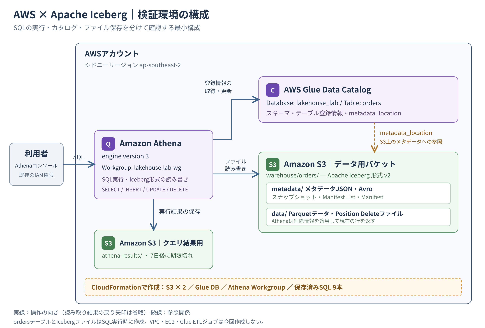
*図1：今回の検証構成。実線はAthenaによる操作の向き、破線はカタログからS3上のメタデータへの参照関係を示す。*

それぞれの役割は次のとおりです。

| 構成要素 | 今回の役割 |
| --- | --- |
| Amazon Athena | SQLを実行し、Iceberg形式に従ってS3上のファイルを読み書きする |
| AWS Glue Data Catalog | `lakehouse_lab.orders`のスキーマや、S3上のメタデータJSONの参照先を保持する |
| Amazon S3：データ用バケット | Parquetのデータファイル、削除情報、Icebergのメタデータを保存する |
| Amazon S3：クエリ結果用バケット | Athenaのクエリ結果を保存する。データ用バケットとは別に作成する |
| Apache Iceberg | どのファイルをテーブルの一部として参照するかを、メタデータで管理するためのテーブルフォーマット |

利用者がAthenaでSQLを実行すると、AthenaはGlue Data Catalogからテーブルの登録情報を取得します。そこからS3上のIcebergメタデータをたどり、読み取るデータファイルや適用する削除情報を特定します。

**Icebergは、S3とAthenaの間に配置する別のサーバーではありません。** 今回はAthenaがIcebergの仕組みを使ってファイルを読み書きし、テーブルの状態を更新します。また、Glue Data Catalogがデータ本体を保存したり、AthenaとS3の間のデータ転送を中継したりするわけではありません。

データ用バケットの`warehouse/orders/`配下には、主に次のファイルが保存されます。

| 保存先 | 保存されるもの |
| --- | --- |
| `data/` | Parquetのデータファイルと、行の削除情報を記録したPosition Delete（位置削除）ファイル |
| `metadata/` | テーブルのメタデータJSONと、ファイルの参照関係を管理するManifest List（マニフェストリスト）・Manifest（マニフェスト）のAvroファイル |

メタデータJSONにはスナップショットの情報があり、Manifest ListとManifestを通じて、それぞれの時点で必要なデータファイルや削除ファイルをたどれるようになっています。

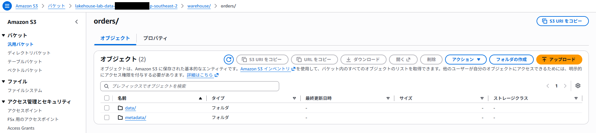
*実際のS3の`warehouse/orders/`。`data/`と`metadata/`が分かれている。*

## 環境構築

環境はCloudFormationを使って構築しました。

操作には、CloudFormationでリソースを作成する権限に加え、Athenaのクエリ実行、Glue Data Catalogの参照・更新、S3の読み書きなどに必要なIAM権限がある既存のユーザーまたはロールを使用します。今回のテンプレートでは、操作用のIAMユーザーやロールは作成していません。

### AWSリソースの作成

CloudFormationのスタック名は`lakehouse-lab`としました。

テンプレートでは次のリソースを作成しています。

- Icebergデータ保存用のS3バケット
- Athenaクエリ結果保存用のS3バケット
- Glueデータベース`lakehouse_lab`
- Athenaワークグループ`lakehouse-lab-wg`
- 検証用SQLを含むAthenaの保存済みクエリ9本

S3バケットにはパブリックアクセスブロックと暗号化を設定し、HTTPS以外のアクセスを拒否しています。また、Athenaのクエリ結果には7日間のライフサイクルルールを設定しました。

Athenaには1クエリあたり1GiBのスキャン量上限も設定しています。ただし、これは料金の上限ではないため、S3やAthenaなどの利用料金には別途注意が必要です。

今回使用したCloudFormationテンプレートは、検証用SQLも含めてGitHubで公開しています。同じ構成を試したい場合や、個々のリソースの設定を確認したい場合は、以下を参照してください。

https://github.com/kkoch5t2/aws-iceberg-lakehouse-cloudformation

CloudFormationの作成が完了したらAthenaを開き、`lakehouse-lab-wg`を選択します。

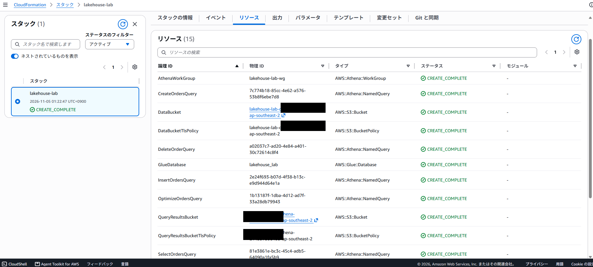
*CloudFormationの`lakehouse-lab`スタック。作成したリソースが`CREATE_COMPLETE`となっている。*

ここで注意したいのが、CloudFormationが作成するのはIcebergテーブルそのものではなく、テーブルを作成するためのSQLも含む実行環境だという点です。

### Icebergテーブルの作成

Athenaで次のSQLを実行します。

```sql
CREATE TABLE lakehouse_lab.orders (
    order_id BIGINT,
    customer_name STRING,
    amount DECIMAL(10,2),
    status STRING,
    order_date DATE
)
PARTITIONED BY (month(order_date))
LOCATION 's3://<DATA_BUCKET>/warehouse/orders/'
TBLPROPERTIES (
    'table_type'='ICEBERG',
    'format'='parquet',
    'write_compression'='snappy'
);
```

`<DATA_BUCKET>`にはCloudFormationで作成されたデータ用S3バケット名を指定します。

`table_type=ICEBERG`でIcebergテーブルとして作成し、`month(order_date)`によって注文日を月単位にパーティション分割しています。[^create]

実行後、Glue Data Catalogから`lakehouse_lab.orders`が確認できました。

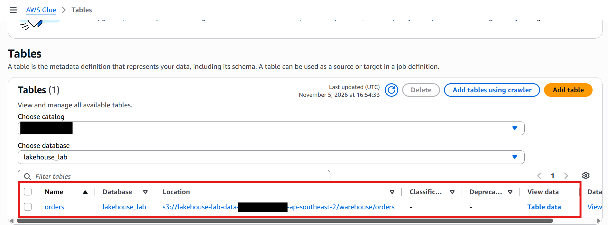
*Glue Data Catalogのテーブル一覧。データベース`lakehouse_lab`に`orders`が登録され、S3の保存先も確認できる。*

## 動作検証

### データの追加と参照

空の`orders`テーブルに、3件の注文データを登録します。

以下の`INSERT`は1回だけ実行します。同じSQLを繰り返すと同じ注文が追加され、この記事の行数やファイル数と一致しなくなります。

```sql
INSERT INTO lakehouse_lab.orders
    (order_id, customer_name, amount, status, order_date)
VALUES
    (1, 'Alice', DECIMAL '1200.00', 'new', DATE '2026-11-01'),
    (2, 'Bob', DECIMAL '2500.00', 'new', DATE '2026-11-02'),
    (3, 'Carol', DECIMAL '800.00', 'new', DATE '2026-11-03');
```

`SELECT`を実行すると、期待どおり3件が取得できました。

| order_id | customer_name | amount | status |
| --- | --- | --- | --- |
| 1 | Alice | 1200.00 | new |
| 2 | Bob | 2500.00 | new |
| 3 | Carol | 800.00 | new |

`INSERT`を実行すると、AthenaがS3にParquet形式のデータファイルを保存します。以下は、一連の検証後にS3のデータ保存先を開き、Parquetファイルまでたどった画面です。

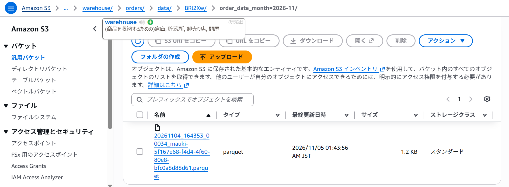
*S3の`warehouse/orders/data/BRI2Xw/order_date_month=2026-11/`配下に保存されたParquetファイルの一例。*

`BRI2Xw`は書き込み時に付く短いプレフィックスで、`order_date_month=2026-11`は注文日で月単位にパーティション分割した保存先です。データはこのようにParquetファイルとして実際に保存されています。[^data-layout]

ただし、**S3上にファイルがあることと、現在のIcebergテーブルがそのファイルを参照していることは別**です。現在参照しているデータファイルは、後述する`orders$files`で確認します。

### データの更新と削除

Athenaでは、Icebergテーブルに対する`UPDATE`と`DELETE`をサポートしています。今回は、元のデータファイルをその場で書き換えるのではなく、削除情報を別のファイルに記録し、読み取り時に反映するMerge-on-Read（マージオンリード）方式で処理されます。これは、今回使用するAthenaの動作です。[^data]

続いてAliceの金額とステータスを更新します。

```sql
UPDATE lakehouse_lab.orders
SET amount = DECIMAL '1350.00',
    status = 'paid'
WHERE order_id = 1;
```

さらにCarolの注文を削除します。

```sql
DELETE FROM lakehouse_lab.orders
WHERE order_id = 3;
```

再度SELECTすると、結果は以下のようになりました。

| order_id | customer_name | amount | status |
| --- | --- | --- | --- |
| 1 | Alice | 1350.00 | paid |
| 2 | Bob | 2500.00 | new |

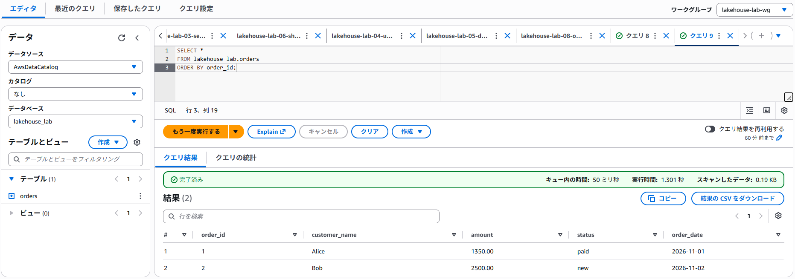
*UPDATE・DELETE後に取得できた現在のデータは2件。*

通常のSQLによってUPDATEとDELETEが正常に実行できました。

ここで気になるのが、S3上の元のParquetファイルがどうなっているのかという点です。

### スナップショットの確認

Icebergのスナップショットは、Athenaから次のSQLで確認できます。

```sql
SELECT *
FROM "lakehouse_lab"."orders$snapshots"
ORDER BY committed_at DESC;
```

今回はINSERT、UPDATE、DELETEそれぞれに対応する3つのスナップショットが作成されていました。

| 処理 | スナップショットID |
| --- | --- |
| INSERT | 7508948322727723283 |
| UPDATE | 3135078563431764598 |
| DELETE | 1651369462038471101 |

スナップショットIDは実行環境ごとに異なります。

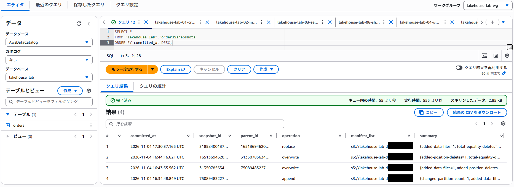
*上の表はINSERT・UPDATE・DELETE時点の3件。スクリーンショットは後からOPTIMIZEも実行したため、合計4件となっている。*

これを利用すると、変更前のデータを参照できます。

```sql
SELECT *
FROM lakehouse_lab.orders
FOR VERSION AS OF 7508948322727723283
ORDER BY order_id;
```

このSQLでは、INSERT直後のAlice、Bob、Carolの3件が取得できました。

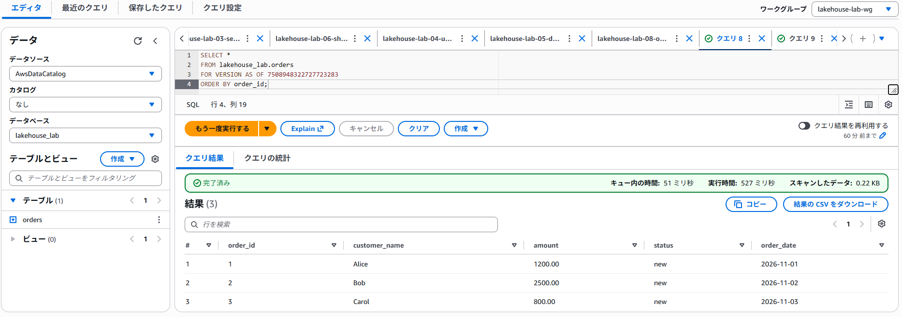
*Version Travelで取得した過去の状態。現在は削除済みのCarolも含まれている。*

つまり、現在のテーブルからCarolが削除されていても、保持されている過去のスナップショットを指定すれば、当時のデータを参照できます。

これはスナップショットIDを指定するVersion Travelです。Athenaでは、日時を指定するTime Travel（`FOR TIMESTAMP AS OF`）も利用できます。[^time-travel]

### S3のファイル構成

次に、Athenaで現在参照しているデータファイルを確認します。

```sql
SELECT
    content,
    file_path,
    record_count,
    file_size_in_bytes
FROM "lakehouse_lab"."orders$files";
```

UPDATE・DELETEを実行したあとの結果は次のとおりでした。

| ファイル | レコード数 | サイズ |
| --- | ---: | ---: |
| INSERT時のParquet | 3件 | 813バイト |
| UPDATE時のParquet | 1件 | 775バイト |

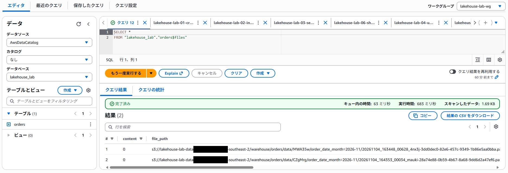
*OPTIMIZE前。現在のIcebergテーブルが参照するデータファイルは2つ。*

ここで重要なのは、**INSERT時のParquetファイルに元の3レコードが残っている**ことです。

S3上のファイルをさらに確認すると、行の削除情報を保持するPosition Delete（位置削除）ファイルが2つ作成されていました。

Position Deleteファイルには、削除対象となるデータファイルのパスと、そのファイル内の行の位置が記録されます。

今回のUPDATEでは、元のAliceの行に対する削除情報と、更新後のAliceの行が記録されます。更新後の行は新しいParquetファイルに保存され、これらは1つの更新トランザクションとして反映されます。DELETEでは、Carolの行の位置が削除対象として記録されていました。

こうしたデータファイルと削除ファイルの参照関係も、Icebergのメタデータで管理されています。

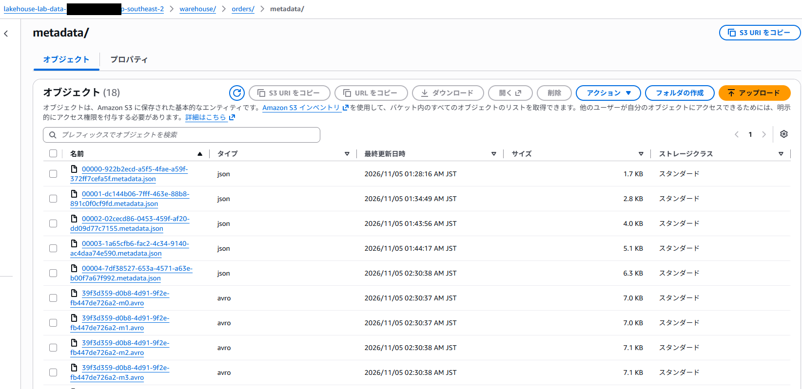
*S3の`metadata/`には、スナップショットやファイルの管理に使うJSON・Avroファイルが保存されている。*

したがって、現在参照する2つのデータファイルには合計4レコードがあっても、古いAliceとCarolを削除扱いにする情報を適用すると、SQLの結果は更新後のAliceとBobの2件になります。

### ファイルの最適化

続いてOPTIMIZEを実行します。

```sql
OPTIMIZE lakehouse_lab.orders
REWRITE DATA USING BIN_PACK;
```

実行は正常に完了しました。

:::message
**OPTIMIZEとは？**

Icebergテーブルのデータファイルを、読み取りやすい構成に書き換えるメンテナンス処理です。今回の`REWRITE DATA USING BIN_PACK`では、小さなファイルをまとめたり、削除情報を反映したデータファイルに書き換えたりします。[^optimization]

読み取り時に扱うファイル数や、削除情報を適用する処理を減らすことが目的です。ただし、対象になるファイルはサイズや削除ファイル数などによって決まるため、実行すれば必ず同じ数にまとまるわけではありません。書き換え時のスキャン量に応じてAthenaの料金が発生します。[^optimize]

古いスナップショットや、それらが参照するファイルを即座に削除する処理ではありません。過去の状態を参照するために必要なファイルは残り、保持条件を満たした不要なファイルの整理には、後述する`VACUUM`を使います。
:::

再度`orders$files`を確認すると、データファイルの構成が変わっていました。

| 項目 | OPTIMIZE前 | OPTIMIZE後 |
| --- | ---: | ---: |
| 現在参照するデータファイル数 | 2 | 1 |
| 上記ファイル内のレコード数（削除情報の適用前） | 4件 | 2件 |
| 上記データファイルの合計サイズ | 1,588バイト | 760バイト |

この表は、各時点で現在のテーブルが参照するデータファイルだけの比較です。**過去のスナップショットが参照するファイルや、削除ファイル・メタデータを含むS3全体の保存量ではありません。** また、今回はファイル構成の変化を確認しており、クエリ速度の改善は測定していません。

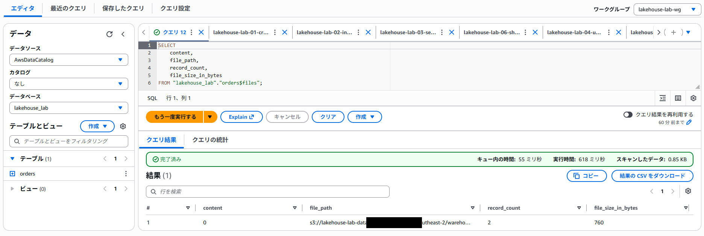
*OPTIMIZE後。データファイルが1つにまとまり、現在有効な2件を保持している。*

更新・削除による変更を反映した、新しいParquetファイルに再編成されたことが分かります。

今回は最適化後のデータファイルに、現在有効なAliceとBobの2件のみが保存されました。

### 不要ファイルの整理

最後にVACUUMを実行しました。

```sql
VACUUM lakehouse_lab.orders;
```

こちらも正常終了しました。

VACUUMは、保持条件に従って古いスナップショットを失効させ、残すスナップショットから参照されなくなったファイルや、一定期間を経過した未参照ファイルを削除するための処理です。失効したスナップショットの状態は、Version Travelでも参照できなくなります。[^vacuum]

ただし、正常終了したからといって古いファイルが必ず削除されるわけではありません。スナップショットの最大経過時間の既定値は5日間で、今回の検証では設定を変更していません。また、最低限残すスナップショット数の設定もあるため、5日を過ぎたものが必ずすべて消えるわけではありません。

今回作成したスナップショットは実行時点で5日を経過しておらず、VACUUM後も保持されていました。この検証で確認したのは、VACUUMの正常終了と、現在のデータ・保持された過去のデータを引き続き参照できることです。期限切れスナップショットの失効や、S3オブジェクトの物理削除までは確認していません。

なお、ファイルの削除には、クエリを実行するユーザーやロールに`s3:DeleteObject`権限が必要です。この権限がなくてもVACUUM自体は正常終了する場合があるため、物理削除を検証するときは、実行結果に加えて権限とS3上のファイルも確認します。[^vacuum]

メンテナンス後に改めて確認したところ、現在のSELECTではAliceとBobの2件が、INSERT直後のスナップショットを指定したVersion Travelでは3件が取得できました。

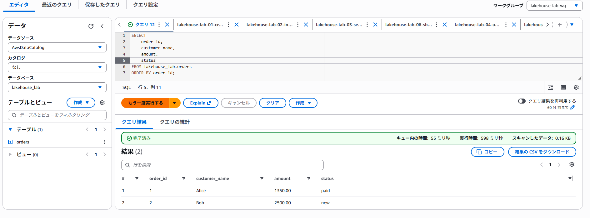
*メンテナンス後の現在のデータ。更新済みのAliceとBobの2件が取得できている。*

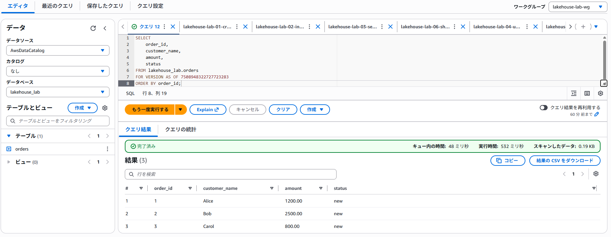
*メンテナンス後のVersion Travel。現在は削除済みのCarolを含め、INSERT直後の3件が取得できている。*

**OPTIMIZE・VACUUM実行後も、現在のデータと保持期間内の過去のデータの両方を参照できることが確認できました。**

### 検証後の後片付け

検証を終えて環境が不要になったら、必要な結果を退避し、今回作成した2つのS3バケットを空にしてから、CloudFormationの`lakehouse-lab`スタックを削除します。バケット内にオブジェクトが残っていると、スタックからのバケット削除は失敗します。[^cleanup]

削除前に、CloudFormationの出力で対象のバケット名を確認してください。データ用バケットを空にすると、現在のデータも過去のスナップショットを参照するためのファイルも失われます。

## まとめ

今回は、Amazon S3、AWS Glue Data Catalog、Amazon Athena、Apache Icebergを使って、小さなデータレイクハウスを構築しました。

実際に試してみて印象的だったのは、Athenaからは普通のSQLでUPDATEやDELETEを実行できる一方、**S3上ではデータファイル、削除情報、スナップショットを分けて管理している**という点です。

S3上のファイルとIcebergのメタデータを確認すると、SQLから見えるテーブルの状態と物理的なファイル構成が異なることもよく分かりました。

今回は最小構成でしたが、Icebergの基本的な動きを理解できたので、次はデータ収集・変換パイプラインや権限管理なども組み合わせ、より実際のデータ基盤に近い構成を検討したいと思います。

### 参考資料

[^iceberg]: [Amazon Athena公式：Apache Icebergテーブルの利用](https://docs.aws.amazon.com/athena/latest/ug/querying-iceberg.html)。Athenaで対応しているIcebergの機能や利用上の前提を参照。
[^create]: [Amazon Athena公式：Icebergテーブルの作成](https://docs.aws.amazon.com/athena/latest/ug/querying-iceberg-creating-tables.html)。`CREATE TABLE`、`TBLPROPERTIES`、パーティション指定について参照。
[^data]: [Amazon Athena公式：Icebergテーブルのデータ更新](https://docs.aws.amazon.com/athena/latest/ug/querying-iceberg-updating-iceberg-table-data.html)。`INSERT`・`UPDATE`・`DELETE`の操作とPosition Deleteの仕様を参照。
[^time-travel]: [Amazon Athena公式：Time TravelとVersion Travel](https://docs.aws.amazon.com/athena/latest/ug/querying-iceberg-time-travel-and-version-travel-queries.html)。スナップショットを指定した過去データの参照方法を確認。
[^optimization]: [Amazon Athena公式：Icebergテーブルの最適化](https://docs.aws.amazon.com/athena/latest/ug/querying-iceberg-data-optimization.html)。`OPTIMIZE`や`VACUUM`の仕組みと注意点を参照。
[^data-layout]: [AWS Big Data Blog：Optimize data layout by bucketing with Amazon Athena and AWS Glue to accelerate downstream queries](https://aws.amazon.com/blogs/big-data/optimize-data-layout-by-bucketing-with-amazon-athena-and-aws-glue-to-accelerate-downstream-queries/)。Icebergの`data/`配下にランダムなプレフィックスが生成され、その下にデータファイルが配置される構成を参照。

[^optimize]: [Amazon Athena公式：OPTIMIZE](https://docs.aws.amazon.com/athena/latest/ug/optimize-statement.html)。対象ファイルの選択と、書き換え時のスキャン量に応じた課金を参照。
[^vacuum]: [Amazon Athena公式：VACUUM](https://docs.aws.amazon.com/athena/latest/ug/vacuum-statement.html)。保持条件、スナップショットの失効、ファイル削除に必要な権限を参照。
[^cleanup]: [AWS CloudFormation公式：DeletionPolicy](https://docs.aws.amazon.com/AWSCloudFormation/latest/TemplateReference/aws-attribute-deletionpolicy.html)。S3バケットの削除には、バケット内の全オブジェクトを削除しておく必要があることを参照。
