AWS PrivateLinkを使い、**アカウントBのLambdaから、アカウントAのSquidプロキシを経由してインターネットへ接続する構成**を検証しました。

:::message
**Squid（スクイッド）とは？**

Squidは、クライアントとWebサーバーの間でHTTP・HTTPS通信を中継する、オープンソースのプロキシサーバーソフトウェアです。キャッシュや、接続先へのアクセス制御などの機能があります。

この記事では、A側のEC2にSquidをインストールし、B側のLambdaに代わって外部サイトへ接続する「フォワードプロキシ」として使います。

参考：[Squid公式サイト](https://www.squid-cache.org/)
:::

B側にはInternet GatewayもNAT Gatewayも置かず、アプリケーションが明示的にA側のプロキシを使います。検証先には、アクセス元のパブリックIPを返す `https://checkip.amazonaws.com/` を使用しました。

最初はA・Bそれぞれで1つのサブネットを使って疎通を確認しました。その後、複数のAvailability Zone（AZ）への配置による耐障害性も考え、各アカウントに別のAZのサブネットを1つずつ追加し、NLB・EC2・Endpointなどの設定を更新して再度検証しました。

この記事では、検証内容、前提、作業手順、テスト、補足・注意点の順に説明します。検証リージョンはシドニー（`ap-southeast-2`）です。

## 検証内容

まずは、今回検証した構成と通信の流れについて説明します。

### アカウントの役割と通信経路

アカウントごとの役割は次のとおりです。

| アカウント | 役割 | 主なリソース |
| --- | --- | --- |
| B：利用側（Consumer） | 外部サイトへアクセスするクライアントを動かす | Lambda、Interface VPC Endpoint |
| A：提供側（Provider） | プロキシをPrivateLinkで提供し、外部への接続を引き受ける | Endpoint Service、内部NLB、Squid EC2、Internet Gateway |

通信の要求は、左から右へ **B → A → インターネット** と進みます。

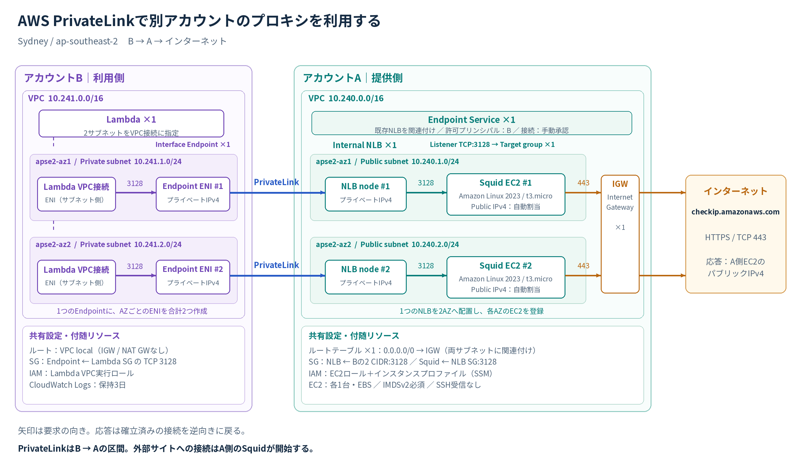
*図1：検証後の2AZ構成。矢印は要求の向きで、応答は確立済みの接続を逆向きに戻ります。各AZの代表経路を描いており、リージョナルDNS名の利用でLambdaとEndpointが常に同一AZになることを保証する図ではありません。*

1. BのLambdaが、BのInterface EndpointのDNS名へTCP 3128で接続する。
2. PrivateLinkを通じて、Aの内部NLBへ到達する。
3. NLBが、ターゲットグループに登録したSquid EC2へTCP 3128で転送する。
4. Squidが外部サイトへTCP 443で接続する。
5. 外部サイトには、A側で処理したEC2のパブリックIPv4が送信元として見える。

**PrivateLinkを使うのはBとAの間です。Aから検証先へは、パブリックエンドポイントへのHTTPS接続になります。** 外部サービスまで含めた全区間をPrivateLinkにしているわけではありません。

たとえば、Snowflakeのように接続元IPを制限するサービスとの連携を考えるときも、「Aのプロキシ経由で公開エンドポイントへ接続する方式」と「接続先が提供するPrivateLinkでプライベート接続する方式」は分けて考える必要があります。今回確認したのは前者につながるプロキシ経路です。Snowflakeへの接続自体は、この検証には含めていません。

### 構成リソース

CloudFormationテンプレートで明示的に作成・設定しているリソースをまとめます。AZを2つ使っていても、NLBやInterface Endpoint自体を2個ずつ作る構成ではありません。

| 配置 | リソース | 数・設定 |
| --- | --- | --- |
| A | VPC | 1個。`10.240.0.0/16`。DNS解決・DNSホスト名を有効化 |
| A | パブリックサブネット | 2個。`10.240.1.0/24` と `10.240.2.0/24`。別々のAZに配置 |
| A | Internet Gateway | 1個。AのVPCにアタッチ |
| A | ルートテーブル | 1個を両サブネットに関連付け。`0.0.0.0/0 → Internet Gateway` |
| A | Squid用EC2 | 各AZに1台、合計2台。Amazon Linux 2023、`t3.micro`、EBSルートボリューム、パブリックIPv4の自動割当 |
| A | 内部NLB | 1個を2つのサブネットに配置。IPv4、`Scheme: internal` |
| A | リスナー／ターゲットグループ | それぞれ1個。TCP 3128。EC2を2台登録し、TCP 3128でヘルスチェック |
| A | Endpoint Service | 1個。内部NLBを関連付け、接続要求の承認を必須に設定 |
| A | Endpoint Serviceの接続許可 | BのAWSアカウントを許可プリンシパルに登録 |
| A | セキュリティグループ | NLB用とSquid EC2用の2個 |
| A | IAMロール／インスタンスプロファイル | EC2用に各1個。`AmazonSSMManagedInstanceCore` を付与 |
| B | VPC | 1個。`10.241.0.0/16`。DNS解決・DNSホスト名を有効化 |
| B | プライベートサブネット | 2個。`10.241.1.0/24` と `10.241.2.0/24`。IGW・NAT Gatewayへのデフォルトルートなし |
| B | Interface VPC Endpoint | 1個に2サブネットを指定。各AZにEndpoint ENIを1つずつ作成。Private DNSは無効 |
| B | Lambda | 1関数。Python 3.13、128MB、タイムアウト25秒。VPC設定に2サブネットを指定 |
| B | セキュリティグループ | Lambda用とInterface Endpoint用の2個 |
| B | IAMロール | Lambda用に1個。`AWSLambdaVPCAccessExecutionRole` を付与 |
| B | CloudWatch Logsロググループ | Lambda用に1個。保持期間3日 |

このほか、VPC作成に伴うメインルートテーブルなど、AWSが自動作成するリソースがあります。B側では追加のルートテーブルを明示作成せず、VPC内の `local` ルートを利用しています。

EC2にはIMDSv2を必須に設定し、SSH用のインバウンドルールは設けていません。SSM用の権限は付けていますが、SSMも利用するには、エージェントの動作とSSM関連サービスへの通信経路が必要です。

## 前提

構築に入る前に、PrivateLink・NLB・Squidがそれぞれ何をするのか、通信に使うポートや接続制御と合わせて説明します。

### PrivateLinkの接続方式

Interface VPC Endpointは、利用側のVPCに作るプライベートな接続口です。選択したサブネットにENI（Elastic Network Interface）が作られ、クライアントはそのプライベートIPへ接続します。

一方、Endpoint Serviceは、提供側で「どのNLBを通じてサービスを提供するか」「どのAWSアカウントの接続を許可するか」「接続要求の承認を必要にするか」を設定するものです。図1ではNLBとの関連を示しており、別のEC2のような中継サーバーを置いているわけではありません。

B側で使うプロキシのホスト名は、**BのInterface Endpointに割り当てられたDNS名**です。A側のEC2のパブリックIPや、Endpoint Serviceのサービス名を、そのままプロキシのホスト名に設定するわけではありません。

また、PrivateLinkでこのプロキシを使えるようにしても、Bのすべての通信が自動でAへ流れるわけではありません。今回のLambdaコードでは、HTTPクライアントにプロキシを明示しています。BとAのVPC全体を接続するVPC Peeringも作成していません。

参考：[AWS PrivateLinkの概念](https://docs.aws.amazon.com/vpc/latest/privatelink/concepts.html)

### NLBの役割

今回は、SquidをNLBの配下に置き、NLBに関連付けたEndpoint Serviceを提供しています。NLBはTCPを転送する役割で、Squidの代わりにプロキシ処理を行うものではありません。

ここで覚えておきたいのは、**今回のようにNLBを使うEndpoint Serviceを作る構成では、提供側にNLBが必要**ということです。PrivateLinkにはAWSサービスへの接続やResource Endpointなどの方式もあり、必要なリソースは方式と提供側・利用側の役割によって異なります。Resource Endpointはロードバランサーを必要としません。

NLBの `Scheme` は `internal` です。今回、EC2と同じパブリックサブネットを選んでいますが、**パブリックサブネットに置いたという理由だけで、内部NLBがインターネット公開されるわけではありません。** 内部NLBはプライベートIPで通信を受けます。

参考：[Endpoint Serviceの作成](https://docs.aws.amazon.com/vpc/latest/privatelink/create-endpoint-service.html)、[Resource Endpointによるリソースへのアクセス](https://docs.aws.amazon.com/vpc/latest/privatelink/privatelink-access-resources.html)

### 通信ポートとHTTPS接続

今回使用したTCP 3128は、Squidがクライアントからの接続を待ち受けるポートです。Squidの標準設定でも使われる代表的な番号ですが、プロキシ全般に必須の番号ではありません。変更する場合は、クライアント設定・各SG・NLBリスナー・ターゲットグループ・Squidを整合させます。

HTTPSの接続先は `checkip.amazonaws.com:443` です。LambdaはSquidに対してHTTPの `CONNECT` を送り、その後に作られるトンネルの中で外部サイトとTLS通信します。

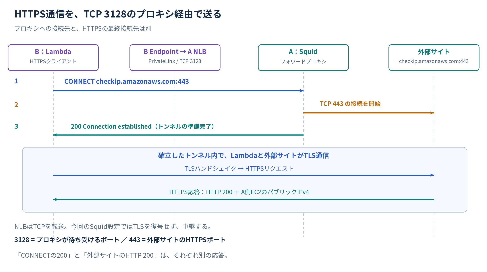
*図2：3128はプロキシへの接続ポート、443は外部サイトのHTTPSポートです。*

今回のNLBはTCPリスナーで、SquidにもTLSを復号する設定は入れていません。HTTPSの内容はLambdaと外部サイトの間のTLS通信に載ります。

参考：[Squidの `http_port` 設定](https://www.squid-cache.org/Doc/config/http_port/)

### アクセス制御

主なインバウンド設定は次のとおりです。

| 対象 | 許可する送信元 | 許可する通信 |
| --- | --- | --- |
| BのLambda SG | インバウンドルールなし | Lambdaから通信を開始する |
| BのEndpoint SG | BのLambda SG | TCP 3128 |
| AのNLB SG | Bの `10.241.1.0/24`、`10.241.2.0/24` | TCP 3128 |
| AのSquid EC2 SG | AのNLB SG | TCP 3128 |

NLBの `EnforceSecurityGroupInboundRulesOnPrivateLinkTraffic` は **`on`** にしています。この場合、NLBのインバウンド判定で見る送信元は、Endpoint ENIのIPではなく**クライアントのプライベートIP**です。そのため、今回のNLB SGではLambdaが接続するB側サブネットのCIDRを許可しています。

NLBのアウトバウンドは、Aの2サブネットへのTCP 3128を許可しています。ヘルスチェックもこのルールの対象なので、実トラフィックの転送と合わせて通す必要があります。

Squidの接続先制御に使った設定の中心部分は次のとおりです。

```conf
http_port 3128
acl SSL_ports port 443
acl CONNECT method CONNECT
acl allowed_sites dstdomain checkip.amazonaws.com

http_access deny !CONNECT
http_access deny CONNECT !SSL_ports
http_access allow allowed_sites
http_access deny all
```

この設定では、CONNECT以外の要求、443以外へのCONNECT、許可ドメイン以外への接続を拒否します。**今回の検証では `checkip.amazonaws.com` だけを許可しています。** 通常のHTTPサイトへのアクセスや、任意の外部サービスへの接続は許可していません。

なお、EC2 SGのアウトバウンドはテンプレート上では全許可です。Lambda SGとEndpoint SGも、明示的なアウトバウンド制限を追加していません。「SGで外部の特定ドメインだけを許可した」構成ではなく、プロキシのドメイン制御はSquidで行っています。

:::details 実際のNLB・SquidのSGルール

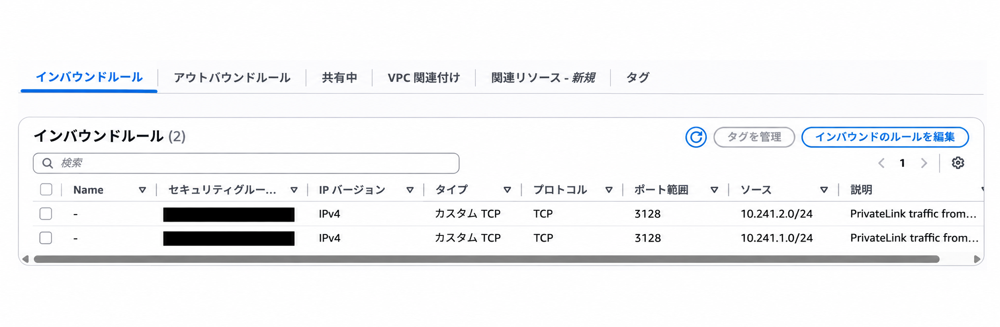
*NLBは、Bの `10.241.1.0/24` と `10.241.2.0/24` からのTCP 3128を許可しています。*

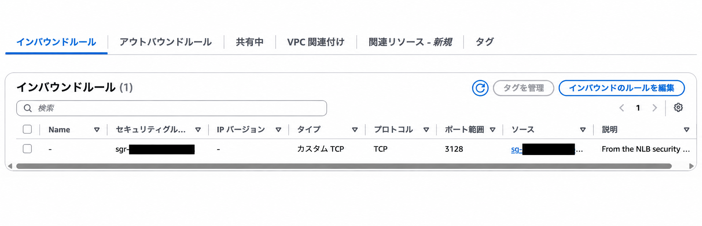
*Squid EC2の許可元には、NLBのセキュリティグループを指定しています。*

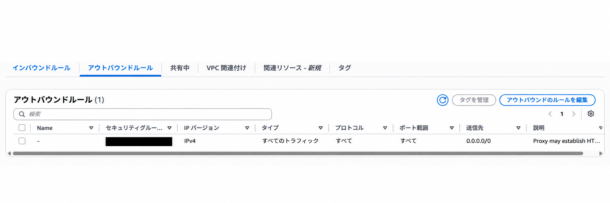
*EC2 SGのアウトバウンドは全許可です。今回の外部ドメインの制限はSquidの設定で行います。*

:::

参考：[NLBのセキュリティグループ](https://docs.aws.amazon.com/elasticloadbalancing/latest/network/load-balancer-security-groups.html)

## 作業手順

検証の作業手順について説明します。A側でプロキシを提供する環境を作り、B側にEndpointとLambdaを設定した後、A側で接続要求を承認します。

### 検証用コード

検証に使用したCloudFormationテンプレートは、以下の公開リポジトリにまとめています。

https://github.com/kkoch5t2/aws-privatelink-proxy

`01-provider-a.yaml` がA側のプロキシ提供環境、`02-consumer-b.yaml` がB側のEndpoint・Lambdaの構築用です。

公開版は、最初から2AZ構成を作成する**新規スタック用**のテンプレートです。初回検証時から一部のパラメーター名・出力名を整理しているため、実行時の指定はリポジトリのREADMEを参照してください。

### リージョンとAZの確認

A・Bともに、シドニーリージョンを使います。最終構成で指定したAZ IDは次の2つです。

| 用途 | AZ ID | Aのサブネット | Bのサブネット |
| --- | --- | --- | --- |
| 1つ目のAZ | `apse2-az1` | `10.240.1.0/24` | `10.241.1.0/24` |
| 2つ目のAZ | `apse2-az2` | `10.240.2.0/24` | `10.241.2.0/24` |

設定中には `ap-southeast-2a`、`ap-southeast-2c` というAZ名も確認しました。ただし、AZ名と物理的なAZの対応はアカウントによって異なる場合があります。別アカウント間で同じAZを指定したいときは、**末尾のa・b・cではなく、AZ IDで照合する**のが確実です。

CloudFormationでは、各サブネットの `AvailabilityZoneId` にAZ IDを指定しました。

```yaml
AvailabilityZoneId: !Ref ProviderAzId
```

コンソールでは、VPCの「サブネット」から対象を選び、詳細に表示されるAZ名とAZ IDを確認できます。必要なら、各アカウントで次の読み取りコマンドを実行して対応関係を確認できます。

```bash
aws ec2 describe-availability-zones \
  --region ap-southeast-2 \
  --query 'AvailabilityZones[].{AZName:ZoneName,AZId:ZoneId}' \
  --output table
```

参考：[アカウントをまたぐAZ IDの確認](https://docs.aws.amazon.com/ram/latest/userguide/working-with-az-ids.html)

### A側のプロキシ環境の構築

検証では、A側を `pl-proxy-provider-lab`、B側を `pl-proxy-consumer-lab` というCloudFormationスタックで管理しました。最初は各アカウントで1つのサブネットを使って作成し、追加検証では同じスタックを更新して、別のAZのサブネットと必要なリソースを追加しました。

A側のパラメーターは次のとおりです。テンプレートは固定名のIAMロールを作成するため、CloudFormationでは名前付きIAMリソースの作成を確認する項目（`CAPABILITY_NAMED_IAM`）も確認します。

| パラメーター | 指定する内容 |
| --- | --- |
| `ConsumerAccountId` | 接続を許可するBのAWSアカウントID |
| `ProviderAzId` | `apse2-az1` |
| `ProviderAzId2` | 追加検証で指定した `apse2-az2` |
| `AmiId` | Amazon Linux 2023のAMIを参照するSSMパラメーター |

AMIには `/aws/service/ami-amazon-linux-latest/al2023-ami-kernel-default-x86_64` を参照しています。Squidのインストールと設定はEC2のUser Dataで実行し、`squid -k parse` で設定を確認してからサービスを有効化・起動します。

ここで、CloudFormationの完了表示とSquidの起動完了は分けて確認します。今回のテンプレートには、Squidの起動成功をCloudFormationへ通知して待機させる仕組みを入れていません。スタックが完了しても、EC2内ではインストールが続いている可能性があります。

EC2コンソールの「ターゲットグループ」で、Squidを登録したターゲットが `healthy` になることを確認します。EC2の追加後は2台とも確認します。

### A側のサービス公開設定

Endpoint Serviceには、Squidの前段に置いた内部NLBを関連付けます。サービスへの接続を許可するプリンシパルには、BのAWSアカウントを指定します。

```text
arn:aws:iam::<BのAWSアカウントID>:root
```

この `:root` は、Bのルートユーザーで接続操作を行う指示ではありません。AWSアカウントを許可対象として表すARNです。BでEndpointを作成する操作主体には、別途必要なIAM権限が必要です。

また、次のように接続承認を必須にしています。

```yaml
AcceptanceRequired: true
```

**「Bを許可プリンシパルに追加すること」と「Bから来た接続要求を承認すること」は、別の設定です。** 前者だけで、手動承認を必要とする接続が自動承認されるわけではありません。

A側スタックの出力にある `ServiceName` を、B側に渡します。形式は次のとおりです。

```text
com.amazonaws.vpce.ap-southeast-2.vpce-svc-<サービスID>
```

### B側の利用環境の構築と接続承認

B側では、Aの `ServiceName` を指定してInterface VPC Endpointを作成します。サブネットは、Aのサービスが提供するAZ IDに対応するものを選びます。

今回の構成では `PrivateDnsEnabled: false` とし、Endpointに割り当てられたリージョナルDNS名を使います。これは選択したAZのEndpoint ENIへの接続に使う名前です。

承認が必須のサービスなので、Bから接続要求を作成した後、A側へ戻って操作します。

1. AのVPCコンソールで「エンドポイントサービス」を開く。
2. 対象のサービスを選び、「エンドポイント接続」を確認する。
3. Bのアカウント・Endpoint IDを確認し、その接続要求を承諾する。
4. B側でEndpointの状態が `Available` になることを確認する。

初回作成中、B側のCloudFormationが承認待ちになることがあります。Bのスタック完了だけを待ち続けず、A側の接続要求も確認するのがポイントです。

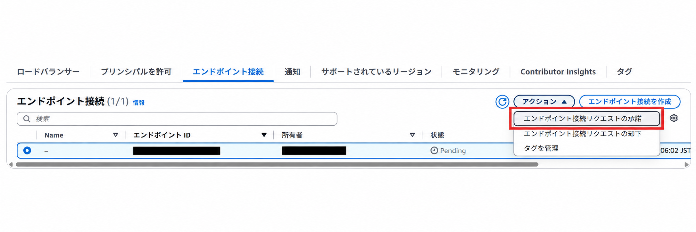
*接続要求を選び、「アクション」から「エンドポイント接続リクエストの承諾」を選択します。この画像は操作位置を示すもので、一覧の状態はまだ `Pending` です。承諾後は、B側でEndpointの利用可能状態を確認します。*

Lambdaには、Bの対象サブネットとLambda SGを指定します。環境変数は次の2つです。

| 環境変数 | 値 |
| --- | --- |
| `PROXY_HOST` | BのInterface EndpointのリージョナルDNS名 |
| `PROXY_PORT` | `3128` |

ここまでで、アプリケーションがPrivateLink経由のプロキシを利用するための接続口がそろいます。

参考：[Endpoint Serviceの権限と接続要求の承認](https://docs.aws.amazon.com/vpc/latest/privatelink/configure-endpoint-service.html)

### 補足：サブネット追加の検証

最初の疎通確認後、耐障害性を考えて、各アカウントで使うサブネットを1つから2つに増やして追加検証しました。

AWSは、ロードバランサーで複数のAZを有効にすることを推奨しています。今回使うNLBは1つのAZでも作成できますが、複数のAZを選び、それぞれにターゲットを配置することで、アプリケーションの耐障害性を高められます。

このため、今回は**異なるAZにサブネットを1つずつ用意し、NLBとSquid EC2を両方のAZに配置する構成**にしました。B側も、それぞれのAZのサブネットをEndpointとLambdaに設定しています。同じAZにサブネットを2つ作るだけでは、AZ障害に備えた分散にはなりません。

参考：[ロードバランサーでの複数AZの利用](https://docs.aws.amazon.com/elasticloadbalancing/latest/userguide/how-elastic-load-balancing-works.html#availability-zones)、[NLB作成時のAZ・サブネットの選択](https://docs.aws.amazon.com/elasticloadbalancing/latest/network/create-network-load-balancer.html)

#### 追加設定

サブネットの追加だけでなく、次のリソースも設定を変更しました。

| 対象 | 追加・変更した内容 |
| --- | --- |
| Aのネットワーク | 2つ目のパブリックサブネットを作成し、既存ルートテーブルに関連付け |
| AのEC2 | 2つ目のAZにSquid EC2を1台追加 |
| AのNLB | 同じNLBに2つ目のサブネットを追加 |
| Aのターゲットグループ | 同じグループに2台目のEC2を登録 |
| AのNLB SG | Bの2つ目のCIDRからの受信と、Aの2つ目のCIDRへの送信を追加 |
| AのEndpoint Service | 新しいAZでのサービス提供を有効化 |
| Bのネットワーク | 2つ目のプライベートサブネットを追加 |
| BのEndpoint | 既存Endpointに2つ目のサブネットを追加し、ENIを追加 |
| BのLambda | 既存関数のVPC設定に2つ目のサブネットを追加 |

1台のEC2を2つのAZにまたがって配置することはできないため、Squidも2台にしています。Lambdaは1関数のVPC設定に2サブネットを指定しており、関数を2つ作っているわけではありません。

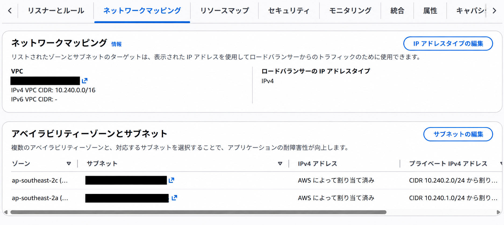
*同じNLBに、`ap-southeast-2a` と `ap-southeast-2c` のサブネットを設定しています。*

#### 発生したエラー

A側でNLBに2つ目のサブネットを設定し、EC2を追加した後、B側のEndpointへ2つ目のサブネットを追加したところ、サービスがそのサブネットのAZをサポートしていないというエラーが出ました。

```text
The VPC endpoint service ... does not support the availability zone of the subnet.
```

確認すると、AのNLBは2つのAZを使う設定になっていましたが、**Endpoint Serviceで有効なAZは1つのまま**でした。

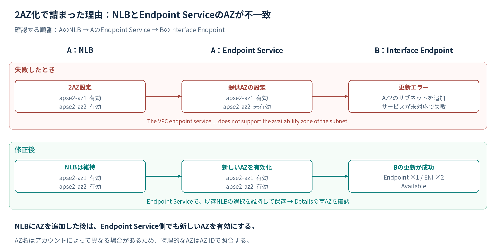
*図3：NLBのネットワークマッピングと、Endpoint Serviceが提供するAZをそれぞれ確認します。*

これはAZ名のa・cを選んだこと自体が原因ではありません。今回の失敗の直接の原因は、追加した物理AZをEndpoint Serviceがまだ提供していなかったことです。AZ IDの照合と、サービス側でのAZ有効化は別々に必要です。

AWS公式ドキュメントにも、ロードバランサーへ追加したAZはEndpoint Serviceで別途有効化が必要であり、反映可能になるまで数分かかる場合があると記載されています。

#### 解消手順

解消時の確認順序は、**AのNLB → AのEndpoint Service → BのEndpoint** です。

1. A側スタックの更新が完了し、NLBに両AZが設定されていることを確認する。
2. NLBの準備が整うまで待ち、AのVPCコンソールで対象のEndpoint Serviceを開く。
3. 「アクション」から **Associate or disassociate load balancers** を開く。
4. **既存NLBを選択したまま**保存し、新しいAZをサービス側でも有効にする。
5. Endpoint Serviceの「詳細」で、`apse2-az1` と `apse2-az2` の両方が提供対象になったことを確認する。
6. その後、B側スタックを更新し、EndpointとLambdaのVPC設定に2つ目のサブネットを追加する。

接続済みEndpointが使っているNLBの関連付けを、いったん解除して作り直す必要はありません。今回も既存のNLB・Endpoint Service・Endpointを維持して更新しました。

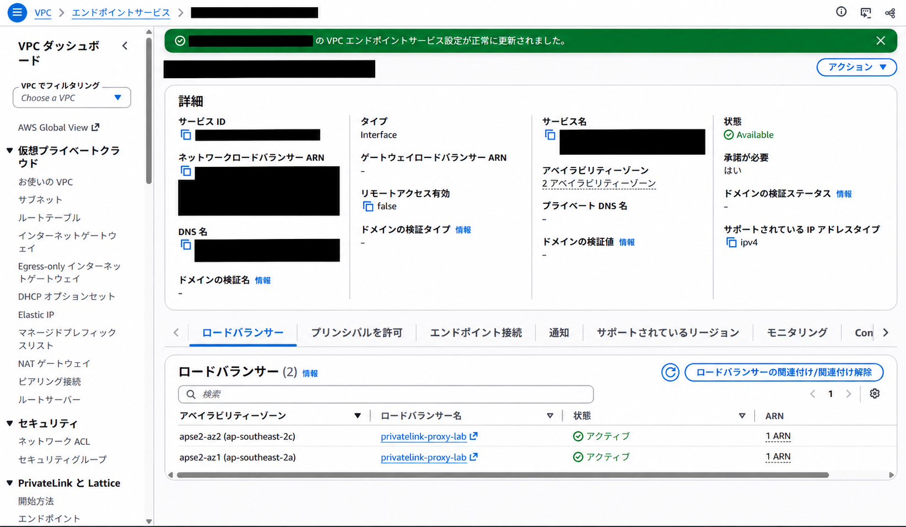
*「詳細」のアベイラビリティーゾーンが2つになり、下部でも `apse2-az1` と `apse2-az2` を確認できます。NLBだけでなく、Endpoint Service側の表示まで確認します。*

CloudFormationの変更内容では、既存VPC・NLB・Endpoint Service・Endpoint・Lambdaなどが意図せず置換されないことも確認します。更新が失敗してロールバックした場合は、先に原因を解消し、スタックの状態を確認してから再度更新します。

今回、この調整後にB側の更新が `UPDATE_COMPLETE` となり、Lambdaからの外部アクセスでもHTTP 200を確認できました。

参考：[Endpoint Serviceに関連付けるロードバランサーとAZの管理](https://docs.aws.amazon.com/vpc/latest/privatelink/configure-endpoint-service.html#manage-load-balancers)

## テスト

リソースの構築後に、B側のLambdaから外部サイトへアクセスするテストを行いました。接続の成功と、外部から見える送信元IPがA側EC2のIPになっていることを確認します。

### リソースの状態確認

Lambdaを実行する前に、経路の途中にあるリソースの状態を確認します。

| 確認箇所 | 確認する状態 |
| --- | --- |
| AのNLB | 2つのAZ・サブネットが設定されている |
| Aのターゲットグループ | Squid EC2が2台登録され、両方 `healthy` |
| AのEndpoint Service | 2つのAZで提供され、Bの接続が承認済み |
| BのInterface Endpoint | `Available` で、2つのAZのサブネット・ENIがある |
| BのLambda | VPC設定に2つのサブネットとLambda SGがある |
| Bのプロキシ設定 | EndpointのDNS名とTCP 3128を指定している |

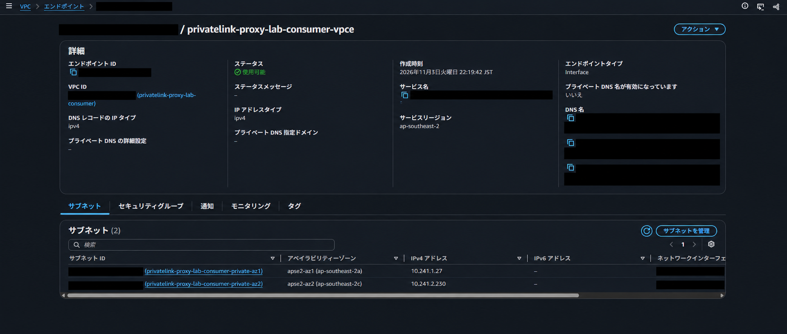
*B側ではEndpointが「使用可能」となり、2つのサブネットにそれぞれプライベートIPv4が割り当てられていることを確認します。*

### 疎通確認

Lambdaのコードでは、Python標準ライブラリの `urllib.request` を使いました。処理の中心は次のとおりです。

```python
import os
import urllib.request

def handler(event, context):
    url = "https://checkip.amazonaws.com/"
    proxy = "http://{}:{}".format(
        os.environ["PROXY_HOST"],
        os.environ["PROXY_PORT"],
    )
    opener = urllib.request.build_opener(
        urllib.request.ProxyHandler({"http": proxy, "https": proxy})
    )
    request = urllib.request.Request(
        url,
        headers={"User-Agent": "aws-privatelink-proxy-lab/1.0"},
    )
    try:
        with opener.open(request, timeout=12) as response:
            return {
                "success": True,
                "http_status": response.status,
                "external_egress_ip": response.read(256).decode().strip(),
                "destination": url,
                "proxy_hostname": os.environ["PROXY_HOST"],
            }
    except Exception as exc:
        return {
            "success": False,
            "error_type": type(exc).__name__,
            "error": str(exc),
            "proxy_hostname": os.environ["PROXY_HOST"],
        }
```

アクセス先は `https://` ですが、プロキシの指定は `http://<EndpointのDNS名>:3128` です。これはCONNECTを送るプロキシへの接続方法を表しています。外部サイトとのTLSを無効にする指定ではありません。

Lambdaコンソールでテストイベント `{}` を実行し、返却値を確認します。今回の実行結果は次のとおりです。パブリックIPとEndpointのDNS名は伏せています。

```json
{
  "success": true,
  "http_status": 200,
  "external_egress_ip": "<A側の2台目のEC2のパブリックIPv4>",
  "destination": "https://checkip.amazonaws.com/",
  "proxy_hostname": "<BのInterface EndpointのDNS名>"
}
```

`external_egress_ip` が、A側スタックの出力 `ProxyPublicIp` または `ProxyPublicIpAz2` のどちらかに一致することを確認します。HTTP 200だけでなく、**期待した出口のIPで通信しているか**まで見るのがポイントです。

今回の返却値は、A側の **`ProxyPublicIpAz2` に一致**しました。

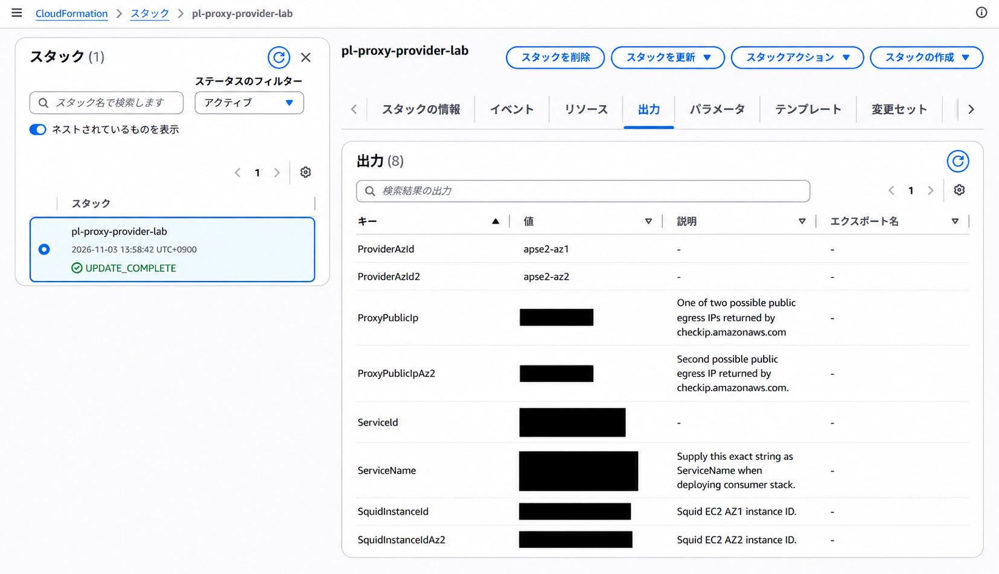
*AのCloudFormation出力とLambdaの返却値を照合します。画像内ではパブリックIPやリソースIDを伏せています。*

なお、このコードは例外を捕捉して `success: false` を返します。そのため、Lambdaコンソール上で関数実行が成功扱いでも、外部サイトへの接続が成功したとは限りません。返却したJSONの `success` と `http_status` を確認します。

### テスト結果と未検証の項目

今回の検証では、LambdaからのアクセスでHTTP 200が返り、外部から見える送信元IPがA側EC2のパブリックIPv4になることを確認できました。

一方、これだけで2AZのすべての経路を個別に検証したことにはなりません。リージョナルDNS名を使った実行で、毎回交互に異なるAZやIPが選ばれる保証はありません。**両AZの個別疎通、AZ障害時の切り替え、接続の再試行、EC2の自動復旧は別の検証項目**です。

また、今回のヘルスチェックはTCP 3128への接続確認です。Squidが接続を受け付けていても、外部DNSの解決や検証先へのHTTPS接続が失敗することはあります。NLBの `healthy` と、Lambdaからの実際の外部疎通を両方確認します。

参考：[NLBのヘルスチェック](https://docs.aws.amazon.com/elasticloadbalancing/latest/network/target-group-health-checks.html)

## 補足・注意点

今回の作業を進める中で、注意したほうがよいと感じたポイントをまとめます。プロキシへの不要な外部接続を防ぐ設定、出口IPの固定、サブネットの見分け方、障害への備え、検証後の片付けについて整理します。

### プロキシの外部公開防止

プロキシをインターネット上の誰でも利用できる状態にすると、第三者の通信を中継する「オープンプロキシ」になる危険があります。**今回許可したいのは、BのLambdaからPrivateLink経由で届く接続だけです。** NLB・EC2・Endpoint Serviceの設定を組み合わせて、利用できる経路を制限します。

特に、今回のSquid EC2には外向き通信のためにパブリックIPv4を割り当てています。**NLBを内部向けにしていても、EC2のパブリックIPへの直接接続まで防げるわけではありません。** EC2側のSGも必ず確認します。

| 確認箇所 | 今回維持する設定・注意点 |
| --- | --- |
| AのNLB | `Scheme: internal` を使い、インターネット向けのNLBに変更しない |
| AのSquid EC2 SG | TCP 3128の許可元をNLB SGに限定する。`0.0.0.0/0` を許可元にした3128番や全ポートのインバウンドルールを追加しない。IPv6を導入する場合も `::/0` に開放しない |
| AのNLB SG | Bの必要なサブネットからのTCP 3128だけを許可し、PrivateLink通信へのインバウンドルール適用を `on` にする |
| AのEndpoint Service | 許可プリンシパルをBなど必要なアカウントに絞り、接続承認を必須にする。不特定のアカウントを示す `*` と自動承認の組み合わせは避ける |
| BのEndpoint SG | TCP 3128の許可元をLambda SGに限定し、同じVPC内の不要なクライアントにも開放しない |

EC2にSGを複数関連付ける場合は、**すべてのSGの許可ルールが合算されます。** 1つを制限していても、別のSGが3128番を広く許可していないか確認します。疎通エラーの切り分けでも、一時的な全開放を残さないようにします。

また、EC2 SGのアウトバウンドにある `0.0.0.0/0` は、EC2から接続を開始できる宛先の設定です。これだけで外部からの新規接続を許可するわけではありません。SGはステートフルなので、Squidが開始した外部HTTPS通信への応答を受け取るために、3128番のインバウンドを全開放する必要もありません。

Squidでは、許可する接続先とポートを絞り、最後の `http_access deny all` を維持します。`http_access allow all` などの広い許可ルールを追加すると、後ろの拒否ルールでは防げない場合があります。今回の `allowed_sites` は**接続先の制限**であり、利用者を認証する設定ではありません。接続元の制限は、前述のSGとEndpoint Serviceの設定で行っています。

設定後は、BのLambdaからの正常な疎通に加え、管理下のインターネット側端末から各EC2のパブリックIPのTCP 3128へ接続できないこと、Bから許可外ドメインへのCONNECTが拒否されることも確認すると安心です。これらは今回のHTTP 200確認とは別の追加確認項目で、この記事の検証結果には含めていません。

参考：[NLB経由の通信だけをターゲットで許可する設定](https://docs.aws.amazon.com/elasticloadbalancing/latest/network/load-balancer-security-groups.html#target-security-groups)、[SGのルールとステートフルな動作](https://docs.aws.amazon.com/vpc/latest/userguide/vpc-security-groups.html)、[Endpoint Serviceの接続権限と承認](https://docs.aws.amazon.com/vpc/latest/privatelink/configure-endpoint-service.html)、[Squidのアクセス制御](https://www.squid-cache.org/Doc/config/http_access/)

### 送信元IPの固定

今回のEC2のパブリックIPv4は、自動割当のIPです。**Elastic IPは設定していません。** EC2の停止・起動などで変わり得るため、そのまま長期運用の接続元IP許可リストに登録する設計には向きません。

接続先が送信元IPによる制限を要求する場合は、出口のIPを安定させる設計が必要です。今回の構成を拡張するなら、各Squid EC2にElastic IPを関連付ける方法が考えられます。2AZで2台を使うなら、接続先では**両方の出口IPを許可**します。

| 構成 | 外部から見える送信元IP | 接続元IP制限への対応 |
| --- | --- | --- |
| 今回の検証 | 2台のEC2に自動割当されたIPのいずれか | IPが変わる可能性がある |
| EC2ごとにElastic IPを関連付ける案 | 各EC2のElastic IPのいずれか | 両方を接続先の許可リストへ登録する |
| 別途NATを使う設計 | NATを含む実際の出口構成による | 出口の冗長性と許可対象IPを設計する |

固定したいのは、外部サイトへ接続を開始する**出口のパブリックIP**です。今回の内部NLBに外部接続用のElastic IPを付ける、という話ではありません。

接続元IPの制限が必要かどうかは、接続先の要件によって決まります。採用する方式は、接続先の認証・ネットワーク要件に合わせます。

参考：[Elastic IPの性質と料金](https://docs.aws.amazon.com/AWSEC2/latest/UserGuide/elastic-ip-addresses-eip.html)

### サブネットの確認方法

サブネット名に `public` や `private` と書いてあるだけで判断せず、関連付けられたルートテーブルを確認します。今回のIPv4構成なら、次の順で見ると分かりやすいです。

1. VPCコンソールの「サブネット」で対象を選ぶ。
2. 下部の「ルートテーブル」タブを開く。
3. 関連付けられているルートテーブルと、`0.0.0.0/0` などの外向きルートを確認する。
4. ターゲットがInternet Gatewayなのか、NAT Gatewayなのか、外向きルート自体がないのかを確認する。

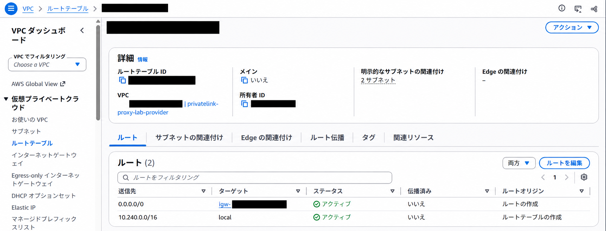
*A側では、`0.0.0.0/0` のターゲットが `igw-...`、VPC内の `10.240.0.0/16` が `local` です。上部には、2つのサブネットとの明示的な関連付けも表示されています。*

| 代表的なIPv4ルート | サブネットの性質 | インターネットへの外向き通信 | インターネットからの新規接続 |
| --- | --- | --- | --- |
| `0.0.0.0/0 → igw-...` | パブリック | EC2ではパブリックIPv4などと許可設定があれば可能 | 対象のパブリックIP、SG・NACL、待ち受け設定などが必要 |
| `0.0.0.0/0 → nat-...` | プライベート | 公開NAT Gatewayとその先のIGWなどの経路が整っていれば可能 | そのNAT経由での外部からの新規接続は不可 |
| 外向きデフォルトルートなし | そのルートではインターネットへ直接出ない | 別の経路やプロキシを用意しなければ不可 | そのルートによる直接接続は不可 |

**プライベートサブネットからも、公開NAT Gatewayを経由する経路が整っていれば、外向きのインターネット通信は可能です。** パブリックサブネットのリソースへの外部からの接続にも、対象のパブリックIPやSG・NACLなどの条件が必要です。

また、`nat-...` という表示だけで、その先がインターネットまでつながっているとは断定できません。NAT Gatewayには公開・プライベートの種別があるため、種別と、その先のルートも確認します。特定の宛先だけにルートを設定する構成もあるので、デフォルトルートの有無だけですべてを判断しないことも大切です。

今回のBにはIGW・NATへのデフォルトルートがありませんが、EndpointのプライベートIPへ到達し、Aのプロキシを利用することで外部HTTPS接続を行っています。

なお、VPCに接続したLambdaは、パブリックサブネットを指定するだけではインターネットへ接続できません。EC2のパブリックIPv4自動割当と同じ感覚では扱わないようにします。

参考：[Internet Gatewayとサブネットのルート](https://docs.aws.amazon.com/vpc/latest/userguide/VPC_Internet_Gateway.html)、[NAT Gatewayの公開・プライベート種別](https://docs.aws.amazon.com/vpc/latest/userguide/vpc-nat-gateway.html)、[VPC接続Lambdaのインターネットアクセス](https://docs.aws.amazon.com/lambda/latest/dg/configuration-vpc-internet.html)

### 可用性と自動復旧

今回は、各AZにSquid EC2を1台ずつ置きましたが、Auto Scaling Groupは使っていません。EC2が失われたとき、自動で代替インスタンスが作られる構成ではありません。

継続運用するなら、少なくとも、プロキシの実疎通監視、EC2障害時の復旧、OS・Squidの更新、許可ドメインの管理、クライアントの再試行、ログの保持期間を検討する必要があります。ログには接続先などが記録されるため、閲覧権限や保存期間も運用に合わせます。

今回の追加検証は、複数AZに必要なリソースを配置して使えるようにするところまでです。障害が起きても要求が途切れないことまで保証する検証ではありません。

### リソースの削除

EC2を止めるだけでは、検証環境全体の課金は止まりません。NLB、Interface EndpointのAZごとの利用、EBS、パブリックIPv4、データ処理・転送、ログなどを確認します。Elastic IPを後から追加した場合は、その解放も確認が必要です。

今回の構成には、自動削除の仕組みを有効化していません。検証が不要になったら、利用側から順に片付けます。

1. B側の `pl-proxy-consumer-lab` スタックを削除する。
2. BのEndpointやLambdaのVPC接続に伴うENIなどの削除が完了したことを確認する。
3. A側の `pl-proxy-provider-lab` スタックを削除する。
4. EC2・EBS・NLB・Endpointなどに、削除失敗や残存がないことを確認する。

Bの接続を先に削除することで、Aのサービスを使う側から依存関係を解消できます。削除時に `DELETE_FAILED` などが出た場合も、完了表示と実際に残っているリソースを確認します。
