> **2026年11月13日（日本時間）時点**のAWS公式ドキュメントと、AWS上での検証に基づく備忘録です。仕様は変わる可能性があります。

最近、仕事でAmazon Bedrockを設定することになりました。そこでまず気になったのが、個人情報の扱いです。社内のルールで、入力された個人情報がシステムに保存されると、セキュリティ審査が厳しくなります。最初から保存しない形にできないかと考えました。

調べてみると、Bedrockには「Bedrock Guardrails」という機能があると知りました。これで個人情報をマスクすれば、保存も防げるのでは？と思ったのですが、そう単純ではありませんでした。モデルに渡す入力はマスクできても、**モデル呼び出しログには元の入力が残り得ます**。

この記事では、Bedrock Guardrailsで隠せる範囲と、Bedrockのログに個人情報を残さないための設定をまとめます。今回は架空の氏名・メールアドレスを使い、**入力のマスクとブロック、CloudWatch Logs・S3への記録、ログ表示時のマスクまで実際に確認しました**。

## まず結論

| データの流れ | Bedrock Guardrailsを有効にすると？ |
| --- | --- |
| ユーザー → モデル | 入力中の個人情報をマスクできる |
| モデル → ユーザー | 回答中の個人情報をマスクできる |
| ユーザー → Bedrockの呼び出しログ | テキストの記録を有効にすると、指定したCloudWatch LogsのロググループかS3バケットに**入力の原文**が記録される |

つまり、**Bedrock Guardrailsでモデルへの入力をマスクしても、記録対象にしたテキストのログまでマスクされるわけではありません**。テキスト本文を記録したくない場合は、モデル呼び出しログ全体を止めるほかに、**「テキスト」だけをオフにする方法もあります**。なお、個人情報の検出に漏れがないという保証もありません。[^sensitive]

:::details 今回の検証条件
| 項目 | 条件 |
| --- | --- |
| 検証日 | 2026年11月13日 |
| リージョン | シドニー（ap-southeast-2） |
| モデル | Amazon Nova Micro（amazon.nova-micro-v1:0）。テキスト記録の切替はNova Lite（amazon.nova-lite-v1:0）でも追加検証 |
| 対象の機密情報 | 組み込みPIIのNAME・EMAIL |
| API | ApplyGuardrail、Converse |
| ログ保存先 | 専用のCloudWatch LogsロググループとS3バケット |
| ログのデータ保護 | 検証用ロググループにEmailAddressのポリシーを適用 |
| テキストの記録 | マスク・ブロック検証時はオン。オフにした場合もS3への追加検証で確認 |

氏名・メールアドレスはすべて架空の値です。キャプチャーは同じ設定で再実行して撮影し、アカウント情報が写らない範囲を掲載しています。検証後はモデル呼び出しログの設定を元に戻し、作成したリソースを削除しました。
:::

## データはどこを通るのか

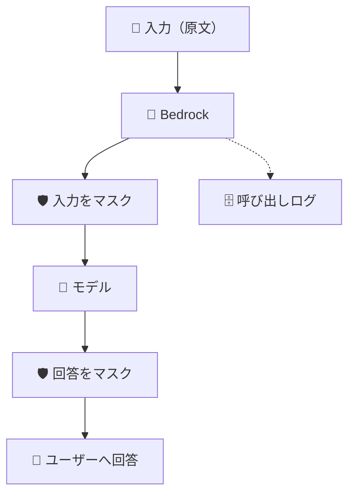

点線は、Bedrockの「モデル呼び出しログ記録」を有効にした場合だけ発生します。この設定は初期状態では無効です。以下の原文が残る例では、ログに含めるデータ種類の「テキスト」も有効にしています。[^logging]

### Bedrockのログはどこに保存される？

**モデル呼び出し**とは、アプリやプレイグラウンドからAIモデルにリクエストを送り、回答を受け取る処理です。その入力・回答や、呼び出した日時などを記録するのが「モデル呼び出しのログ記録」です。

設定場所は、Amazon Bedrockコンソールの左側にある**「設定および学習」→「設定」**です。下の赤枠を見てください。左側のメニューが閉じている場合は、画面左上のメニューボタンから開きます。

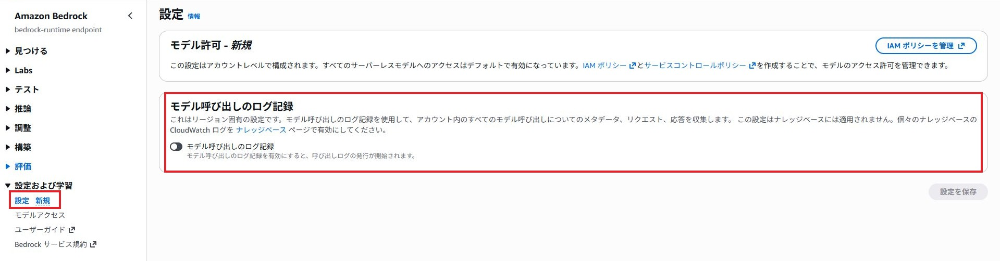
*左の「設定」を開くと、右側に「モデル呼び出しのログ記録」があります。この画像ではログ全体のスイッチがオフなので、テキストなどの選択項目はまだ表示されていません。見やすくするため、ほかのメニューは折りたたんでいます。*

設定するときの流れは次のとおりです。**リージョンごとの設定**なので、検証に使うモデルと同じリージョンのコンソールを開きます。[^logging]

1. 「モデル呼び出しのログ記録」のスイッチをオンにする。
2. 表示された「ログに含めるデータタイプを選択」で、本文を保存するかどうかに応じて「テキスト」のチェックを切り替える。オンの画面は後の「②」、オフの画面は次の小見出しに載せています。
3. 「ログ記録先を選択」で保存先を選び、ロググループやS3バケット、書き込み権限を設定する。
4. 最後に「設定を保存」を押して適用する。

選べる保存先は次の3種類です。

- **Amazon S3のみ**：指定したバケットに圧縮JSONのログを保存。
- **CloudWatch Logsのみ**：指定したロググループ内のログイベントに保存。
- **Amazon S3とCloudWatch Logsの両方**：両方へ出力。

**保存先を選んでログを有効にする場所は、CloudWatch LogsもS3もBedrockの設定画面です。** IAMでログのオン・オフを設定するわけではありません。CloudWatch Logsへ出す場合、Bedrockがロググループへ書き込めるIAMロールを使います。今回のコンソールでは、書き込み権限を自動で付与する旨の案内と、権限設定を確認・変更する「Customize」が表示されました。S3へ出す場合は、Bedrockがバケットへ書き込めるバケットポリシーが必要です。AWS公式手順では、設定者に所定のS3権限があれば、バケットポリシーは設定時に自動で追加されると説明しています。[^logging]

例えば「CloudWatch Logsのみ」を選ぶと、下に「ロググループ名」の欄が表示されます。**ロググループは、ログをまとめて保存するCloudWatch Logsの入れ物**です。保存先にするロググループをここで指定します。

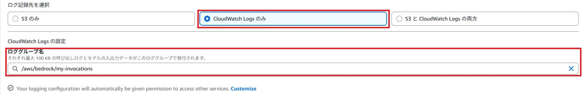
*保存先の入力欄を示す設定例です。`/aws/bedrock/my-invocations`は説明用の名前で、固定名ではありません。このキャプチャーは保存前の画面で、設定の完了を示すものではありません。*

CloudWatch Logsを選んでも、大きな本文の保存先としてS3を別途設定する構成があります。[^logging]

#### ログ全体とテキスト本文の記録は別に切り替えられる

設定画面には、「モデル呼び出しのログ記録」全体のスイッチと、「ログに含めるデータタイプ」のチェック項目があります。**テキストの入出力本文を保存したくないだけなら、ログ全体をオンにしたまま「テキスト」をオフにする方法があります**。APIでは`textDataDeliveryEnabled: false`に対応します。[^logging-config]

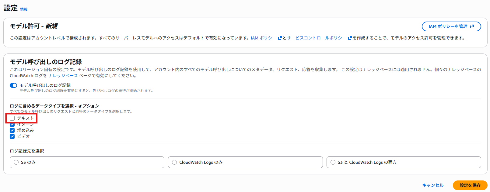
*「モデル呼び出しのログ記録」はオン、「テキスト」はオフにした設定例です。「イメージ」「埋め込み」「ビデオ」はそれぞれ別のチェック項目です。*

この違いもS3への出力で追加検証しました。「テキスト」をオフ、「イメージ」「埋め込み」「ビデオ」をオンにして、テキスト専用のNova Microと、画像を扱えるNova Liteを呼び出しています。ログ設定だけの挙動を比較するため、この追加検証ではGuardrailsを指定していません。

| 実際に試した条件 | 入出力のテキスト本文 | メタデータ |
| --- | --- | --- |
| テキストON・Nova Micro・テキスト入力 | 記録された | 記録された |
| テキストOFF・Nova Micro・テキスト入力 | 記録されなかった | 記録された |
| テキストOFF・Nova Lite・テキスト入力 | 記録されなかった | 記録された |
| テキストOFF・Nova Lite・画像＋テキスト入力 | 記録されなかった | 記録された |

テキストOFFの3件では、`inputBodyJson`・`outputBodyJson`がログになく、呼び出し日時・リクエストID・モデルID・トークン数などは残っていました。S3に配信された各オブジェクトも調べ、入力した架空のメールアドレスが含まれないことを確認しています。

つまり、**テキストOFFは、本文の記録を止めながら呼び出し情報を残すために使えます**。画像・動画・埋め込みなども保存したくない場合は、それぞれのデータ種類も確認します。メタデータを含めてモデル呼び出しログ全体が不要なら、全体のスイッチをオフにします。

### ① モデルへの入力と回答はマスクできる

**入力側：ユーザー → モデル**

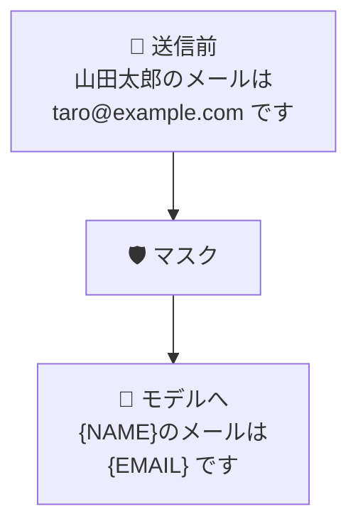

**出力側：モデル → ユーザー**

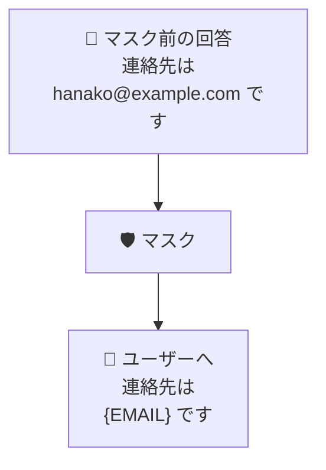

例えば「山田太郎のメールはtaro@example.comです」と入力したとします。対象の個人情報を検出し、入力側のマスクを設定していれば、モデルには氏名やメールアドレスを`{NAME}`や`{EMAIL}`へ置き換えて渡せます。出力側にも設定すれば、回答中の個人情報もマスクできます。`BLOCK`を選べば、内容をブロックすることもできます。[^sensitive]

#### 実際に日本語の氏名・メールアドレスをマスクしてみる

Bedrockコンソールで「Use ApplyGuardrail API」を有効にし、評価対象に「Input」を選択して、次の架空情報を送りました。この操作ではモデルを呼び出さず、ガードレール単体の変換結果を確認できます。

> 以下は検証用の架空情報です。顧客の氏名は山田太郎で、連絡用メールアドレスは taro@example.com です。

結果は、氏名が`{NAME}`、メールアドレスが`{EMAIL}`に置き換わりました。同じ文章を「Output」として評価した場合も、同様にマスクされました。

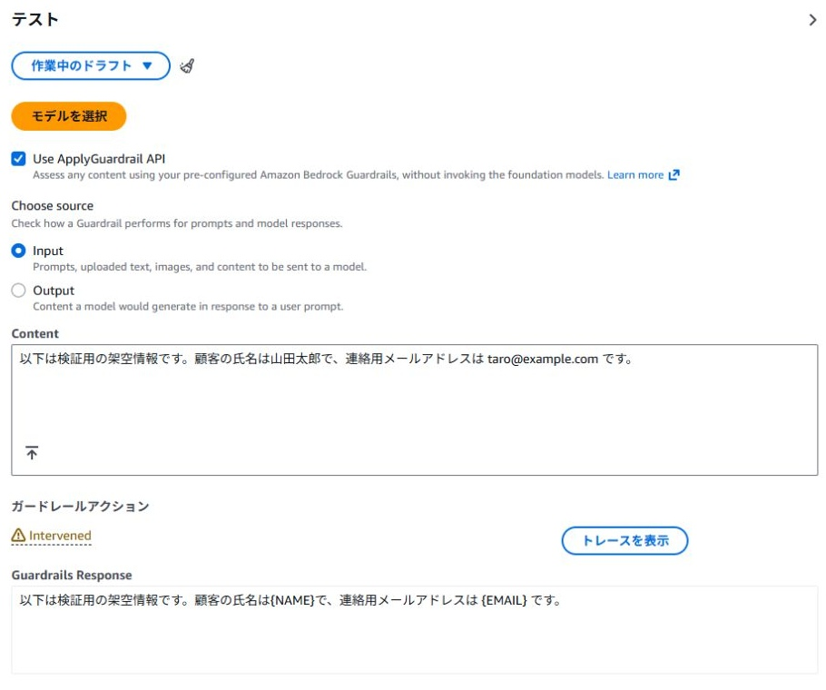
*上が入力した架空情報、下のGuardrails Responseがマスク後の文章です。*

#### 入力側の動作まで確認する

今回、PII種類の`action`だけを`ANONYMIZE`にし、`inputEnabled`・`outputEnabled`を有効にした条件では、入力中の氏名・メールアドレスは検出されたものの、入力評価の`action`は`NONE`でした。出力側ではマスクされていたため、**回答が隠れているだけでは、モデルに渡す前の入力もマスクされたとは判断できません**。

そこで、入力・出力それぞれの動作を明示しました。EMAILの設定例は次のとおりです。NAMEにも同じ動作を設定しています。[^actions]

```json
{
  "type": "EMAIL",
  "action": "ANONYMIZE",
  "inputAction": "ANONYMIZE",
  "outputAction": "ANONYMIZE",
  "inputEnabled": true,
  "outputEnabled": true
}
```

この設定では、ApplyGuardrailのInput・Output両方で置換され、Converseでも入力評価の`action`が`ANONYMIZED`になることを確認できました。これは今回のリージョン・DRAFT・設定の組み合わせでの結果です。入力のマスクを目的にする場合は、**入力側の動作を指定し、トレースの入力評価まで確認する**ようにします。

ただし、**元の入力はBedrock Guardrails（AWSサーバー）には届きます**。「AWSへ送る前に個人情報を消したい」場合は、送信する側で先にマスクします。

検出は確実ではありません。日本固有の番号や社内番号などは、対応するPII種類を確認し、必要ならカスタム正規表現や送信前のチェックを追加します。[^sensitive]

> **補足：Bedrockのモデルはどこで動く？**  
> Bedrockでは、Amazon NovaなどのAWS製モデルと、Claudeなど外部企業が開発したモデルを利用できます。外部モデルも提供会社のAPIへ入力を転送するのではなく、AWSが所有・運用する専用環境に配置されます。そのため、モデル提供会社はBedrockの入力や回答にアクセスできません。第三者モデルの一部はAWS Marketplace経由で課金されます。契約や料金の仕組みはモデルによって異なります。[^deployment][^billing]

### ② テキストの記録が有効なら呼び出しログに原文が残る

ここでいう**「テキストの記録が有効」**とは、先ほどのBedrockの「設定」画面で、**「モデル呼び出しのログ記録」がオン、かつ「ログに含めるデータタイプを選択」の「テキスト」にチェックが入った設定を保存している状態**です。「テキスト」は、モデルに送る文章と、モデルが返す文章をログに含めるための項目です。

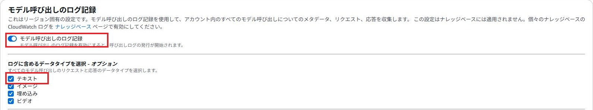
*赤枠の2か所がオンの設定例です。この状態で保存先や権限も設定し、「設定を保存」で適用すると、テキスト本文の記録が有効になります。本文の記録を止めたい場合は、全体のスイッチをオンにしたまま「テキスト」のチェックを外して保存します。*

テキストの記録を有効にした場合、Bedrock Guardrailsを適用しても、CloudWatch Logsのモデル呼び出しログの`input`には、加工前のリクエストが記録されます。[^sensitive] また、AWS公式Security Blogの[「Implementing least privilege access for Amazon Bedrock」](https://aws.amazon.com/blogs/security/implementing-least-privilege-access-for-amazon-bedrock/)でも、CloudWatch Logs・S3のログにはガードレール適用前の入力が含まれると説明されています。

#### 入力をマスクしてもログには原文が記録された

今回は、入力評価が`ANONYMIZED`になったConverseの呼び出しを、CloudWatch LogsとS3の両方で照合しました。どちらも、次のフィールドに**山田太郎・taro@example.comを含む原文**が残っていました。

```text
input.inputBodyJson.messages[0].content[0].text
```

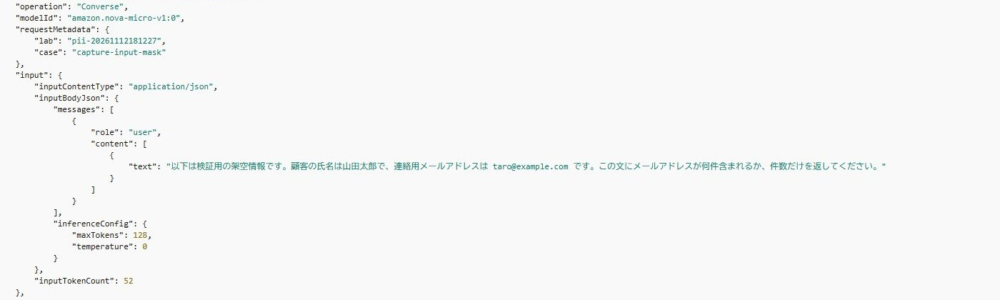
*入力側のマスクを有効にした呼び出しでも、ログのinputには置換前の氏名・メールアドレスが含まれています。画像はCloudWatch Logsの入力フィールドの抜粋です。S3のログも取得して、同じ原文を確認しました。*

入力ブロックでも、`LAB_INPUT_BLOCKED`が返り、モデルの入出力トークンがともに0になった一方、入力の原文は両保存先に記録されました。逆に、送信前にメールアドレスを`[EMAIL_REDACTED]`へ置き換えた場合は、ログにも置換後の文章が記録されました。

| 実際に試した条件 | CloudWatch Logs・S3の入力ログ |
| --- | --- |
| Bedrock Guardrailsで入力をマスク | マスク前の原文が残る |
| Bedrock Guardrailsで入力をブロック | ブロック前の原文が残る |
| Bedrockへ送る前にマスク | 送信したマスク済みの文が記録される |

#### トレースにも元の値が含まれる

マスクが成功したConverseのトレースにも、検出結果の`match`として、元のメールアドレスが含まれていました。[^sensitive]

```json
{
  "match": "taro@example.com",
  "type": "EMAIL",
  "action": "ANONYMIZED",
  "detected": true
}
```

このため、**APIレスポンスのトレースをアプリ側でそのままログに出す場合も、原文の扱いを確認する必要があります**。

モデル呼び出しログはデフォルトで無効です。ログを有効にすると、CloudWatch Logs、S3、または両方へ入力・出力などを記録できます。CloudWatch Logsを選んでも、大きな本文などの保存先としてS3を設定していれば、そのデータはS3へ送られます。[^logging]

## CloudWatch Logsにはログの個人情報を隠す機能がある

CloudWatch Logsには「データ保護ポリシー」という機能があります。Bedrockの呼び出しログを保存するロググループに設定すると、メールアドレスなどの機密情報を検出し、**通常のログ表示でマスクできます**。原文を確認するには、`logs:Unmask`権限が必要です。[^cloudwatch]

### 通常表示と原文表示を比べる

検証用ロググループにEmailAddressのデータ保護ポリシーを設定し、反映を確認してから、`verified.mask@example.com`を含む架空情報をBedrockへ送りました。CloudWatch Logsの通常表示では、入力中のメールアドレスがアスタリスクになりました。

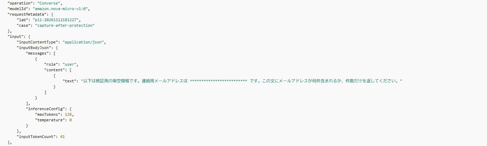
*通常表示では、入力中のメールアドレスがアスタリスクで隠れています。*

続いて、同じログを表示メニューの「保護されたデータのマスキングを一時的に解除」で確認すると、元の`verified.mask@example.com`が見えました。APIでも、`unmask=false`と`unmask=true`で同じ違いを確認しています。

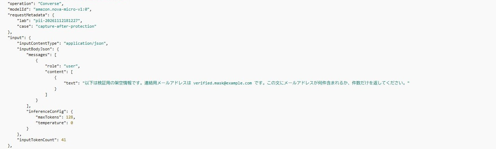
*上の画像と同じ呼び出しのログです。権限のある利用者がマスクを解除すると、元の値を確認できます。*

今回は、`logs:Unmask`権限を持つ同じ利用者で表示方法を切り替えた比較です。**権限があっても通常表示ではマスクされますが、原文を取得することは可能**でした。S3に直接保存されたログには、このCloudWatch Logsのポリシーによるマスクは適用されず、元の値が残っていました。

### 原文を保存しないための機能ではない

この結果からも、**表示時のマスクと、原文を保存しないことは区別する必要があります**。データ保護ポリシーは原文を削除する機能ではありません。設定前に取り込まれたログには遡って適用されず、S3へ直接保存したデータも対象外です。[^cloudwatch]

実際に、ポリシー設定前に取り込まれたログは、設定後も通常表示で原文が見えました。また、設定直後にはマスクされなかったログもあったため、新しく投入したテスト用ログがマスクされることを確認してから、Bedrockを再度呼び出しています。

テキストの原文を呼び出しログに残したくないなら、**ログに含めるデータ種類の「テキスト」をオフにする**か、**Bedrockへ送る前に入力をマスクする**ことを検討します。メタデータも含めてモデル呼び出しログを残す必要がなければ、ログ全体を無効にする選択肢もあります。

## 「学習に使われない」ならBedrock Guardrailsは不要？

AWSのAmazon Bedrock紹介ページは、Bedrockがデータをモデル学習に使用しないと説明しています。文言は次のとおりです。[^faq]

> 「Bedrock は、モデルのトレーニングを行うためにデータを保存または使用することはなく」

それでもBedrock Guardrailsには意味があります。**「学習に使わない」と「回答やログから漏れない」は別**だからです。具体的には、次のような情報漏洩を防ぐのに役立ちます。

- 顧客との会話を要約する前に、不要な氏名やメールアドレスを入力側でマスクする。
  - **理由：** モデルにはマスク後の文章が渡るため、回答に同じ氏名やメールアドレスが再び出てくる可能性を下げられます。
- モデルの回答に個人情報が含まれていたら、出力側でマスクする。
  - **理由：** ユーザーの画面に表示される前に隠せるため、そのままメールへ転記したり、ファイルに保存してGitへ上げたりする事故を防ぎやすくなります。
- AWSアクセスキーなどを誤って入力したらブロックする。
  - **理由：** モデルへ渡る前に処理を止められます。ただし、モデル呼び出しログを有効にしている場合は、ログに入力の原文が残り得ます。

ただし、ツール呼び出しの引数やツールの結果は、このフィルターの対象外です。AIにファイルを書かせてGitへ上げる運用なら、コミット内容の検査も必要です。[^sensitive]

また、**「呼び出しログが無効＝AWS側にも一切保持されない」ではありません**。AWS側の推論データ保持は別の設定とモデルごとの条件で決まります。公式文書には、次の注意書きがあります。[^retention]

> 「`store=false`を設定しても、データ保持がゼロであるとは限りません。」

「`store=false`でもゼロ保持は保証されない」という意味です。保存を禁止する要件がある場合は、対象モデルの保持設定も確認します。[^retention]

## 何を設定すればいい？

目的ごとに対策を選びます。

| 目的 | 対策 |
| --- | --- |
| モデルに個人情報を渡したくない | 入力側のBedrock Guardrailsでマスク動作を指定し、入力評価まで確認。AWSへの送信自体を避けるなら送信前にマスク |
| 回答で個人情報を見せたくない | 出力側のBedrock Guardrailsと、ツール出力・ファイル内容の検査 |
| Bedrockのログにテキストの原文を残したくない | ログに含めるデータ種類の「テキスト」をオフにする。またはBedrockへ送る前に入力をマスク |
| メタデータも含めてモデル呼び出しログが不要 | モデル呼び出しログ全体を無効にする |
| ログを見る人に原文を見せたくない | CloudWatch Logsのデータ保護と閲覧権限 |
| AWS側でも保持させたくない | 対象モデルのデータ保持モード |

**Bedrock Guardrailsでマスクしても、記録対象にしたテキストのログから原文まで消えるわけではありません**。入力のマスクと、どのデータ種類をログに含めるかは、それぞれ設定します。

## 参照したAWS公式ドキュメント

[^sensitive]: [機密情報フィルターを使用して会話から PII を削除する — Amazon Bedrock](https://docs.aws.amazon.com/ja_jp/bedrock/latest/userguide/guardrails-sensitive-filters.html)。入力・出力のマスク、モデル呼び出しログとトレースの例外、ツール利用時の対象外を確認。
[^logging]: [CloudWatch Logs と Amazon S3 を使用してモデル呼び出しをモニタリングする — Amazon Bedrock](https://docs.aws.amazon.com/ja_jp/bedrock/latest/userguide/model-invocation-logging.html)。コンソールでの設定手順、デフォルト設定、保存先、ログ形式、S3への大容量データ保存を確認。
[^cloudwatch]: [機密性の高いログデータをマスキングで保護する — Amazon CloudWatch Logs](https://docs.aws.amazon.com/ja_jp/AmazonCloudWatch/latest/logs/mask-sensitive-log-data.html)。閲覧・転送時のマスク、`logs:Unmask`、既存ログへの非遡及を確認。
[^faq]: [Amazon Bedrock — AWS](https://aws.amazon.com/jp/bedrock/)。入力データをモデルのトレーニング目的で保存・使用しないことを確認。
[^retention]: [データ保持 — Amazon Bedrock](https://docs.aws.amazon.com/ja_jp/bedrock/latest/userguide/data-retention.html)。AWS側の推論データ保持が、モデル・設定によって異なる点を確認。
[^deployment]: [データ保護 — Amazon Bedrock](https://docs.aws.amazon.com/ja_jp/bedrock/latest/userguide/data-protection.html)。モデルはAWSが所有・運用するModel Deployment Accountへ配置され、モデル提供元はその環境や入力・出力へアクセスできないことを確認。
[^billing]: [モデルへのアクセスをリクエストする — Amazon Bedrock](https://docs.aws.amazon.com/ja_jp/bedrock/latest/userguide/model-access.html)。第三者モデルのAWS Marketplace購読とEULAを確認。

[^actions]: [Options for handling harmful content detected by Amazon Bedrock Guardrails — Amazon Bedrock](https://docs.aws.amazon.com/bedrock/latest/userguide/guardrails-harmful-content-handling-options.html)。入力・出力ごとの動作指定と、マスク・ブロック・検出のみの違いを確認。

[^logging-config]: [LoggingConfig — Amazon Bedrock API Reference](https://docs.aws.amazon.com/bedrock/latest/APIReference/API_LoggingConfig.html)。textDataDeliveryEnabledなど、データ種類ごとのログ配信設定を確認。
