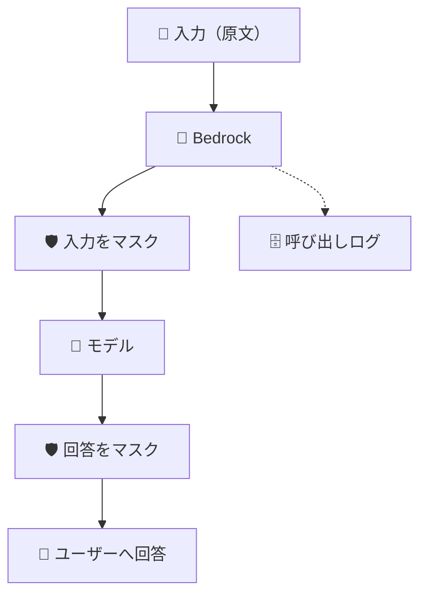
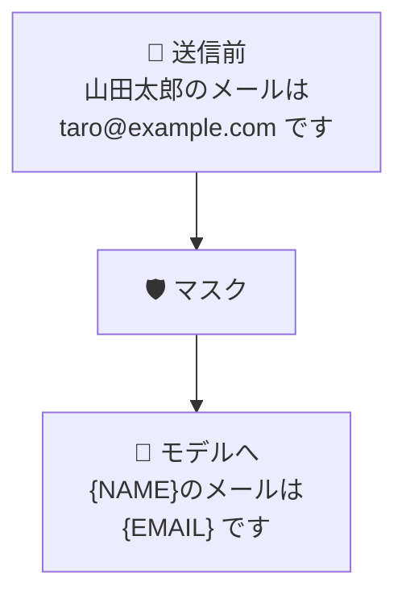
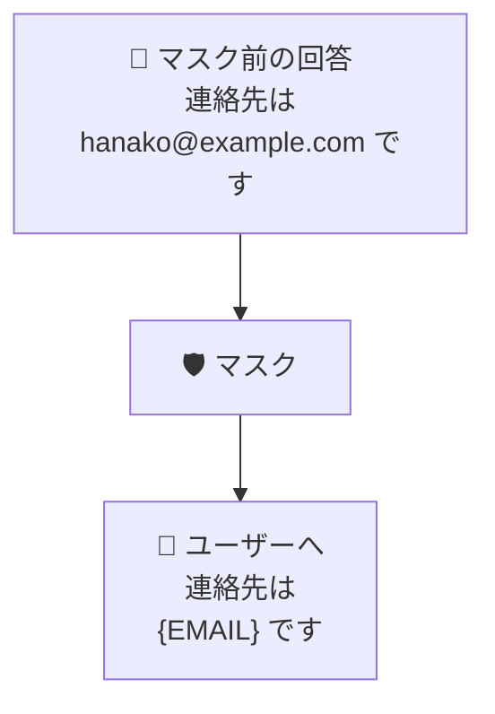
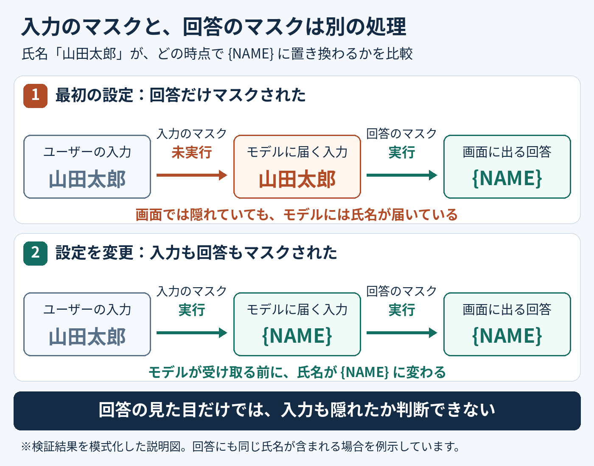

> **2026年11月13日（日本時間）時点**のAWS公式ドキュメントと、AWS上での検証に基づく備忘録です。仕様は変わる可能性があります。

最近、仕事でAmazon Bedrockを設定することになりました。そこでまず気になったのが、個人情報の扱いです。社内のルールで、入力された個人情報がシステムに保存されると、セキュリティ審査が厳しくなります。最初から保存しない形にできないかと考えました。

調べてみると、Bedrockには、入力や回答に含まれる個人情報を検出してマスクできる「Bedrock Guardrails」という機能があると知りました。これで個人情報をマスクすれば、保存も防げるのでは？と思ったのですが、そう単純ではありませんでした。モデルに渡す入力はマスクできても、**入力や回答を記録するログには元の入力が残り得ます**。

この記事では、Bedrock Guardrailsで隠せる範囲と、Bedrockのログに個人情報を残さないための設定をまとめます。今回は架空の氏名・メールアドレスを使い、**入力のマスクとブロック、CloudWatch Logs・S3への記録、ログ表示時のマスクまで実際に確認しました**。

## まず結論

| データの流れ | Bedrock Guardrailsを有効にすると？ |
| --- | --- |
| ユーザー → モデル | 入力中の個人情報をマスクできる |
| モデル → ユーザー | 回答中の個人情報をマスクできる |
| ユーザー → Bedrockの呼び出しログ | テキストの記録を有効にすると、指定したCloudWatch LogsのロググループかS3バケットに**入力の原文**が記録される |

つまり、**Bedrock Guardrailsでモデルへの入力をマスクしても、記録対象にしたテキストのログまでマスクされるわけではありません**。テキスト本文を記録したくない場合は、ログに含めるデータタイプの**テキストのチェックをオフにする**ことで、呼び出した日時などの情報を残しながら本文の記録を止められます。なお、個人情報の検出に漏れがないという保証もありません。[^sensitive]

:::details 今回の検証条件
| 項目 | 条件 |
| --- | --- |
| 検証日 | 2026年11月13日 |
| リージョン | シドニー（ap-southeast-2） |
| モデル | Amazon Nova Micro（amazon.nova-micro-v1:0）。テキスト記録の切替はNova Lite（amazon.nova-lite-v1:0）でも追加検証 |
| 対象の機密情報 | 組み込みの個人情報（PII）フィルターのNAME（氏名）・EMAIL（メールアドレス） |
| API | ApplyGuardrail（ガードレール単体の評価）、Converse（モデルとの会話） |
| ログ保存先 | 専用のCloudWatch LogsロググループとS3バケット |
| ログのデータ保護 | 検証用ロググループにEmailAddressのポリシーを適用 |
| テキストの記録 | マスク・ブロック検証時はオン。オフにした場合もS3への追加検証で確認 |

氏名・メールアドレスはすべて架空の値です。結果画面は検証と同じ設定で再実行して撮影し、設定項目の説明には保存前の画面も掲載しています。キャプチャーはアカウント情報が写らない範囲に絞っています。検証後はモデル呼び出しログの設定を元に戻し、作成したリソースを削除しました。
:::

## データはどこを通るのか



点線は、Bedrockの「モデル呼び出しのログ記録」を有効にした場合だけ発生します。この設定は初期状態では無効です。以下の原文が残る例では、ログに含めるデータ種類の「テキスト」も有効にしています。[^logging]

### Bedrockのログはどこに保存される？

上の図にある「呼び出しログ」の保存先は、**CloudWatch Logs・Amazon S3のどちらか、または両方**です。[^logging]

- **Amazon S3のみ**：指定したバケットに圧縮JSONのログを保存。
- **CloudWatch Logsのみ**：指定したロググループ内のログイベントに保存。
- **Amazon S3とCloudWatch Logsの両方**：両方へ出力。

このログには、モデルに送った入力やモデルからの回答、処理した日時などを記録できます。Bedrockコンソールでは、この記録機能が**モデル呼び出しのログ記録**という名前になっています。

ログ全体のオン・オフに加えて、テキスト本文を記録するかどうかも選べます。まず、入力と回答のマスクがログにどう影響するかを見ていきます。設定手順と、本文を記録しない場合の検証結果は、後半の「何を設定すればいい？」にまとめています。

### ① モデルへの入力と回答はマスクできる

**入力側：ユーザー → モデル**



**出力側：モデル → ユーザー**



例えば「山田太郎のメールはtaro@example.comです」と入力したとします。対象の個人情報を検出し、入力側のマスクを設定していれば、モデルには氏名やメールアドレスを`{NAME}`や`{EMAIL}`へ置き換えて渡せます。出力側にも設定すれば、回答中の個人情報もマスクできます。`BLOCK`を選べば、内容をブロックすることもできます。[^sensitive]

#### 実際に日本語の氏名・メールアドレスをマスクしてみる

まず、ガードレールだけで個人情報をマスクできるかを確かめました。使ったのは**ApplyGuardrail API**という、モデルに回答を生成させずに入力や回答の文章を評価するAPIです。

Bedrockコンソールのガードレールのテスト画面で「Use ApplyGuardrail API」を有効にし、評価対象に「Input」（入力）を選んで、次の架空情報を送りました。

> 以下は検証用の架空情報です。顧客の氏名は山田太郎で、連絡用メールアドレスは taro@example.com です。

結果は、氏名が`{NAME}`、メールアドレスが`{EMAIL}`に置き換わりました。同じ文章を「Output」（回答）として評価した場合も、同様にマスクされました。


*上が入力した架空情報、下のGuardrails Responseがマスク後の文章です。*

#### 回答だけでなく、入力のマスクも確認する

氏名「山田太郎」を送った例で比べます。**入力のマスクはモデルへ渡す前、回答のマスクはモデルが回答を生成した後**に行われます。


*検証で確認した2つの状態をもとに、マスクされる位置を示した説明図です。氏名と回答は説明用の例です。*

- **上段**：画面の回答は`{NAME}`でも、モデルに渡った入力には「山田太郎」が残っています。
- **下段**：モデルに渡す前に入力をマスクしているため、モデルが受け取る氏名も`{NAME}`に置き換わっています。

今回の最初の設定では、上段のように回答だけがマスクされました。入力と回答のそれぞれにマスク動作を指定し直すと、下段のように入力もマスクされることを確認できました。

入力のマスクが実行されたかは、APIのレスポンスに含められる**トレース**（ガードレールの評価結果）で確認しました。具体的な設定と評価結果は、次の折りたたみに載せています。

:::details 入力側の動作を明示した設定と確認結果

今回、氏名やメールアドレスのフィルター設定で、`action`だけを`ANONYMIZE`にし、`inputEnabled`・`outputEnabled`を有効にした条件では、入力中の氏名・メールアドレスは検出されたものの、入力評価の`action`は`NONE`でした。出力側ではマスクされていたため、**回答が隠れているだけでは、モデルに渡す前の入力もマスクされたとは判断できません**。

そこで、入力に対する動作を指定する`inputAction`と、回答に対する動作を指定する`outputAction`を、どちらもマスクを意味する`ANONYMIZE`にしました。EMAILの設定例は次のとおりです。NAMEにも同じ動作を設定しています。[^actions]

```json
{
  "type": "EMAIL",
  "action": "ANONYMIZE",
  "inputAction": "ANONYMIZE",
  "outputAction": "ANONYMIZE",
  "inputEnabled": true,
  "outputEnabled": true
}
```

この設定では、ApplyGuardrailのInput・Output両方で置換され、モデルとの会話に使うConverse APIでも入力評価の`action`が`ANONYMIZED`になることを確認できました。これは今回のリージョンで、ガードレールの作業中バージョン（DRAFT）と上記の設定を使った結果です。入力のマスクを目的にする場合は、**入力側の動作を指定し、トレースの入力評価まで確認する**ようにします。
:::

ただし、**元の入力はBedrock Guardrails（AWSサーバー）には届きます**。「AWSへ送る前に個人情報を消したい」場合は、送信する側で先にマスクします。

検出は確実ではありません。日本固有の番号や社内番号などは、対応するPII種類を確認し、必要ならカスタム正規表現や送信前のチェックを追加します。[^sensitive]

### ② テキストの記録が有効なら呼び出しログに原文が残る

入力や回答をマスクできても、ログに残る文章は別に確認する必要があります。今回、原文が記録されたのは、Bedrockの「設定」画面で次の2つを有効にし、保存先や権限も設定して保存した場合です。

- **モデル呼び出しのログ記録**：ログ全体のスイッチ。
- **テキスト**：モデルに送る文章と、モデルが返す文章をログに含めるチェック項目。


*赤枠の2か所がオンの設定例です。この状態で保存先や権限も設定し、「設定を保存」で適用すると、テキスト本文の記録が有効になります。本文の記録を止めたい場合は、全体のスイッチをオンにしたまま「テキスト」のチェックを外して保存します。*

テキストの記録を有効にした場合、Bedrock Guardrailsを適用しても、CloudWatch Logsのモデル呼び出しログの`input`には、加工前のリクエストが記録されます。[^sensitive] また、AWS公式Security Blogの[「Implementing least privilege access for Amazon Bedrock」](https://aws.amazon.com/blogs/security/implementing-least-privilege-access-for-amazon-bedrock/)でも、CloudWatch Logs・S3のログにはガードレール適用前の入力が含まれると説明されています。

#### 入力をマスクしてもログには原文が記録された

次に、モデルと会話するためのConverse APIを使って呼び出し、入力評価が`ANONYMIZED`（マスク実行済み）になったリクエストを、CloudWatch LogsとS3の両方で照合しました。どちらも、次のフィールドに**山田太郎・taro@example.comを含む原文**が残っていました。

```text
input.inputBodyJson.messages[0].content[0].text
```


*入力側のマスクを有効にした呼び出しでも、ログのinputには置換前の氏名・メールアドレスが含まれています。画像はCloudWatch Logsの入力フィールドの抜粋です。S3のログも取得して、同じ原文を確認しました。*

入力をブロックした場合も、検証用に指定した応答文`LAB_INPUT_BLOCKED`が返り、モデルの入出力トークンがともに0になった一方、入力の原文は両保存先に記録されました。逆に、送信前にメールアドレスを`[EMAIL_REDACTED]`へ置き換えた場合は、ログにも置換後の文章が記録されました。

| 実際に試した条件 | CloudWatch Logs・S3の入力ログ |
| --- | --- |
| Bedrock Guardrailsで入力をマスク | マスク前の原文が残る |
| Bedrock Guardrailsで入力をブロック | ブロック前の原文が残る |
| Bedrockへ送る前にマスク | 送信したマスク済みの文が記録される |

#### トレースにも元の値が含まれる

モデル呼び出しログに加えて、APIレスポンスのトレースにも注意が必要です。マスクが成功したConverse APIのトレースにも、検出結果の`match`として、元のメールアドレスが含まれていました。[^sensitive]

```json
{
  "match": "taro@example.com",
  "type": "EMAIL",
  "action": "ANONYMIZED",
  "detected": true
}
```

このため、**APIレスポンスのトレースをアプリ側でそのままログに出す場合も、原文の扱いを確認する必要があります**。

## CloudWatch Logsにはログの個人情報を隠す機能がある

ここまでの検証では、ログに入力の原文が残ることを確認しました。では、ログを読む人に個人情報を見せないようにはできるでしょうか。

CloudWatch Logsには「データ保護ポリシー」という機能があります。Bedrockの呼び出しログを保存するロググループに設定すると、メールアドレスなどの機密情報を検出し、**通常のログ表示でマスクできます**。原文を確認するには、`logs:Unmask`権限が必要です。[^cloudwatch]

### 通常表示と原文表示を比べる

検証用ロググループに、メールアドレスを検出するEmailAddressのデータ保護ポリシーを設定し、反映を確認してから、`verified.mask@example.com`を含む架空情報をBedrockへ送りました。CloudWatch Logsの通常表示では、入力中のメールアドレスがアスタリスクになりました。


*通常表示では、入力中のメールアドレスがアスタリスクで隠れています。*

続いて、同じログをCloudWatch Logsの表示メニューの「保護されたデータのマスキングを一時的に解除」で確認すると、元の`verified.mask@example.com`が見えました。APIでも、`unmask=false`と`unmask=true`で同じ違いを確認しています。


*上の画像と同じ呼び出しのログです。権限のある利用者がマスクを解除すると、元の値を確認できます。*

今回は、`logs:Unmask`権限を持つ同じ利用者で表示方法を切り替えた比較です。**権限があっても通常表示ではマスクされますが、原文を取得することは可能**でした。S3に直接保存されたログには、このCloudWatch Logsのポリシーによるマスクは適用されず、元の値が残っていました。

### 原文を保存しないための機能ではない

この結果からも、**表示時のマスクと、原文を保存しないことは区別する必要があります**。データ保護ポリシーは原文を削除する機能ではありません。設定前に取り込まれたログには遡って適用されず、S3へ直接保存したデータも対象外です。[^cloudwatch]

実際に、ポリシー設定前に取り込まれたログは、設定後も通常表示で原文が見えました。また、設定直後にはマスクされなかったログもあったため、新しく投入したテスト用ログがマスクされることを確認してから、Bedrockを再度呼び出しています。

入力中の個人情報を呼び出しログに残したくないなら、**ログに含めるデータ種類の「テキスト」をオフにする**か、**Bedrockへ送る前に入力をマスクする**ことを検討します。呼び出し日時などのメタデータも含めてモデル呼び出しログを残す必要がなければ、ログ全体を無効にする選択肢もあります。

## 「学習に使われない」ならBedrock Guardrailsは不要？

AWSのAmazon Bedrock紹介ページは、Bedrockがデータをモデル学習に使用しないと説明しています。文言は次のとおりです。[^faq]

> 「Bedrock は、モデルのトレーニングを行うためにデータを保存または使用することはなく」

学習に使われなくても、回答に個人情報がそのまま含まれる可能性はあります。Bedrock Guardrailsは、入力や回答から個人情報を検出して隠すために役立ちます。

- **要約に不要な個人情報を入力側で隠す**：顧客との会話から氏名やメールアドレスをマスクしてモデルに渡せば、回答に同じ値が再び現れる可能性を下げられます。
- **回答に含まれる個人情報を表示前に隠す**：出力側でマスクすれば、ユーザーがその値をメールへ転記したり、ファイルへ保存してGitに上げたりする事故を防ぎやすくなります。
- **機密情報を含む入力をブロックする**：対象の情報を検出できれば、モデルへ渡る前に処理を止められます。ただし、テキストの記録が有効な呼び出しログには、ブロック前の原文が残り得ます。

ただし、AIが外部の処理を実行するために渡す引数や、その処理から返る結果（ツール呼び出しの引数・結果）は、このフィルターの対象外です。AIにファイルを書かせてGitへ上げる運用なら、コミット内容の検査も必要です。[^sensitive]

### 利用者が出力するログと、AWS側のデータ保持も分けて考える

ここまで扱ったのは、自分のCloudWatch LogsやS3へ出力するモデル呼び出しログです。それを無効にしても、AWS側で推論データが一切保持されないとは限りません。学習用途の利用とは別に、対象モデルや設定に応じたデータ保持の条件があります。[^retention]

原文の保存を禁止する要件がある場合は、呼び出しログの設定に加えて、**利用するモデルのデータ保持条件**も確認します。

:::details 補足：Bedrockのモデルはどこで動く？
Bedrockでは、Amazon NovaなどのAWS製モデルと、Claudeなど外部企業が開発したモデルを利用できます。外部モデルも提供会社のAPIへ入力を転送するのではなく、AWSが所有・運用する専用環境に配置されます。そのため、モデル提供会社はBedrockの入力や回答にアクセスできません。第三者モデルの一部はAWS Marketplace経由で課金されます。契約や料金の仕組みはモデルによって異なります。[^deployment][^billing]
:::

## 何を設定すればいい？

検証結果を踏まえると、入力・回答・ログのどこに個人情報を残したくないかによって、設定する場所が変わります。

| 目的 | 対策 |
| --- | --- |
| モデルに個人情報を渡したくない | 入力側のBedrock Guardrailsでマスク動作を指定し、入力評価まで確認。AWSへの送信自体を避けるなら送信前にマスク |
| 回答で個人情報を見せたくない | 出力側のBedrock Guardrailsと、ツール出力・ファイル内容の検査 |
| CloudWatch Logs・S3へテキスト本文を記録したくない | ログに含めるデータタイプの「テキスト」をオフにする |
| 入力ログを残しつつ、入力中の個人情報を隠したい | Bedrockへ送る前に入力をマスク。回答やアプリ側ログも確認 |
| メタデータも含めてモデル呼び出しログが不要 | モデル呼び出しログ全体を無効にする |
| ログを通常表示する際に個人情報を隠したい | CloudWatch Logsのデータ保護ポリシーを設定し、マスクを解除できる権限も管理 |
| AWS側でも保持させたくない | 対象モデルのデータ保持条件と、利用できる保持モードを確認 |

### 呼び出しログの設定場所を確認する

保存先や記録する内容を設定するには、Amazon Bedrockコンソールの左側にある**設定および学習 → 設定**を開きます。下の赤枠がその場所です。左側のメニューが閉じている場合は、画面左上のメニューボタンから開きます。


*左の「設定」を開くと、右側に「モデル呼び出しのログ記録」があります。この画像ではログ全体のスイッチがオフなので、テキストなどの選択項目はまだ表示されていません。見やすくするため、ほかのメニューは折りたたんでいます。*

設定するときの流れは次のとおりです。**リージョンごとの設定**なので、モデルを呼び出す先のリージョンのコンソールを開きます。[^logging]

1. 「モデル呼び出しのログ記録」のスイッチをオンにする。
2. 表示された「ログに含めるデータタイプを選択」で、本文を保存するかどうかに応じて「テキスト」のチェックを切り替える。オンの画面は前半の「②」、オフの画面は次の小見出しに載せています。
3. 「ログ記録先を選択」で保存先を選び、ロググループやS3バケット、書き込み権限を設定する。
4. 最後に「設定を保存」を押して適用する。

例えば「CloudWatch Logsのみ」を選ぶと、下に「ロググループ名」の欄が表示されます。**ロググループは、ログをまとめて保存するCloudWatch Logsの入れ物**です。保存先にするロググループをここで指定します。


*保存先の入力欄を示す設定例です。`/aws/bedrock/my-invocations`は説明用の名前で、固定名ではありません。このキャプチャーは保存前の画面で、設定の完了を示すものではありません。*

保存先の指定に加えて、Bedrockがそこへログを書き込める権限も必要です。CloudWatch LogsではIAMロール、S3ではバケットポリシーを使います。今回のコンソールには権限を自動付与する旨の案内と「Customize」が表示されました。AWS公式手順では、設定者に所定のS3権限があれば、バケットポリシーは設定時に自動で追加されると説明しています。[^logging]

なお、CloudWatch Logsに収まらない大きな本文やバイナリデータのために、S3を追加の保存先として設定する構成もあります。[^logging]

### テキストだけオフにして、呼び出し情報を残す

設定画面には、「モデル呼び出しのログ記録」全体のスイッチと、「ログに含めるデータタイプ」のチェック項目があります。**テキストの入出力本文を保存したくないだけなら、ログ全体をオンにしたまま「テキスト」をオフにする方法があります**。APIでは`textDataDeliveryEnabled: false`に対応します。[^logging-config]


*「モデル呼び出しのログ記録」はオン、「テキスト」はオフにした設定例です。「イメージ」「埋め込み」「ビデオ」はそれぞれ別のチェック項目です。*

本文を止めても、呼び出し日時・モデルID・トークン数などの情報（メタデータ）は記録できます。

#### テキストOFFで本文が記録されないことを確認

実際の挙動を、S3への出力で追加検証しました。「テキスト」をオフ、「イメージ」「埋め込み」「ビデオ」をオンにして、テキスト専用のNova Microと、画像を扱えるNova Liteを呼び出しています。ログ設定だけの挙動を比較するため、この追加検証ではGuardrailsを指定していません。

| 実際に試した条件 | 入出力のテキスト本文 | メタデータ |
| --- | --- | --- |
| テキストON・Nova Micro・テキスト入力 | 記録された | 記録された |
| テキストOFF・Nova Micro・テキスト入力 | 記録されなかった | 記録された |
| テキストOFF・Nova Lite・テキスト入力 | 記録されなかった | 記録された |
| テキストOFF・Nova Lite・画像＋テキスト入力 | 記録されなかった | 記録された |

テキストOFFの3件では、`inputBodyJson`・`outputBodyJson`がログになく、呼び出し日時・リクエストID・モデルID・トークン数などは残っていました。S3に配信された各オブジェクトも調べ、入力した架空のメールアドレスが含まれないことを確認しています。

つまり、**テキストOFFは、本文の記録を止めながら呼び出し情報を残すために使えます**。画像・動画・埋め込みなども保存したくない場合は、それぞれのデータ種類も確認します。メタデータを含めてモデル呼び出しログ全体が不要なら、全体のスイッチをオフにします。

**Bedrock Guardrailsでマスクしても、記録対象にしたテキストのログから原文まで消えるわけではありません**。入力のマスクと、どのデータ種類をログに含めるかは、それぞれ設定します。

## 参照したAWS公式ドキュメント

[^sensitive]: [機密情報フィルターを使用して会話から PII を削除する — Amazon Bedrock](https://docs.aws.amazon.com/ja_jp/bedrock/latest/userguide/guardrails-sensitive-filters.html)。入力・出力のマスク、モデル呼び出しログとトレースの例外、ツール利用時の対象外を確認。
[^logging]: [CloudWatch Logs と Amazon S3 を使用してモデル呼び出しをモニタリングする — Amazon Bedrock](https://docs.aws.amazon.com/ja_jp/bedrock/latest/userguide/model-invocation-logging.html)。コンソールでの設定手順、デフォルト設定、保存先、ログ形式、S3への大容量データ保存を確認。
[^cloudwatch]: [機密性の高いログデータをマスキングで保護する — Amazon CloudWatch Logs](https://docs.aws.amazon.com/ja_jp/AmazonCloudWatch/latest/logs/mask-sensitive-log-data.html)。閲覧・転送時のマスク、`logs:Unmask`、既存ログへの非遡及を確認。
[^faq]: [Amazon Bedrock — AWS](https://aws.amazon.com/jp/bedrock/)。入力データをモデルのトレーニング目的で保存・使用しないことを確認。
[^retention]: [データ保持 — Amazon Bedrock](https://docs.aws.amazon.com/ja_jp/bedrock/latest/userguide/data-retention.html)。AWS側の推論データ保持が、モデル・設定によって異なる点を確認。
[^deployment]: [データ保護 — Amazon Bedrock](https://docs.aws.amazon.com/ja_jp/bedrock/latest/userguide/data-protection.html)。モデルはAWSが所有・運用するModel Deployment Accountへ配置され、モデル提供元はその環境や入力・出力へアクセスできないことを確認。
[^billing]: [モデルへのアクセスをリクエストする — Amazon Bedrock](https://docs.aws.amazon.com/ja_jp/bedrock/latest/userguide/model-access.html)。第三者モデルのAWS Marketplace購読とEULAを確認。

[^actions]: [Options for handling harmful content detected by Amazon Bedrock Guardrails — Amazon Bedrock](https://docs.aws.amazon.com/bedrock/latest/userguide/guardrails-harmful-content-handling-options.html)。入力・出力ごとの動作指定と、マスク・ブロック・検出のみの違いを確認。

[^logging-config]: [LoggingConfig — Amazon Bedrock API Reference](https://docs.aws.amazon.com/bedrock/latest/APIReference/API_LoggingConfig.html)。textDataDeliveryEnabledなど、データ種類ごとのログ配信設定を確認。
