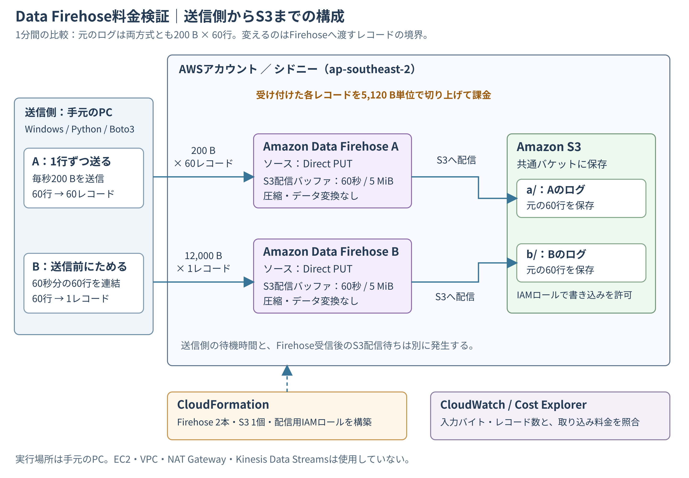
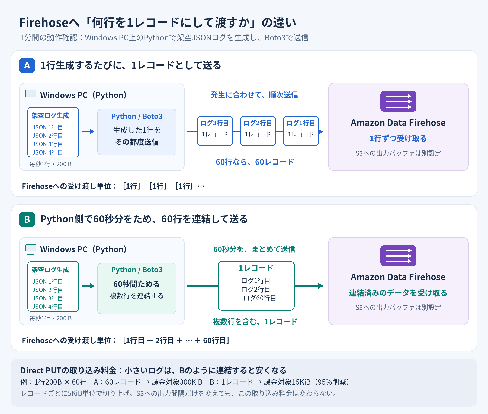
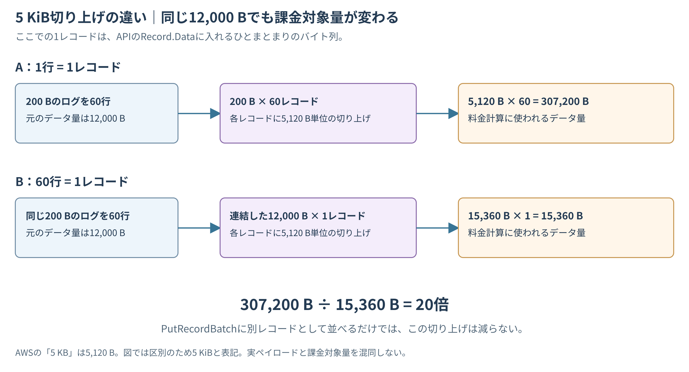
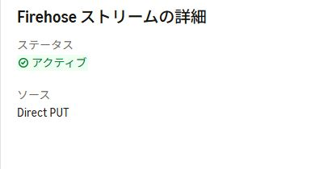
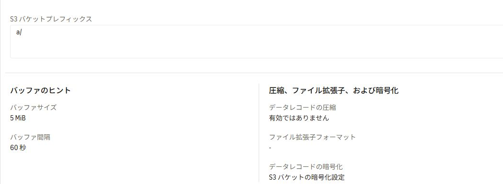
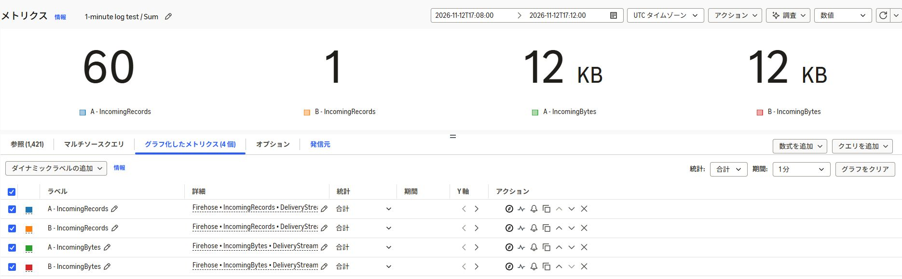
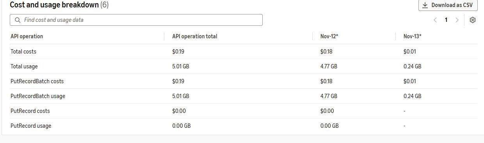
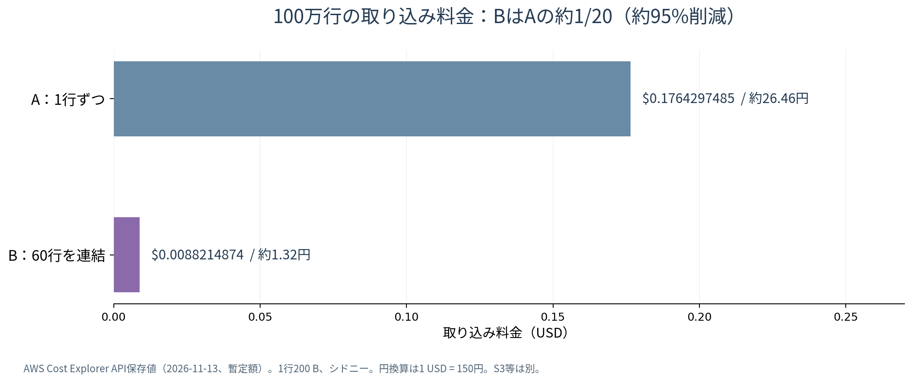

業務でAmazon Data Firehoseを使うことになったのですが、導入に向けて調べる中で高額請求に関する記事を見かけました。

https://qiita.com/mizumoto_masaki/items/beb5d3beab4f1682ade2

コストについて不安になったため、運用を始める前に料金の仕組みと実際にかかる費用を検証することにしました。
今回はその検証内容と検証から見えたコスト削減方法を共有します。

## 1. 今回の構成と比較条件

### 送信側のまとめ方だけを変える



送信元はWindows PC上のPythonです。Boto3からFirehoseの公開APIへ送信し、A・Bそれぞれのストリームから、共通S3バケットの異なるプレフィックスへ配信します。

| サービス・ツール | 今回の役割 |
|---|---|
| Python / Boto3 | 200バイトの架空ログを生成し、A・Bの方法で送信する |
| Amazon Data Firehose | Direct PUTで受信し、S3へ配信する。ストリームはA・Bの2本 |
| Amazon S3 | Aは`a/`、Bは`b/`配下に保存する |
| IAMロール | Firehoseから検証用S3バケットへの書き込みを許可する |
| CloudFormation | Firehose 2本・S3バケット1個・IAMロール1個を作る |
| CloudWatch | 入力バイト数・レコード数・スロットリングを確認する |
| Cost Explorer | 日付とAPI操作ごとの取り込み使用量・料金を確認する |

EC2、Kinesis Data Streams、Lambdaによる変換処理は使っていません。実際のプロキシを起動した検証ではなく、アクセスログのような小さな行を送る条件をPythonで再現しています。


*実際に検証したWindows PC上のPython／Boto3の構成です。1分間の動作確認では、Pythonで毎秒1行・改行込み200 Bの架空JSONログを生成し、Aは1行ずつ、Bは60秒分の60行を連結してFirehoseへ送りました。*

### 1分間の動作確認と100万行の料金確認を分ける

| 項目 | A：1行ずつ | B：60秒ためて送信 |
|---|---|---|
| 1行の大きさ | 改行込み200 B | 同じ |
| 1分間のログ発生 | 毎秒1行、合計60行 | 同じ |
| Firehoseへ渡すレコード | 200 Bを60レコード | 12,000 Bを1レコード |
| 送信方法 | 発生した行を順次送信 | 60秒分をためてから送信 |
| FirehoseのS3配信バッファ | 60秒・5 MiB | 同じ |
| S3配信時の圧縮 | なし | 同じ |

まず1分間ずつ動かして、入力レコード数とS3到着行数を確認しました。ただし60行だけでは料金が小さすぎるため、料金確認用に各方式100万行も送信しています。

**100万行の追加検証では、Bを60行単位で連結しますが、そのたびに60秒待つことはしません。** レコード境界を維持したまま件数を増やすための検証で、送信量は0.5 MiB/秒を目安に制限しました。

## 2. なぜ同じデータ量でもFirehoseの料金が変わるのか

### 取り込み料金はレコードごとに切り上がる

**Firehoseへ渡した各レコードのサイズを5 KB（5,120バイト）単位で切り上げて**料金を計算します。[^rounding]

1レコードが200バイトでも、課金対象は5,120バイトです。一方、60行を連結した12,000バイトのレコードは、3単位分の15,360バイトとして計算されます。



| 60行を送る方法 | 実際のデータ量 | 課金対象量 |
|---|---:|---:|
| A：200 Bを60レコード | 12,000 B | 5,120 B × 60 = **307,200 B** |
| B：12,000 Bを1レコード | 12,000 B | 15,360 B × 1 = **15,360 B** |

レコード数は60分の1になりますが、料金は20分の1です。Bの1レコードも5 KiBではなく15 KiBとして課金されるためです。

### PutRecordBatchでまとめて呼ぶだけでは減らない

`PutRecordBatch`は、1回のAPI呼び出しで複数レコードを送るためのAPIです。**API呼び出しを1回にまとめることと、データを1レコードに連結することは別です。**

```python
# APIは1回でも、Firehoseには60個のレコードとして渡る
client.put_record_batch(
    DeliveryStreamName=stream,
    Records=[{"Data": row} for row in rows],
)

# 60行を連結し、Firehoseへ1個のレコードとして渡す
client.put_record_batch(
    DeliveryStreamName=stream,
    Records=[{"Data": b"".join(rows)}],
)
```

AWS公式FAQでも、切り上げはAPI呼び出し単位ではなく、レコード単位と説明されています。100万行の比較ではA・Bとも`PutRecordBatch`を使用し、このレコードの境界を変えました。[^batch]

### 「送信側」と「Firehose側」のバッファを分けて考える

| バッファの場所 | 今回の動作 | 取り込み料金への影響 |
|---|---|---|
| 送信側のPython | Bでは60行をためて連結し、1レコードにする | Firehoseへ渡すレコード数・サイズが変わる |
| Firehose受信後 | S3へ配信する前に60秒・5 MiBを目安にためる | 受信済みレコードの5 KiB切り上げを取り消す効果はない |

Firehose側の配信間隔を長くしても、1行ずつ受け付けたレコードが料金上の1レコードになるわけではありません。

:::message
S3配信で使う`BufferingHints`のデフォルトは300秒・5 MiBです。今回は両ストリームを60秒・5 MiBに設定しました。時間またはサイズのどちらかが先に条件に達すると、S3への配信を開始します。ただし、これらは配信タイミングの目安であり、「必ず60秒以内にS3へ届く」という保証ではありません。Bでは、送信側でためる最大約60秒に、Firehose側の配信待ちも加わります。[^buffer]
:::

## 3. FirehoseとS3を設定する

### Direct PUTとAmazon S3を選ぶ

ソースを`Direct PUT`、送信先を`Amazon S3`にします。A・Bで同じ設定を使い、S3プレフィックスだけを分けています。


*同じ設定で再作成したストリームの画面です。ソースはDirect PUTで、ストリームはアクティブになっています。*

| 設定項目 | 設定値 |
|---|---|
| リージョン | シドニー：`ap-southeast-2` |
| S3プレフィックス | A：`a/`、B：`b/` |
| バッファサイズ | 5 MiB |
| バッファ間隔 | 60秒 |
| 圧縮・データ変換・形式変換 | 無効 |
| 動的パーティショニング | 無効 |
| S3公開アクセス | ブロック |
| S3保存時の暗号化 | SSE-S3 |
| 検証コードのS3ライフサイクル | オブジェクトを7日後に期限切れにする設定 |


*Aの設定。Firehose受信後のS3配信バッファは60秒・5 MiBです。*

Bも配信バッファは同じ設定です。送信前の60行連結は、この画面の設定ではなくPythonで行います。設定画像は2026年11月14日に撮影しています。

なお、今回はFirehoseの配信エラーログを無効にしています。CloudWatchの入力メトリクスとは別の機能で、継続運用では障害調査に使うログの取得も検討します。

### CloudFormationで検証環境を作る

テンプレートには検証用データを7日後に期限切れにするS3ライフサイクルも含めています。必要な実測結果は別途保存します。

CloudFormationテンプレート`template.json`で、Firehose 2本・S3バケット1個・配信専用IAMロールを作成しました。送信処理の`lab.py`とREADMEとともに、GitHubで公開しています。

https://github.com/kkoch5t2/firehose-cost-lab

リポジトリをクローンし、そのディレクトリで以下のコマンドを実行します。

以下はWindows PowerShellでの実行例です。`firehose-lab`は、利用者が用意したAWS認証プロファイル名に置き換えます。

```powershell
# 検証用コードを取得する
git clone https://github.com/kkoch5t2/firehose-cost-lab.git
# 取得したディレクトリへ移動する
cd firehose-cost-lab
# 検証に使うAWS認証プロファイルを選ぶ
$env:AWS_PROFILE = "firehose-lab"
# シドニーリージョンを指定する
$env:AWS_DEFAULT_REGION = "ap-southeast-2"
# Pythonの仮想環境を作成する
python -m venv .venv
# AWS SDKを仮想環境へインストールする
.\.venv\Scripts\python.exe -m pip install -r requirements.txt
# Firehose・S3・配信用IAMロールを作成する
aws cloudformation deploy --stack-name firehose-cost-lab --template-file template.json --capabilities CAPABILITY_IAM
```

`aws login`で取得した認証情報をBoto3から直接利用する環境では、対応バージョンのSDKとCRTが必要です。利用する場合は`pip install "boto3[crt]"`で追加します。[^login]実際の送信ではAに認証更新のオーバーヘッドがあったため、今回の処理時間をFirehose自体の性能比較には使っていません。

### 1行を改行込み200バイトに揃える

ログは架空の`run`、`seq`、`status`を持つJSONです。末尾の空白で長さを揃え、最後に改行を付けています。

```python
import json

def line(run_id, seq):
    # JSON本体をASCIIのバイト列に変換する
    raw = json.dumps(
        {"run": run_id, "seq": seq, "status": 200},
        separators=(",", ":"),
    ).encode("ascii")
    # 空白と改行を加えて、1行をちょうど200バイトにする
    return raw + b" " * (200 - len(raw) - 1) + b"\n"
```

`seq`は行の連番です。S3到着後に`run`と`seq`を読み取り、ユニーク行数、欠損、重複を確認しました。Bでも改行は残るため、1レコードに連結した後もログ行として分けて読み取れます。

## 4. 1分間のログ送信で動作を確認する

### A・Bをそれぞれ60秒動かす

`lab.py`は今回の検証用スクリプトで、AWS標準のコマンドではありません。検証コード一式に収録したものを使用します。1分間の検証では、次のように実行します。

```powershell
# A：毎秒1行を送り、1分間で60レコードを送信する
.\.venv\Scripts\python.exe lab.py --scenario a --kind live --run-id livea001
# B：60秒分の60行をため、連結して1レコードで送信する
.\.venv\Scripts\python.exe lab.py --scenario b --kind live --run-id liveb001
```

実際の検証では別々のrun IDで結果を保存しました。Bは60秒の蓄積が終わってからAPIを呼び出すので、スクリプト全体は60秒を少し超えます。

### CloudWatchとS3の実測結果


*初回の検証時間帯をCloudWatchで表示したキャプチャです。合計（Sum）でAは60レコード、Bは1レコード、入力は両方12 KB（12,000 B）でした。画面の時刻はUTCです。*

| 確認項目 | A：1行ずつ（リアルタイム送信） | B：60行を連結（60秒分をまとめて送信） |
|---|---:|---:|
| 元のログ行数 | 60 | 60 |
| `IncomingBytes`のSum | 12,000 B | 12,000 B |
| `IncomingRecords`のSum | 60 | 1 |
| S3で確認できたユニーク行数 | 60 | 60 |
| 欠損／重複／不正行 | 0／0／0 | 0／0／0 |
| 課金対象量の計算値 | 307,200 B | 15,360 B |

ここでの「リアルタイム送信」は、生成したログをその都度Firehoseへ送るという意味です。S3への保存には、別途Firehose側の配信待ち時間があります。

CloudWatchでは、実行全体を含む時間範囲を選び、統計を`Sum`で確認します。`IncomingBytes`は受け付けた実際のバイト数で、切り上げ後の課金対象量ではありません。[^metrics]

S3の照合は、配信を待ってから実行しました。

```powershell
# Aの送信記録に対応するS3の行を照合する
.\.venv\Scripts\python.exe lab.py --scenario a --verify result-livea001-a.json
# Bの送信記録に対応するS3の行を照合する
.\.venv\Scripts\python.exe lab.py --scenario b --verify result-liveb001-b.json
```

60行の料金は非常に小さいため、この段階は動作確認です。60行A/Bの請求は同じ日の`PutRecord`項目に合算されており、方式ごとの請求額を個別に実測した結果とは区別しています。

### S3に保存されたログの見え方を比較する

**A・Bとも、S3に保存されたログはJSONが1行に1件ずつ並んでいました。** 送信前に複数行を連結したBでも、各行末の改行（LF）が残るため、行単位で読めます。

S3に保存されたA・Bそれぞれのログの先頭を示します。表示のため、行末のサイズ調整用の空白は省略しています。

**A：1行ずつ送信したログ** （3行のみ）

```json
{"run":"t1113190850","seq":0,"status":200}
{"run":"t1113190850","seq":1,"status":200}
{"run":"t1113190850","seq":2,"status":200}
```

**B：60秒分を連結して送信したログ** （3行のみ）

```json
{"run":"s3b1113165526","seq":0,"status":200}
{"run":"s3b1113165526","seq":1,"status":200}
{"run":"s3b1113165526","seq":2,"status":200}
```

両方式とも`seq`と`status`の内容は60行すべて一致しました。`run`だけは実行を区別する値のため異なります。

:::message
**S3ファイルが分かれる場合もある**

検証では、Aのログが複数ファイルに分かれることもありました。S3のファイルの区切りはFirehose側の配信バッファなどで変わり、送信時の1レコードと一致するわけではありません。取り込み料金は、S3のファイル数ではなく、Firehoseへ渡したレコード単位で計算されます。[^s3delivery]
:::

## 5. 100万行の取り込み料金を比較する

### 料金確認のためAとBを別のUTC日付で実行

料金を分けて確認するため、Aの100万行は2026年11月12日UTC、Bは11月13日UTCに送信しました。日本時間では午前9時がUTCの日付の境目です。

```powershell
# A：200バイトのログ100万行を、各行別レコードとして送る
.\.venv\Scripts\python.exe lab.py --scenario a --kind bulk --lines 1000000 --run-id bulka001
# Aの実行完了日より後のUTC日付に、Bの100万行を60行ずつ連結して送る
.\.venv\Scripts\python.exe lab.py --scenario b --kind bulk --lines 1000000 --run-id bulkb001
```

両方式とも`PutRecordBatch`で送り、Aでは1行ずつを別レコード、Bでは60行を連結したバイト列を1レコードにします。Bの最後は40行なので、レコード数は16,667です。

| 確認項目 | A：1行ずつ | B：60行を連結 |
|---|---:|---:|
| 元のログ行数 | 1,000,000 | 1,000,000 |
| 入力バイト数（CloudWatch） | 200,000,000 B | 200,000,000 B |
| 入力レコード数（CloudWatch） | 1,000,000 | 16,667 |
| API呼び出し回数 | 2,000 | 834 |
| API応答の部分失敗レコード数 | 0 | 0 |
| `ThrottledRecords`のSum | 0 | 0 |
| S3のユニーク行数 | 1,000,000 | 1,000,000 |
| S3の欠損／重複／不正行 | 0／0／0 | 0／0／0 |

BのS3照合は、初回スキャンでは最後の配信が未到着で、待機後の再スキャンで全100万行を確認しました。未到着の段階で送信をやり直すと重複させる可能性があるため、照合だけを再実行しています。

### Cost Explorerで課金使用量と料金を確認する

集計条件は次のとおりです。

| 項目 | 条件 |
|---|---|
| 期間 | 2026年11月12日・13日（UTC） |
| 粒度 | 日別（Daily） |
| Usage type | `APS2-BilledBytes` |
| Region | `ap-southeast-2` |
| Group by | API operation |
| 指標 | `UnblendedCost`、`UsageQuantity` |

100万行の比較対象は`PutRecordBatch`です。1分間の動作確認に使用した`PutRecord`は別項目として分けました。


*初回検証の請求を、設定画像の撮影時に確認した画面です。画面表示は丸められるため、以下の表は保存済みAPI応答の数値を使用しています。*

| 項目 | A：1行ずつ | B：60行を連結 |
|---|---:|---:|
| 課金対象量の計算値 | 5,120,000,000 B | 256,000,000 B |
| AWSの課金使用量 | 4.76837158 GB | 0.2384185791 GB |
| 計算した取り込み料金 | 0.1764297485 USD | 0.0088214874 USD |
| AWS請求APIの取り込み料金 | **0.1764297485 USD** | **0.0088214874 USD** |
| 参考：1 USD＝150円で換算 | 約26.46円 | 約1.32円 |

課金使用量は、切り上げ後のバイト数を`2**30`で割った値と一致しました。元の200,000,000バイトをそのまま料金単価に掛けると、Aの取り込み料金を大きく過小評価します。



料金差も事前計算どおりでした。

```text
A / B ≒ 20
削減率 = (1 - B / A) × 100 ≒ 95%
```

:::message
2026年11月13日22:51 JSTの取得時点で、A・Bとも`Estimated: true`でした。これは月次請求の確定額ではありません。また、Firehose取り込み料金の比較であり、環境全体の総費用や請求書の支払額の比較ではありません。
:::

### 参考：東京とシドニーの単価・予想料金

2026年11月14日にAWS公式Price Listの`BilledBytes`項目を再確認しました。以下は最初の500 TB/月の単価を使った比較で、東京での実行結果ではありません。

| 比較項目 | 東京（ap-northeast-1） | シドニー（ap-southeast-2） |
|---|---:|---:|
| 取り込み単価 | 0.036 USD/GB | 0.037 USD/GB |
| 100万行を1行ずつ送る計算値 | 約0.17166 USD／約25.75円 | 約0.17643 USD／約26.46円 |
| 100万行を60行ずつ連結する計算値 | 約0.00858 USD／約1.29円 | 約0.00882 USD／約1.32円 |

1行200バイト・同じ切り上げ条件・1 USD＝150円の仮定です。今回の小さなログでは、リージョン単価の差より、送信レコードのまとめ方の影響が大きい結果でした。

参考：[東京の公式Price List](https://pricing.us-east-1.amazonaws.com/offers/v1.0/aws/AmazonKinesisFirehose/current/ap-northeast-1/index.json)、[シドニーの公式Price List](https://pricing.us-east-1.amazonaws.com/offers/v1.0/aws/AmazonKinesisFirehose/current/ap-southeast-2/index.json)

## 6. 実際のログ収集で考えたいこと

### 料金と鮮度のトレードオフがある

今回のBは、先頭のログなら最大約60秒、送信側で待つことになります。その後にFirehoseのS3配信待ちもあるため、即時に検索・監視したいログへ、そのまま適用できるとは限りません。

ログの利用目的に応じて、「何秒まで待てるか」「何バイトまでためるか」を先に決めます。実運用では時間上限とサイズ上限のどちらかに達したら送る形にすると、ログが少ない時間帯に長く滞留するのを避けられます。

また、送信側のメモリだけに蓄積すれば、プロセス停止時に未送信ログを失う可能性があります。今回のスクリプトは有限の技術検証用であり、ディスクへの退避、再起動時の復旧、送信確認後の削除といった、ログ収集基盤としての永続化機能は実装していません。

:::message
**実運用ではAmazon Kinesis Agentも選択肢**

Squidなどのログファイルを継続的にFirehoseへ送る場合は、EC2などのLinuxサーバーにAmazon Kinesis Agentをインストールして利用する方法もあります。ログのローテーションへの対応、読み取り位置の記録、送信失敗時の再試行といった既存機能を利用できるため、Pythonでログ収集・送信処理を一から自作する場合に比べ、実装や保守にかかるコストを抑えやすくなります。[^agent]

複数行を集約する`aggregatedRecordSizeBytes`も設定できます。デフォルトは`0`（集約なし）のため、取り込み料金の削減を狙う場合は、送信前の集約設定も確認します。[^agent-config]
:::

### 「何行まとめるか」はログの実サイズで変わる

200バイトを60行という条件で約95%削減になりましたが、ログの長さやまとめる行数が変われば、効果も変わります。5 KiBの切り上げ境界をまたぐため、まとめた量に対して料金が滑らかに変化するわけではありません。

Firehose APIにはレコードサイズ・リクエストサイズの上限もあります。Boto3へ渡す前のバイト数を確認し、文字数だけで判定しないことも必要です。日本語などを含むUTF-8のログでは、1文字と1バイトは一致しません。[^limits]

### 今回の検証で確認できたこと

同じログ量でも、Firehoseへ1行ずつ別レコードとして渡すか、送信側で連結して渡すかによって、取り込み料金は変わりました。

今回の条件では、**100万行・実データ200 MBに対して、1行ずつなら約26.46円、60行連結なら約1.32円**です。Firehose側のS3配信バッファを変更するのではなく、送信前のレコード境界を変えることで、約95%の差を実測できました。

小さなアクセスログをFirehoseへ流すときは、総バイト数とあわせて、**1レコードのサイズとレコード数**を確認しておくと、料金の見積もりをしやすくなります。

### 参考資料

[^rounding]: [AWS公式：Firehoseのクォータ（5 KB＝5,120バイトの切り上げ）](https://docs.aws.amazon.com/firehose/latest/dev/limits.html)
[^batch]: [AWS公式：Firehose FAQ（PutRecordBatchの切り上げ単位）](https://aws.amazon.com/firehose/faqs/)
[^buffer]: [AWS公式：BufferingHints](https://docs.aws.amazon.com/firehose/latest/APIReference/API_BufferingHints.html)、[AWS公式：Configure buffering hints](https://docs.aws.amazon.com/firehose/latest/dev/create-configure-backup.html#buffering-hints)
[^metrics]: [AWS公式：CloudWatchメトリクスによるFirehoseのモニタリング](https://docs.aws.amazon.com/firehose/latest/dev/monitoring-with-cloudwatch-metrics.html)
[^login]: [AWS公式：Login credentials provider](https://docs.aws.amazon.com/sdkref/latest/guide/feature-login-credentials.html)
[^limits]: [AWS公式：PutRecordBatch API](https://docs.aws.amazon.com/firehose/latest/APIReference/API_PutRecordBatch.html)

参考：[Amazon Data Firehose料金](https://aws.amazon.com/firehose/pricing/)

[^s3delivery]: [AWS公式：Understand data delivery in Amazon Data Firehose](https://docs.aws.amazon.com/firehose/latest/dev/basic-deliver.html)

[^agent]: [AWS公式：Kinesis AgentによるFirehoseへの送信](https://docs.aws.amazon.com/firehose/latest/dev/writing-with-agents.html)
[^agent-config]: [AWS公式：Kinesis Agentの設定項目](https://docs.aws.amazon.com/firehose/latest/dev/agent-config-settings.html)
