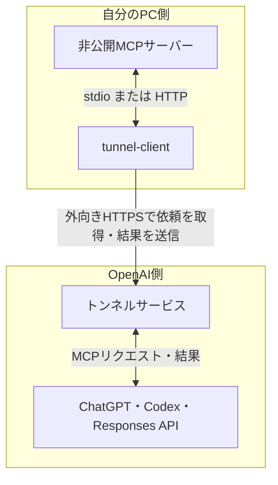
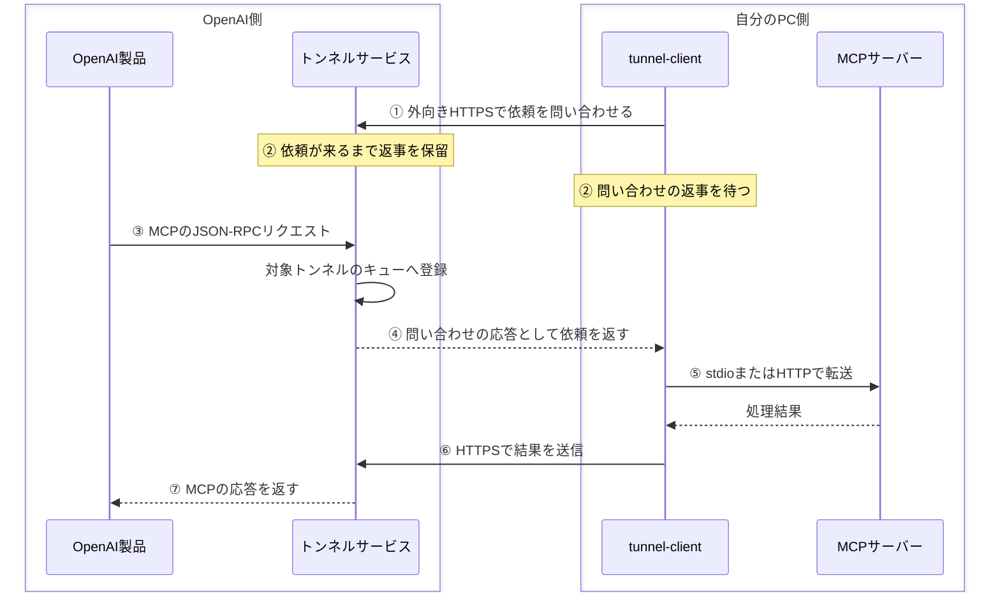
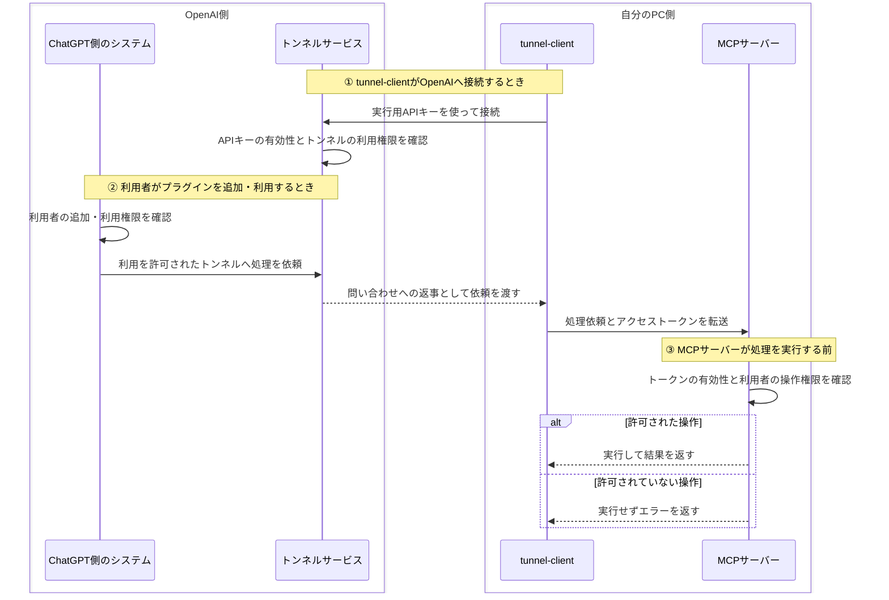
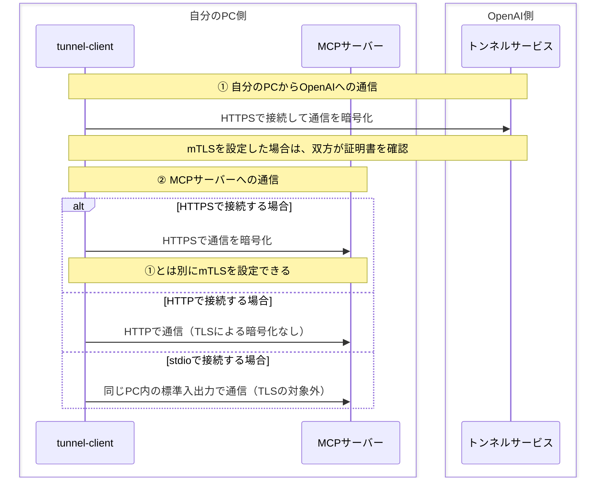

## Secure MCP Tunnelの概要

**Secure MCP Tunnelは、非公開のMCPサーバーを、ChatGPTなどのOpenAI製品から利用するための通信の仕組みです。**[^guide]

MCP（Model Context Protocol）は、AIアプリケーションと外部のツールやデータを接続するためのプロトコルです。MCPサーバーは、AIから呼び出せるツールを提供します。[^mcp]

例えば、必要なツールをMCPサーバーに用意すると、次のような使い方ができます。

| 活用例 | ChatGPTへの依頼例 | MCPサーバーが行う処理 |
| --- | --- | --- |
| 社内文書の検索 | 「有給休暇の申請手順を調べて」 | 社内の規程やマニュアルから該当箇所を検索し、内容を返す |
| データベースの集計 | 「先月の売上を部署別に集計して」 | 売上データベースを参照し、部署別の集計結果を返す |
| 自分のPCで開発作業 | 「このプロジェクトのテストを実行して」 | 自分のPCでテスト用のコマンドを実行し、成否とログを返す |

ChatGPTは、依頼に合うツールを呼び出し、返ってきた情報を使って回答します。例えば、文書の検索結果から申請手順をまとめたり、テストのログから失敗した箇所を説明したりします。実行できる処理は、MCPサーバーに用意したツールと権限によって決まります。

こうしたMCPサーバーが自分のPC内や社内ネットワークにあると、クラウド上のChatGPTから直接接続できないことがあります。Secure MCP Tunnelは、ネットワーク内部からOpenAIへ接続し、依頼と結果をやり取りできるようにします。

これにより、MCPサーバーをインターネットへ公開したり、外部から着信するポートを開放したりせずに利用できます。対応する利用先には、ChatGPT、Codex、Responses APIなどがあります。[^guide]

## 技術構成要素

構成は、OpenAI側の2つと、自分のPC側の2つに分かれます。

| 構成要素 | 配置先 | 役割 |
| --- | --- | --- |
| MCPを利用する製品 | OpenAI側 | MCPのリクエストを送る。ChatGPT、Codex、Responses APIなど |
| トンネルサービス | OpenAI側 | 対象トンネルへの依頼を受け付け、クライアントとの間で結果を中継する |
| tunnel-client | 自分のPC側 | OpenAIへ接続して依頼を取得し、設定したMCPサーバーへ転送する |
| 非公開MCPサーバー | 自分のPC側 | ツールを提供し、受け取った処理を実行する |

次の図は、構成要素を配置先ごとにまとめた全体構成図です。上が自分のPC側、下がOpenAI側です。

**外部（ChatGPTなど）から自分のPCへ直接接続できる入口を設けていないため、自分のPC側からOpenAIへ問い合わせます。ChatGPTからの処理依頼は、その問い合わせへの返事として受け取ります。**

操作を依頼するのはChatGPT、ネットワーク接続を始めるのは自分のPC側の`tunnel-client`です。

### ローカル側の接続方法

`tunnel-client`からMCPサーバーへの接続には、次の方法を使えます。

| 接続方法 | クライアントから見た転送先 |
| --- | --- |
| stdio | 設定したMCPサーバーのコマンド。標準入出力で通信する |
| HTTP | 設定したMCPサーバーのURL。内部ネットワーク上の別ホストも対象にできる |

クライアントとMCPサーバーを同じホストに置く構成も、内部ネットワークの別ホストへHTTPで接続する構成も取れます。

## 通信の流れとロングポーリング

### 問い合わせたまま、返事を待つ

自分のPC側から問い合わせても、その時点でChatGPTに処理依頼があるとは限りません。そこで、OpenAI側は「ありません」とすぐに返す代わりに、依頼が来るまで返事を待たせます。この方式を**ロングポーリング**と呼びます。[^architecture]

どのトンネル宛ての依頼を受け取るかは、設定した**トンネルID**で決まります。「このトンネルに処理依頼はありますか？」と問い合わせるイメージです。

動きは次の繰り返しです。

1. **自分のPCが問い合わせる**：「このトンネルに処理依頼はありますか？」
2. **OpenAI側が返事を待たせる**：依頼が来るまで、その問い合わせを待機させる。
3. **依頼が来たら返す**：ChatGPTなどから届いた依頼を、問い合わせへの返事として自分のPCへ渡す。
4. **自分のPCが次の問い合わせをする**：続く依頼を受け取れるようにする。

一定時間待っても依頼がなければ、その問い合わせを終えて、また問い合わせます。1回の問い合わせを永久に開いたままにするわけではありません。

**自分のPC側から接続するのは、外部からの直接接続を不要にするため。返事を長く待つのは、依頼が来た時点で返せるようにし、細かく問い合わせを繰り返す回数を減らすためです。**

OpenAIの設計解説では、HTTPSが既存のファイアウォールやプロキシ環境で扱いやすいことや、クライアントが処理できる量の依頼を取得しやすいことも、採用理由に挙げられています。

### 実際に送られるメッセージ

実際の処理依頼には、MCPの**JSON-RPC**という形式のメッセージを使います。OpenAI側のトンネルサービスは、対象トンネルの依頼をキュー（一時的に依頼をためる場所）に入れます。`tunnel-client`がそれを受け取り、MCPサーバーへ渡します。

次の図では、接続の準備から結果が戻るまでを①〜⑦で示します。

④は①の問い合わせへの返事です。⑥は自分のPC側から結果を送る通信です。図はメッセージが通る順番を示しており、すべての段階で1本のTCP接続を使う、という意味ではありません。

自分のPCで処理している途中でも、OpenAI側へ途中経過を送れる場合があります。例えば、100件のテストを実行するなら、次のように通知するイメージです。

1. 「テストを開始しました」
2. 「100件中50件が終わりました」
3. 「すべて完了しました。結果はこちらです」

こうした途中の通知を順に届ける通信方式の一つが、**Server-Sent Events（SSE）** です。実際に利用するには、MCPサーバー側が途中経過を通知し、ChatGPTなどの依頼する側もその受け取りに対応している必要があります。[^architecture]

Responses APIから利用するときは、MCPツールの設定に`tunnel_id`を指定します。直接到達できる公開MCPサーバーを指定する`server_url`とは、接続先の指定方法が分かれています。[^mcp]

## 認証とアクセス制御

**認証**は、ChatGPTと自分のPCが通信するときに、接続してきた利用者やプログラムが誰かを確かめることです。例えば、自分のPCの`tunnel-client`がOpenAIへ接続するときは、OpenAI側が実行用APIキーを使って接続元を確認します。

**アクセス制御**は、ChatGPTから自分のPCへ依頼できる操作や、トンネルを使える利用者を制限することです。例えば、ChatGPTから「ファイルを削除して」と依頼が届いても、その利用者に削除権限がなければ、自分のPCのMCPサーバーが実行を拒否します。

### いつ、誰が、何を確認するのか

**① 自分のPCからOpenAIへ接続するとき**

自分のPCの`tunnel-client`が実行用APIキーを使って接続すると、OpenAI側のトンネルサービスが、そのAPIキーは有効か、そのAPIキーで対象のトンネルを利用できるかを確認します。[^guide]

**② 利用者がChatGPTでプラグインを追加・利用するとき**

OpenAI側のシステムが、その利用者にプラグインの追加・利用が許可されているかを確認します。また、使用するワークスペースなどに、そのトンネルの利用が許可されているかも確認します。[^guide]

**③ 自分のPCで依頼された操作を実行する前**

自分のPCのMCPサーバーが、その利用者に依頼された操作を実行する権限があるかを確認します。OAuthを使う構成では、MCPサーバーがアクセストークンの有効性も確認します。[^auth]

次の図は、MCPサーバーがOAuthを使う場合の例です。ChatGPT側のシステムは、処理依頼にアクセストークン（利用者に与えられた許可を確認するための情報）を添えます。

①で使うトンネルIDは、接続先を選ぶための番号です。自分のPCの`tunnel-client`は、それとは別に実行用APIキーを使い、OpenAI側に利用資格を示します。[^guide]

③では、MCPサーバーが自分に設定されたルールに従って判断します。例えば「ファイルを読むことは許可、削除は禁止」と設定していれば、利用者がChatGPTから削除を依頼しても、MCPサーバーはその操作を拒否します。[^auth]

設定や管理に必要な権限を整理すると、次のようになります。

| 確認する対象 | 主な管理箇所 |
| --- | --- |
| トンネルを作成・編集できるか | PlatformのTunnels Read + Manage |
| クライアントを実行し、トンネルを利用できるか | PlatformのTunnels Read + Use |
| ChatGPTでカスタムMCPサーバーを追加・利用できるか | ChatGPT側のワークスペース権限 |
| ツールがどのデータ・操作を許可するか | MCPサーバーの認証・認可 |

### HTTPSとmTLSの適用箇所

**HTTPS**を使うと、通信内容を暗号化できます。**mTLS（相互TLS認証）** を追加すると、通信する双方が証明書を提示し合い、接続相手を確認します。

この構成では、`tunnel-client`からOpenAIへの通信と、`tunnel-client`からMCPサーバーへの通信があります。mTLSを使う場合、管理者はそれぞれの区間に設定します。

**① 自分のPCからOpenAIへ接続するとき**

`tunnel-client`はHTTPSでOpenAIのトンネルサービスへ接続します。通常の接続先は`api.openai.com:443`です。管理者がこの区間にmTLSを設定した場合は、`mtls.api.openai.com:443`へ接続し、双方が証明書を確認します。[^guide]

**② tunnel-clientからMCPサーバーへ接続するとき**

管理者がMCPサーバーへの接続にHTTPSを使う場合は、この区間にもmTLSを設定できます。①のOpenAI向けの設定とは別の設定です。HTTPのまま接続する場合はTLSによる暗号化はなく、stdioで接続する場合は同じPC内の標準入出力を使うため、この区間にTLSやmTLSは使いません。[^architecture]

OAuthのログイン先などを知らせる情報は、トンネル経由で取得できます。ただし、ログインやトークン発行を担当する認可サーバー自体へは、それらの手続きを行う側から接続できる必要があります。[^architecture]

## 通信上の制限

2026年10月26日時点の公式ドキュメントに記載された既定値は、次のとおりです。[^guide]

| 項目 | 既定の制限 | 解釈するときの注意点 |
| --- | --- | --- |
| リクエストレート | 毎分600件、持続的には毎秒10件 | 同じトンネルIDと呼び出しアプリIDで共有。アプリIDがない場合はトンネルIDと利用者で共有 |
| リクエストまたは応答のサイズ | 10 MiB | 本文だけでなく、ヘッダーやトンネルの管理情報も含めた送受信データ全体 |
| リクエスト期限 | 120秒 | キューに入ってから最終応答が届くまでの合計 |
| 待機キュー | トンネルごとに1,000件 | クライアントが取得する前の依頼。取得済みの実行中処理は含まない |

特に、**120秒にはキューで待った時間も含まれ、進捗通知で期限が延長されることもありません。**

例えば、キューで20秒待った依頼は、残り100秒の間に処理と最終応答の返送を終える必要があります。また、10 MiBのサイズ制限には管理情報も含まれるため、本文に使えるサイズはそれより少なくなります。

### 参考資料

[^guide]: OpenAI, [Secure MCP Tunnel](https://developers.openai.com/api/docs/guides/secure-mcp-tunnels)
[^architecture]: OpenAI, [Making private MCP servers reachable without making them public](https://developers.openai.com/blog/connect-private-mcp-servers-to-openai-products)
[^mcp]: OpenAI, [MCP servers](https://developers.openai.com/api/docs/guides/tools-connectors-mcp)
[^auth]: OpenAI, [Authentication](https://developers.openai.com/plugins/build/auth)
