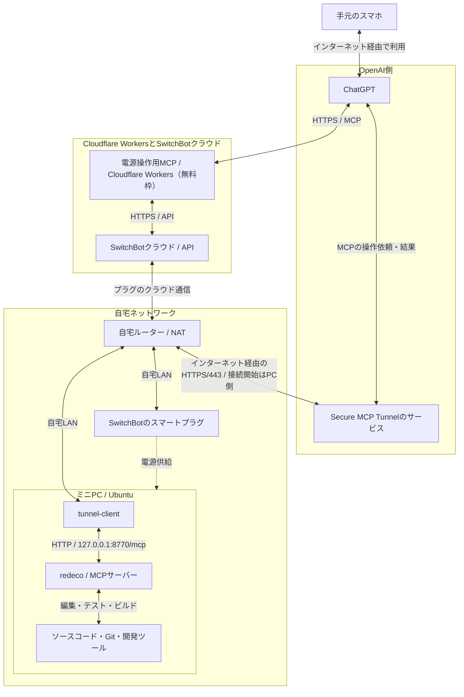

## 最近のエージェント駆動開発

最近の個人開発は、ほとんどスマホのChatGPTに指示して進めています。

作りたい機能や直したいところを伝えると、ChatGPTが自宅のミニPCを操作して、コードの修正やテスト、ビルドを行います。自分はできあがった画面を触り、「ここが使いづらい」「こういう動きにしてほしい」と追加で伝えています。

AIエージェントに実装や検証を任せる、エージェント駆動開発という進め方です。最近は、自分でコードを書く機会だけでなく、コードそのものを見る機会もかなり減りました。

今回は、今使っている開発環境と運用コスト、それから、このやり方で開発していて思うことを書いてみます。

## やっていること

手元にあるのはスマホで、実際にコードを編集したり、ビルドしたりするのは、自宅に置いたUbuntuのミニPCです。

作業全体の流れは、こんな感じです。

**redecoは、ChatGPTから自宅PCを操作するために自作した接続ツールです。**

ファイルの読み書きやコマンドの実行ができ、コードの修正・テスト・ビルドなどを進められます。

https://github.com/kkoch5t2/redeco

### ネットワークを含めた構成

ChatGPTからは、電源操作用のMCPと、PC操作用のMCPを使っています。MCPは、ChatGPTなどのAIから外部のツールを利用するための仕組みです。

電源操作にはSwitchBotのスマートプラグ、PC操作にはこの「redeco」（自作のMCPサーバー）を使っています。自宅のミニPCとChatGPTの間は、OpenAI公式のSecure MCP Tunnelでつないでいます。

電源操作用MCPは、Cloudflareのサーバーレス実行環境である**Cloudflare Workers**に配置しています。ChatGPTからの依頼を受け、SwitchBotのAPIへ電源のON／OFFや状態確認のリクエストを送るプログラムです。

電源操作用MCPのコードもGitHubで公開しています。

https://github.com/kkoch5t2/switchbot-control

実線は通信の経路、点線は電源供給を示しています。スマートプラグのクラウド通信は、サービス間の関係が分かるように簡略化しています。

PC操作の経路では、**ミニPC上の`tunnel-client`が、自宅ルーターを通ってOpenAI側へHTTPS接続します。** 双方向の矢印は、依頼と結果が行き来するという意味です。接続を開始するのはPC側です。

ChatGPTが出した操作依頼は、PC側からの問い合わせへの応答として届きます。それを`tunnel-client`が同じPC内のredecoへ渡し、実行結果をOpenAI側へ返します。redecoの待ち受け先はループバックアドレスなので、このMCPサーバーのポートを自宅の外へ公開する必要はありません。[^tunnel]

スマホは外出先の回線からChatGPTを使えればよく、自宅のミニPCと同じLANに接続している必要もありません。

トンネルの通信やロングポーリングについては、以下の記事でまとめています。

https://zenn.dev/kkoch5t2/articles/openai-secure-mcp-tunnel

### 起動から終了までChatGPTに頼む

スマートプラグをONにすると、ミニPCに電源が供給されます。PC側では通電時に自動起動するようBIOS／UEFIを設定し、Ubuntuの起動に合わせてredecoと`tunnel-client`もsystemdで立ち上がるようにしています。

電源操作用のMCPはCloudflare Workers上で動いているため、自宅のミニPCが停止していても起動を依頼できます。起動するための処理を、自宅PCとは別の実行環境に置いているのがポイントです。

起動後は、例えば「このアプリの不具合を直して」と伝えると、ChatGPTがredeco経由でファイルを調べ、修正し、テストやビルドまで進めます。コードの生成だけでなく、手元のプロジェクトへ変更を適用して動かすところまで任せています。

実際にRoutiaの修正を依頼したときのチャット画面です。赤枠は、redecoを使ってPC上のコードを調査し、計算や検証を実行した操作履歴です。

終わったら、スマホから「実行中の処理を確認して、問題なければシャットダウンして」と依頼します。OSの正常終了を確認してから、スマートプラグもOFFにする運用です。接続が切れただけで正常終了とは判断せず、確認できなければプラグのOFFは保留します。

起動、開発、終了まで、スマホのChatGPTから進められる構成になっています。

## 運用コスト

**Cloudflare Workersの無料枠も活用しているため、今の使い方で主にかかっているのは、ChatGPT Plusの月額料金と電気代くらいです。**

| 項目 | 費用の考え方 |
| --- | --- |
| ChatGPT Plus | 毎月のサブスクリプション料金 |
| Cloudflare Workers | 電源操作用MCPを無料枠内で利用 |
| 電気代 | ミニPCやスマートプラグを動かす分 |

ミニPCとスマートプラグには購入費用がかかっていますが、それらは初期費用です。ネット回線は、もともと契約している自宅のものを使っています。

開発に使う計算資源を自宅のミニPCでまかない、AIの利用はPlusの範囲を中心にしているので、個人開発として続けやすいと感じています。

これは今の自分の構成と利用量での話で、外部サービスの有料枠や追加クレジットを使えば、その分の費用は増えます。

### 電源操作用MCPはCloudflare Workersの無料枠で動かす

Cloudflare Workersには無料プランがあり、2026年10月28日時点の主な上限は次のとおりです。[^workers-pricing]

| 項目 | Workers Freeの上限 |
| --- | --- |
| リクエスト数 | アカウント全体で1日10万回 |
| CPU時間 | 1回の実行につき10ms |

CPU時間は、プログラムの計算処理に使った時間です。SwitchBotのAPIなど、外部への通信の応答を待っている時間は含まれません。[^workers-limits]

この構成でWorkersが担当するのは、電源操作や状態確認のためのAPI連携です。アプリのビルドやテストは自宅のミニPCで行います。電源操作の連携を無料枠内でまかなうことで、継続して使う費用を抑えています。

なお、1日10万回という数字は、電源をON／OFFできる回数ではなく、Workersが受けるリクエスト数です。同じアカウントのほかのWorkersと枠を共有し、日次上限を超えるとリクエストがエラーになります。[^workers-limits]

## 使っていて思うこと

### コードを書かなくなったし、見ることも少なくなった

一番気になっているのは、コードを書く機会も、読む機会も減ったことです。

画面を触って気になったところを伝えると、AIが直してくれます。そのやり取りだけでも開発が進むので、修正されたコードを細かく見ずに、次の要望を出してしまうことが増えました。

正直、エンジニアとしては良くないなと思っています。自分が作っているものなのに、その中身を十分に把握できていない状態はどうにかしたいです。変更の理由や仕組みを確認する時間を、もう少し意識して取る必要があると感じています。

ただ、同時に、**今後は「自分でコードを書く」という行為の価値が、どんどん下がっていくのだろうな**とも思います。

作りたいものを伝えると、実際に動くところまでAIが進めてくれる。その様子を見ていると、何を作るか、どういう動きならよいのか、できあがったものをどう判断するかに、自分が使う時間は移っていきそうです。

コードを理解する機会が減ることへの不安はあるし、この便利さも使っていきたい。今は、その両方の気持ちがあります。

### ChatGPT Plusが、思っていた以上に使える

使い始める前は、Plusだと制限がきつくて、本格的に開発を任せるには使い物にならないのでは、と思っていました。

実際に使ってみると、思っていた以上に使えます。

Chatで使っているGPT-6 Sol（6sol）は、自分の使い方では、ほぼ無制限という感覚です。制限を気にせずやり取りできている場面が多くあります。

GPT-6 Astra（Astra）などの上位モデルには5時間単位の利用枠による制限があるものの、自分の利用量では、基本的に余裕を持って使えています。

もちろん、これは自分の利用時の体感です。利用枠の消費はモデルや作業内容などによって変わるので、誰でも無制限に使えるという意味ではありません。[^usage]

少なくとも、個人でアプリを作ったり、不具合を直したりする今の用途では、Plusでここまで進められるのは予想以上でした。

この環境は、感覚的には**スマホからほぼ無制限に使えるCodexのようなもの**です。ChatGPTに指示するだけで、自宅のミニPC上でコードの修正からテスト、ビルドまで進められるので、今の自分の個人開発ではCodexなどの専用コーディングツールを別途使わずに済んでいます。もちろん、Codexと機能が同じという意味ではなく、ChatGPT Plusも厳密には無制限ではありません。あくまで自分の使い方での感覚ですが、スマホひとつでここまで開発できるのは便利です。

ただ、チャットの管理は意外と難しいです。ひとつの会話で開発を続けていると、やり取りが長くなるにつれて動作が重くなり、作業を進めづらくなることがあります。

そのため、今は「**1チャット1タスク**」を意識しています。タスクごとにチャットを分け、会話が長くなった場合は、必要な背景や進捗を引き継いで新しいチャットに切り替える。ChatGPT Plusを快適に使い続けるには、こうしたチャットの管理も大切だと感じています。

### AIが使える計算資源があれば、どこからでも開発を進められる

今回の環境を使っていて感じるのは、**AIが使える計算資源と、そこを操作するための接続があれば、自分がどこにいても開発を進めてもらえる**ということです。

自分の環境では、その計算資源が自宅のミニPCです。必要なファイルや開発ツールを置き、ChatGPTがredecoを通して操作できるようにしています。

ただし、自宅にPCを置くことが必須というわけではありません。VPSやクラウド上の仮想マシンでも、開発ツールとredeco、接続用のクライアントを動かせる環境なら、同じようにChatGPTから操作できます。今回は、計算資源として自宅のミニPCを使っている一例です。

スマホと自宅のミニPCが、同じWi-FiやLANにつながっている必要はありません。ミニPCが起動してインターネットに接続され、Secure MCP Tunnelが利用できる状態なら、外出先のモバイル回線などからChatGPTを通じて操作できます。

外出中で手元に開発用PCがなくても、スマホで「こういう機能を作りたい」と伝えれば、AIが自宅のPCを使って作業してくれます。思いついたことを実際の開発につなげるまでのハードルは、かなり下がったと感じます。

OpenAI公式のSecure MCP Tunnelのように、非公開の環境へ接続するための技術が用意されていて、redecoのようなソフトも使えます。こうした仕組みを組み合わせられるのは便利です。

開発環境を用意する手間はありますが、一度つながると、スマホからでも普段のプロジェクトで作業を進められます。「PCの前に座ってから始める」という場面が減ったのは、自分にとって大きな変化でした。

## おまけ：最近開発したもの

この環境で、最近は次のようなアプリを開発しています。

### 誘惑ブロック

アプリやWebサイトの利用を制限するためのアプリです。自分の欲しい制限に合わせて、ブロック時の待ち時間や厳格モードなどを調整しています。

実際にスマホで使いながら、「この操作で制限がかかるのはおかしい」「この設定を変えたい」とChatGPTに伝えて、修正を重ねています。

https://github.com/kkoch5t2/temptation-block-android

### Routia

習慣を記録し、継続状況を確認したり、振り返ったりするためのアプリです。

継続日数やグラフの見せ方、リマインダー、振り返りの画面などを、自分で使いながら調整しています。こちらも、画面を見て気になった点をスマホから伝え、修正されたものをまた触る、というやり取りで開発しています。

https://github.com/kkoch5t2/routia

## 補足：AI駆動開発・エージェント駆動開発・バイブコーディングの違い

似た言葉ですが、注目している点が少し違います。厳密に分かれた分類というより、重なり合う開発スタイルとして考えると分かりやすいです。

| 呼び方 | 特徴 | 具体例 |
| --- | --- | --- |
| AI駆動開発 | AIを活用して開発を進める広い考え方。設計の相談やコード生成、レビューなども含む | AIにコードの修正案を出してもらい、人が確認して反映する |
| エージェント駆動開発 | AIがツールを使い、調査・編集・テストなどの作業を実際に進める | 「不具合を直して」と頼むと、AIがファイルを調べて修正し、テストを実行する |
| バイブコーディング | 細かなコードの中身を追わず、自然言語で指示し、動いた結果を見ながら作る | 「画面をもっと見やすくして」と頼み、生成された画面を触って追加の修正を依頼する |

今回の環境は、ChatGPTがredecoを通じてPCを操作し、コードの修正やテストまで行うので、**エージェント駆動開発**と呼んでいます。ただし、自分でコードを見る機会が減り、できあがった画面を見て修正を頼む部分は、**バイブコーディング**に近い面もあります。

エージェント駆動開発はAIに作業を実行させる仕組み、バイブコーディングはコードとの向き合い方の違い、と考えると整理しやすいと思います。[^agentic-coding][^vibe-coding]

[^tunnel]: [OpenAI公式：Secure MCP Tunnel](https://developers.openai.com/api/docs/guides/secure-mcp-tunnels)。自宅のMCPサーバーに外部から直接接続する入口を設けず、PC側のクライアントからOpenAIへ接続する仕組みです。
[^usage]: [OpenAI公式：利用料金と利用上限](https://learn.chatgpt.com/docs/pricing)。Work／Codexの利用枠は、モデルや作業の複雑さなどによって消費量が変わります。本文の使用感は2026年10月時点の個人の体感です。
[^workers-pricing]: [Cloudflare公式：Workersの料金](https://developers.cloudflare.com/workers/platform/pricing/)。無料プランのリクエスト数とCPU時間の上限を参照。
[^workers-limits]: [Cloudflare公式：Workersの制限](https://developers.cloudflare.com/workers/platform/limits/)。CPU時間の定義と、アカウント全体の日次リクエスト上限を参照。
[^agentic-coding]: [GitHub Docs：About GitHub Copilot agents](https://docs.github.com/en/copilot/concepts/agents/about-copilot-coding-agent)。AIエージェントによる調査、修正、テストなどの説明を参考にしています。
[^vibe-coding]: [Martin Fowler：Vibe Coding](https://martinfowler.com/bliki/VibeCoding.html)。生成されたコードを細かく確認せず進めるという区別を参考にしています。
